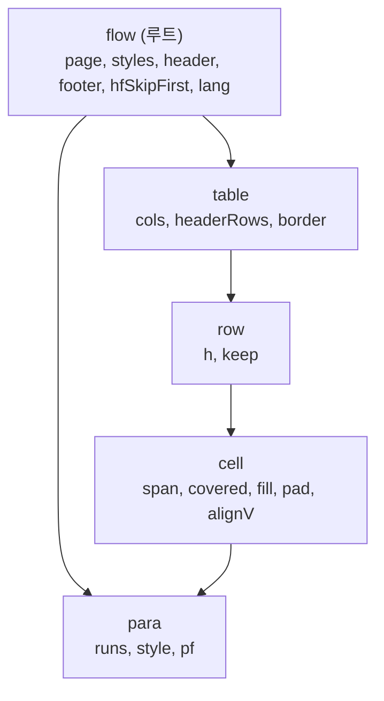
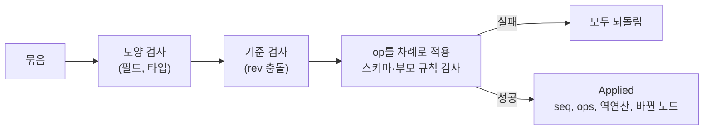
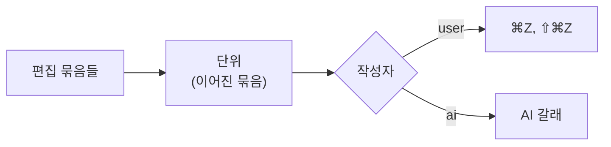

# 문서 모델과 저장

문서는 노드의 집합이고, 바꾸는 길은 op 묶음 하나뿐이다. 규칙은 `kari-doc`(`app/engine/doc`)에, 디스크로 옮기는 일은 `kari-store`(`app/engine/store`)에 있다.

## 노드

| 필드 | 뜻 |
|---|---|
| `id` | `[A-Za-z0-9_-]{1,32}`. 엔진이 만드는 id는 `n` + 36진수 |
| `type` | 스키마의 노드 종류 |
| `parent` | 부모 노드 id. 루트는 없음 |
| `z` | 형제 사이의 순서 키. 문자열 비교로 순서가 정해지고, 두 키 사이에 늘 새 키를 만들 수 있다 |
| `props` | 속성. 기본값과 다른 값만 저장한다 |
| `born`, `rev`, `revs` | 이 노드를 만든 묶음, 마지막으로 바꾼 묶음, 속성별 마지막 변경 묶음의 번호(seq) |

스키마는 문서 종류마다 파일 하나다: `app/engine/doc/schema/flow.json`(흐름 문서), `app/engine/doc/schema/canvas.json`.

### 흐름 문서의 노드

| 노드 | 부모 | 주요 속성 |
|---|---|---|
| `flow` | 없음(하나뿐) | `page`(용지, 방향, 여백), `styles`(이름 붙은 스타일), `header`·`footer`(왼쪽·가운데·오른쪽 칸의 글), `hfSkipFirst`(첫 쪽에 머리글·바닥글을 넣지 않음) |
| `para` | `flow`, `cell` | `runs`(글), `style`(스타일 이름), `pf`(문단 모양 덮어쓰기) |
| `table` | `flow`, `cell` | `cols`(열 폭, pt), `headerRows`(쪽마다 다시 그릴 머리 행 수), `border` |
| `row` | `table` | `h`(최소 높이), `keep` |
| `cell` | `row` | `span`(합친 행·열 수), `covered`(합쳐져 가려진 셀), `fill`, `pad`, `alignV` |

- 표 안에 표를 넣는 명령은 거절된다.
- 모든 행은 `cols` 길이만큼 셀을 가진다. 합쳐져 가려진 셀도 노드로 있다.

### runs

문단의 글은 run의 배열이다. run 하나는 같은 모양의 글 조각이다.

| 필드 | 뜻 |
|---|---|
| `t` | 글. 탭(`\t`)과 줄바꿈(`\n`) 밖의 제어 문자는 쓸 수 없다 |
| `s` | 글자 모양: `font`, `size`, `weight`, `italic`, `underline`, `strike`, `color`, `bg` 등. 문단 스타일 위에 덮어쓴다 |
| `link` | 링크 주소 |
| `o` | 개체(그림). `t`는 U+FFFC 한 글자이고 `o`에 `{"type": "image", "asset", "w", "h", "alt"}`를 둔다 |

이웃한 run의 속성이 같으면 하나로 합친다(정규 형태). 같은 글이면 늘 같은 run 배열이 된다.

### 스타일

`flow.styles`에 이름 붙은 스타일이 있다: `body`(본문), `title`(제목), `h1`(제목 1), `h2`(제목 2). 스타일은 글자 모양(`cs`)과 문단 모양(`pf`)을 갖고 `based`로 다른 스타일을 이어받는다. 문단과 run은 다른 부분만 덮어쓴다.

## op와 묶음

| op | 필드 | 하는 일 |
|---|---|---|
| `add` | `node` | 노드를 만든다 |
| `set` | `id`, `props`, `rev` | 속성을 바꾼다(`null`은 기본값으로) |
| `del` | `id`, `rev` | 노드와 자손을 지운다 |
| `move` | `id`, `parent`, `z`, `rev` | 부모나 순서를 바꾼다 |
| `text` | `id`, `at`, `del`, `ins`, `expect`, `rev` | 문단 글의 바이트 위치 `at`에서 `del`바이트를 지우고 `ins`를 넣는다. `expect`가 있으면 지울 글이 그것과 같아야 한다 |
| `doc` | `props.name` | 문서 이름을 바꾼다 |

**묶음**은 op 배열 하나다. 묶음은 전부 적용되거나 전혀 적용되지 않는다.

- **역연산**: 적용하면서 각 op의 반대 op를 만든다. 역연산을 뒤에서부터 적용하면 묶음 전 상태가 된다.
- **기준 rev**: op의 `rev`(없으면 묶음의 기준)보다 그 노드의 해당 속성이 나중에 바뀌었으면 충돌이다. 충돌은 (노드, 속성) 단위로 본다. 다른 속성을 바꾼 것은 충돌이 아니다.
- 밖에서 들어온 묶음은 op 5,000개까지 받는다. 사용자 편집에는 이 제한을 두지 않는다.

## 상태 해시

노드마다 SHA-256(정규 직렬화한 `{id, parent, props, type, z}`)을 구하고 모두 XOR한 값이 문서의 상태 해시다. `rev`, `born`, `revs`는 넣지 않는다. 노드가 바뀔 때 그 노드의 값만 빼고 더하므로 바로 답한다.

같은 내용이면 어떤 길로 만들었든 해시가 같다. 저장, 재생, 되돌리기, 편집 세션의 두 사본이 이 해시로 서로를 확인한다.

## 저장

### 표

| 표 | 내용 |
|---|---|
| `docs` | 문서: 종류, 이름, 지금 seq와 해시, 복제한 원본, 휴지통 시각 |
| `nodes` | 지금 상태의 노드 행 |
| `batches` | 묶음 기록: seq, 작성자(`user`, `ai`), 종류(`edit`, `undo`, `redo`, `restore`), 이름, 되돌리기 단위, op, 역연산, 해시 |
| `snapshots` | 정규 직렬화한 문서 상태 |
| `versions` | 버전: seq, 자동(`auto`)·이름 붙음(`named`), 이유 |
| `assets` | 에셋 정보: 해시, 형식, 크기 |
| `settings` | 설정 |
| `records` | 범용 기록(종류, id, 본문). 채용공고와 면접 세션이 여기 있다 |

### 커밋

편집 한 묶음은 SQLite 트랜잭션(`BEGIN IMMEDIATE`) 하나다. 묶음 행, 바뀐 노드 행, 문서 행을 함께 쓴다. 트랜잭션이 실패하면 메모리의 문서를 DB에서 다시 읽는다. DB는 `synchronous=FULL`, `fullfsync=ON`으로 연다.

저장 단추는 없다. 편집이 곧 커밋이다.

### 과거 상태: 스냅샷 + 재생

- 문서를 만들 때와 seq가 200의 배수가 될 때 스냅샷을 쓴다.
- seq N의 상태 = N 이하에서 가장 가까운 스냅샷 + 그 뒤 묶음의 `ops`를 차례로 적용. 묶음마다 기록된 해시와 맞는지 본다.
- 역연산은 과거 상태를 만드는 데 쓰지 않는다. 되돌리기에만 쓴다.
- `doc.verify`는 세 표현(노드 행, 기록 재생, 스냅샷)이 같은 해시를 가리키는지 확인한다.

## 되돌리기

- **단위**: 되돌리기 한 번에 함께 되돌아가는 이어진 묶음들. 1.5초 안에 이어 친 글은 한 단위가 된다.
- 되돌리기와 다시 하기는 작성자(`user`, `ai`)마다 따로다. 앱의 편집 명령과 ⌘Z는 `user` 갈래만 쓴다.
- 되돌리기는 기록을 지우지 않는다. 그 단위를 끄는 묶음을 새로 붙인다(`kind = undo`). 다시 하기도 같다.
- 판정: 사본에서 그 뒤의 단위들을 걷어 내고, 대상 단위를 끄고(켜고), 걷어 낸 단위들을 다시 얹는다. 모두 그대로 얹히면 실제 문서에 반영한다. 얹히지 않으면 "지금 상태에는 적용할 수 없습니다"로 거절하고 문서는 그대로다.
- `kari-store`의 `stage`와 `commit_staged`는 AI 작성자의 편집을 임시 사본(`Staging`)에 적용한 뒤, 그 묶음들을 기준 seq와 함께 묶음 하나, 단위 하나로 커밋하는 저장 API다. 임시 사본에서는 op 5,000개 제한을 지킨다.

## 버전

버전은 seq 하나에 붙인 이름표다. 버전으로 돌아가기는 그 seq의 상태와 지금 상태의 차이를 새 묶음(`kind = restore`)으로 붙인다. 이 묶음도 ⌘Z로 되돌릴 수 있다.

| 이유 | 언제 |
|---|---|
| `manual` | 사용자가 이름을 붙일 때 |
| `idle` | 편집이 5분 멈췄을 때 |
| `close` | 문서나 라이브러리를 닫을 때 |
| `before_restore` | 버전으로 돌아가기 직전 |

자동 버전은 가장 최근 버전이 같은 seq를 가리키면 만들지 않는다.

## 문서 목록

| 동작 | 이름 | 규칙 |
|---|---|---|
| 만들기 | `docs.create` | 빈 문서와 첫 스냅샷 |
| 이름 바꾸기 | `docs.rename` | `doc` op 묶음 |
| 복제 | `docs.duplicate` | 지금 상태로 새 문서. 원본 문서와 seq를 기록 |
| 휴지통, 되살리기 | `docs.trash`, `docs.untrash` | 휴지통 시각을 쓰고 지운다 |
| 완전 삭제 | `docs.purge` | 문서의 모든 행을 지우고, 남은 문서가 쓰지 않는 에셋을 지운다 |

## 에셋

- 그림 파일은 내용의 SHA-256(소문자 16진수 64자)으로 이름 붙여 `assets/<앞 2자>/<해시>`에 둔다. 같은 그림은 한 번만 저장된다.
- 임시 이름으로 쓰고 동기화한 뒤 제자리로 옮기고, 그다음 행을 넣는다.
- 문서를 완전히 지울 때, 남은 문서(휴지통 포함)의 노드·기록·스냅샷 어디에도 없는 에셋만 지운다. 되돌리기와 버전이 가리키는 그림은 남는다.

## 백업

라이브러리를 열 때 마지막 백업에서 하루가 지났으면 SQLite 온라인 백업으로 `backups/library-<ms>.db`를 만든다. 최근 10개를 남긴다. API 키는 DB와 백업에 들어가지 않는다 → [ai-connection.md](ai-connection.md).

## 더 읽을 것

- [overview.md](overview.md): 크레이트와 경계
- [layout-and-editing.md](layout-and-editing.md): 편집 명령이 묶음을 만드는 길
