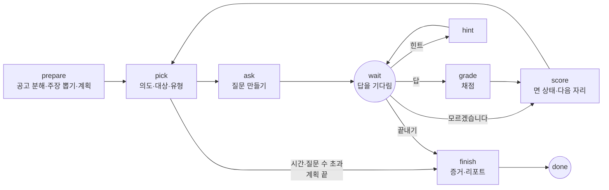
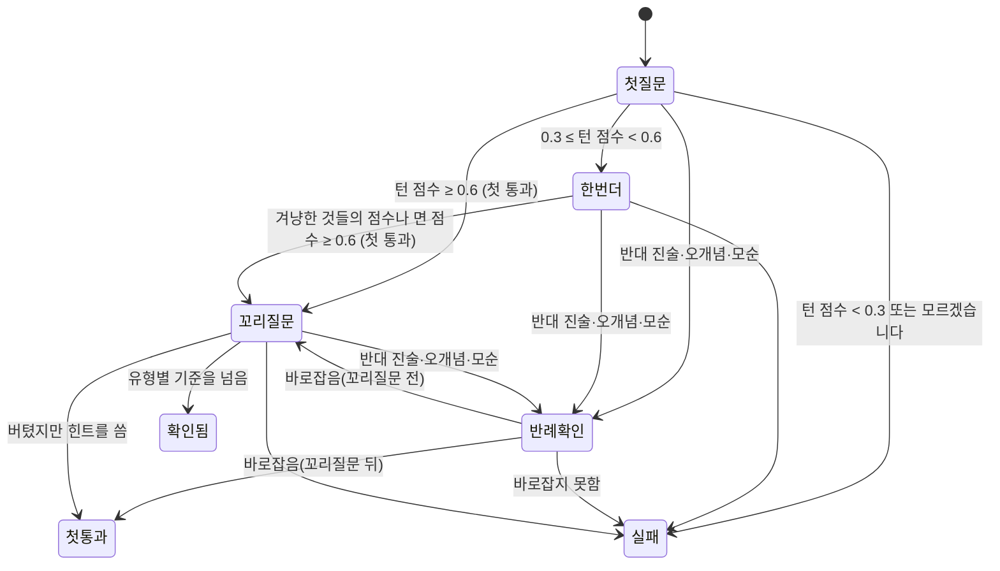

# 면접 엔진

글로 하는 면접 연습의 진행, 채점, 리포트를 맡는 크레이트 `kari-interview`(`app/engine/interview`)와, 그것을 앱에 잇는 `app/engine/ffi/src/iv.rs`를 설명한다. 묻는 내용의 틀(개념, 면, 체크포인트)은 [knowledge-pack.md](knowledge-pack.md)에 있다.

## 원칙

| 무엇을 | 누가 정하나 |
|---|---|
| 물을 개념, 목표 깊이, 물을 면, 질문의 의도와 유형 | 코드 |
| 질문 문장, 체크포인트별 판정과 근거 인용, 주장·공고 분해 | 모델 |
| 모델이 준 값을 받아들일지 | 코드(인용은 원문에 그대로 있어야 하고, id는 준 목록에 있어야 한다) |
| 점수, 깊이, 숙련도, 리포트 | 코드 |

- 크레이트는 화면, 파일, 스레드, 저장소를 모른다. 모델은 부르는 쪽이 준 함수(`Model`)로 부르고, 상태는 직렬화되는 값 하나(`Session`)다.
- 모델에게 도구(tool)를 주지 않는다. 모든 호출은 받을 JSON의 모양(스키마)을 정해 둔다.
- 호출은 네 가지 일(주장 뽑기 `claims`, 공고 분해 `posting`, 질문과 힌트 `ask`, 채점 `grade`)로 나뉘고, 일마다 세션을 시작할 때 정한 판과 추론 강도로 부른다([ai-connection.md](ai-connection.md#일마다의-모델)).

## 용어

| 용어 | 뜻 |
|---|---|
| 면 | 개념을 보는 관점 하나(원리, 한계, 선택 근거 등). 체크포인트가 면마다 묶여 있다 |
| 단 | 면의 깊이 눈금(1~5) |
| 목표 단 | 이 세션에서 그 개념을 어디까지 물을지 |
| 도달 단 | 낮은 면부터 이어서 확인된 가장 높은 단 |
| 체크포인트 | 그 면에 대한 좋은 답에 들어 있어야 할 내용 하나. `must`(필수)인 것만 점수에 든다 |
| 턴 | 질문 하나와 그 답 |

## 진행 그래프

세션은 노드를 따라 도는 상태 기계다(`app/engine/interview/src/graph.rs`). 노드 하나를 돌 때마다 상태 전체를 저장한다. 상태에는 다음에 돌 노드가 들어 있어, 앱이 닫혔다가 다시 열려도 그 노드부터 이어 간다. 노드가 실패하면 상태를 그 노드 앞으로 되돌리고 오류를 적어 둔다.

| 노드 | 모델 호출 | 하는 일 |
|---|---|---|
| `prepare` | 공고 분해, 주장 뽑기(각각 필요할 때 한 번) | 결과를 확인한 뒤 계획을 세운다 |
| `pick` | 없음 | 다음 질문의 개념, 면, 단계, 의도, 유형을 고른다 |
| `ask` | 질문 | 질문 문장을 받아 규칙을 확인한다 |
| `wait` | 없음 | 실행을 멈추고 사람의 동작(답, 모르겠습니다, 힌트, 끝내기)을 기다린다 |
| `grade` | 채점 | 판정을 받아 인용을 확인한다 |
| `score` | 없음 | 면의 상태와 다음 자리를 정한다 |
| `hint` | 질문(힌트) | 같은 질문에 붙일 실마리를 만든다 |
| `finish` | 없음 | 숙련도 증거와 리포트를 만든다 |

사람의 동작은 모델을 부르기 전에 먼저 저장한다. 답은 모델 호출이 실패해도 남는다.

## 준비: 공고 분해와 주장 뽑기

`app/engine/interview/src/extract.rs`.

| 호출 | 보내는 것 | 받는 것 | 코드의 확인 |
|---|---|---|---|
| 공고 분해 | 공고 글, 개념 색인(id, 이름, 별칭) | 직무 이름, 백엔드 여부, 요구 연차, 요구 사항(인용, 개념 id, 필수·우대) | 인용이 공고에 그대로 있고 팩에 있는 개념이 하나 이상인 항목만 남긴다 |
| 주장 뽑기 | 이력서 문단(id, 글), 개념 색인 | 주장(문단 id, 인용, 개념 id, 쓴 기술·겪은 문제·낸 결과) | 그 문단에 인용이 그대로 있고 팩에 있는 개념이 하나 이상인 주장만, 최대 30개 |

- 이력서는 흐름 문서의 문단을 문서 순서대로 읽는다. 표 안의 문단도 들고, 합친 셀에 가려진 셀의 문단은 뺀다.
- 결과는 캐시에 둔다. 공고는 분해 결과를 공고 기록에, 주장은 문서별로 "본 문단(id, rev)"과 함께 둔다. 다음 세션에서는 rev가 바뀐 문단만 다시 보낸다. rev는 노드가 바뀔 때마다 오르는 번호다([document-model.md](document-model.md)).
- 글 길이의 상한: 이력서 30,000자, 공고 20,000자, 답 4,000자.

## 계획

`app/engine/interview/src/plan.rs`. 같은 입력이면 같은 계획이 나온다.

**물을 개념의 순서**(앞에서부터 채운다):

1. 지난 세션에서 숙련도 추정이 0.5 미만인 개념 1개
2. 이력서 주장에 걸린 개념: 공고의 필수 → 우대 → 핵심 개념 → 그 밖. 겪은 문제(`problem`) 주장에 걸린 개념도 여기에 든다(따로 앞에 두지 않는다). 계획에 든 겪은 문제 개념에서는 아래의 깊이 파기 사다리가 나온다
3. 공고에만 걸린 필수 개념
4. 팩의 핵심 개념

같은 순위 안에서는 최근 두 세션에 물은 개념을 뒤로 보내고, 그다음은 팩의 순서다. 개념 수는 10분과 12분이 3개, 15분이 4개다. 계획한 개념을 다 물었는데 시간이 남으면 같은 순서의 다음 개념을 이어서 묻는다.

**목표 단**: 지원 연차(공고에 요구 연차가 있으면 그것)로 정하고, 여러 갈래에 들면 가장 높은 값을 쓴다.

| 갈래 | 신입 | 1~3년, 4년 이상 |
|---|---|---|
| 핵심 개념 | 2(계획 앞쪽의 핵심 개념 둘은 3) | 4 |
| 핵심이 아닌 개념 | 1 | 2 |
| 이력서 주장에 걸림(겪은 문제) | 3 | 5 |
| 이력서 주장에 걸림(그 밖) | 2 | 5 |
| 공고의 필수 | 위 값 + 1(최대 5) | 위 값 + 1(최대 5) |

**물을 면**: 그 개념이 가진 면 가운데 단이 목표 이하인 것(낮은 단부터). 신입은 가장 낮은 면부터, 그 밖은 둘째 면부터 묻는다.

## 질문 고르기

`app/engine/interview/src/pick.rs`. 면 하나는 단계를 따라 간다.

- 면의 상태: 안 물음, 정해지지 않음, 첫 통과, 확인됨, 실패. **깊이는 꼬리질문을 버틴 "확인됨"만 인정한다.**
- 반례 확인은 면마다 한 번이다. 이미 반례 확인을 한 면에서 반대 진술이나 오개념이 다시 나오면 실패다.
- **겨냥**: 주제 전환, 심화, 힌트, 꼬리질문의 시나리오와 트레이드오프 선택은 그 면의 필수 체크포인트 하나를 겨냥한다. 팩의 순서로 보아 아직 `met`이 아니고 이 면에서 아직 겨냥하지 않은 첫 번째, 없으면 아직 `met`이 아닌 첫 번째다. 한 번 더는 앞 턴의 겨냥을 그대로 쓴다.
- **턴 점수**는 이 턴의 판정으로 낸 면 점수와 겨냥한 체크포인트의 점수 가운데 큰 값이다. 물은 것에 옳게 답했으면 통과하고, 겨냥은 놓쳤어도 다른 필수를 넓게 말한 답이 떨어지지 않는다.
- 면이 끝나면 다음 자리를 정한다: 확인됨이면 더 높은 안 물은 면(올림), 첫 질문을 통과하지 못한 면이면 더 낮은 안 물은 면(내림), 첫 통과에 닿았던 면이거나 갈 면이 없으면 다음 개념(전환). 같은 면을 이어서 묻는 것이 유지다.
- 새 질문을 내기 전에 시간 예산과 질문 수 상한(분 × 2)을 본다. 넘으면 끝낸다. 흐른 시간은 답을 기다린 시간과 면접 중 모델을 기다린 시간의 합이다(준비 단계의 호출은 넣지 않는다).

**질문 유형**

| 단계 | 유형 |
|---|---|
| 첫 질문 | 주제 전환(새 개념), 심화(같은 개념의 다른 면) |
| 한 번 더 | 심화. 코칭이면 힌트를 먼저 |
| 반례 확인 | 모순 추궁(확인된 모순이 있고 세션에서 처음일 때), 시나리오(잡힌 오개념에 반례 질문이 있을 때), 근거 요구, 심화 |
| 꼬리질문 | 심화, 시나리오, 트레이드오프 선택, 근거 요구, 본인 기여 확인, 반박, 30초 요약 가운데 이 세션에서 덜 쓴 것. 실전이면 반박을 먼저. 이력서의 겪은 문제가 걸린 개념은 아래 사다리가 먼저다 |

- 시나리오는 그 면을 건드리는 시나리오가 팩에 있을 때, 트레이드오프는 개념에 트레이드오프가 있을 때, 본인 기여 확인은 개념이 이력서 주장에 걸렸을 때, 반박은 코칭이 아닐 때만 고른다. 꼬리질문의 심화, 시나리오, 트레이드오프 선택은 그 면에 아직 `met`이 아닌 필수 체크포인트가 남았을 때만 고른다(남지 않았으면 근거나 입장을 묻는 유형과 요약에서 고른다). 반례 확인과 꼬리질문에서는 같은 (개념, 면, 유형)을 다시 쓰지 않는다. 한 번 더의 심화는 첫 질문이 심화였어도 낸다. 낼 유형이 없으면 그 면은 그 상태로 끝난다(정해지지 않았으면 실패).
- **겪은 문제 깊이 파기**: 이력서에서 겪은 문제(`problem`) 주장이 걸린 개념이 계획에 들면, 그 개념의 첫 통과 뒤 꼬리질문이 사다리다. 왜 그렇게 했나(`why`) → 무엇을 보고 알았나(`evidence`) → 다른 선택지는(`alt`) → 다시 한다면(`redo`). 단계마다 그 이력서 주장의 인용을 짚어 묻고, 아래 방어 축으로 채점한다. 첫 단계가 그 면의 꼬리질문이다: 버티면 확인됨, 못 버티면 실패다. 이어지는 단계는 면의 상태를 바꾸지 않고 "주장 방어"로만 기록한다(버티면 다음 단계, 못 버티면 거기서 사다리가 끝나고 면은 다음 면으로 올라간다). 힌트를 쓰면 첫 단계에서 첫 통과로 끝난다. 사다리는 개념마다 한 번이고(다음 면에서 다시 하지 않는다), 시간 예산과 질문 수 상한은 그대로다.
- "모르겠습니다" 뒤에는 세션에 한 번 "모를 때 대처" 질문을 낸다. 이 질문은 채점하지 않는다.

**꼬리질문을 버텼는지**는 유형마다 기준 하나로 본다. 앞 턴까지 쌓인 점수로는 버티지 않는다.

| 유형 | 버틴 것으로 보는 기준 |
|---|---|
| 심화, 시나리오, 트레이드오프 선택 | 필수 체크포인트가 새로 `met` |
| 근거 요구, 본인 기여 확인, 반박, 사다리의 단계 | 방어 점수 ≥ 0.6 |
| 30초 요약 | 이 턴의 판정으로 낸 면 점수 ≥ 0.6 |

**방어 축**: 근거나 입장을 묻는 질문의 답은 개념의 체크포인트가 아니라 아래 축으로 본다. 방어 점수 = (met 수 + 0.5 × partial 수) / 축 수. 축의 판정은 면 점수에 들지 않는다.

| 축 | 기준 | 보는 유형 |
|---|---|---|
| 수치나 사례 | 수치나 구체적인 사례를 댄다 | 근거 요구, 본인 기여 확인, 반박, 왜 그렇게 했나 |
| 확인한 방법 | 그 수치를 어떻게 쟀는지, 무엇을 보고 알았는지 말한다 | 근거 요구, 본인 기여 확인 |
| 한계 | 한계나 조건, 다시 한다면 바꿀 점을 말한다 | 근거 요구, 본인 기여 확인, 반박, 다시 한다면 |
| 본인 몫 | 본인이 한 일과 팀이 한 일을 구분해 말한다 | 본인 기여 확인 |
| 입장 | 입장을 분명히 하고 그 근거를 댄다(근거 없이 물러서거나 같은 말을 되풀이하면 충족이 아니다) | 반박, 왜 그렇게 했나, 다른 선택지는, 다시 한다면 |
| 대안 비교 | 다른 선택지를 들고 견주어, 이것을 고른 까닭을 말한다 | 다른 선택지는 |

**압박 단계**

| 단계 | 말투 | 힌트 | 그 밖 |
|---|---|---|---|
| 코칭 | 부드럽게 | 질문마다 한 번 | 답 뒤에 "핵심 n개 중 m개를 짚었습니다"를 보여 준다 |
| 표준 | 담백하게 | 개념마다 한 번 | |
| 실전 | 짧고 건조하게 | 없음 | 꼬리질문에서 반박을 먼저 |

## 질문 만들기

`app/engine/interview/src/ask.rs`. 모델에게는 의도, 개념의 이름과 요약, 면, 유형, 압박 단계, 그 개념에서 오간 문답, 걸린 이력서 주장의 인용, 유형의 재료(시나리오, 트레이드오프 축, 반례 질문, 모순된 두 진술), 겨냥한 체크포인트의 글(`aim`)을 준다. **체크포인트의 글은 겨냥한 것 하나만 준다.** 모델에게는 그 글이 지원자에게 보이지 않는 채점 기준이라고 알리고, 조건을 주고 결과를 묻거나 예/아니오로 답할 수 있게 묻지 않도록 하며, 같은 개념의 다른 내용이 아니라 그 글의 내용에 닿는 질문을 하도록 한다(힌트 유형만 그 글을 실마리로 쓴다). 사다리의 질문에는 겨냥 대신 그 이력서 주장의 인용을 재료로 준다.

코드가 강제하는 것:

| 규칙 | 어기면 |
|---|---|
| 질문은 하나(물음표 하나, 번호 목록 없음), 400자 이내 | 한 번 다시 묻고, 또 어기면 첫 물음까지만 쓴다 |
| 앞에 낸 질문과 같지 않다(공백만 정리해 견준다) | 한 번 다시 묻고, 또 같으면 다음 개념으로 간다 |
| 겨냥한 체크포인트의 글을 옮기지 않는다(그 글의 글자 3개 묶음 가운데 질문에 그대로 있는 비율이 0.25 이하) | 한 번 다시 묻고, 또 옮기면 겨냥 없이 다시 묻는다. 그 턴은 겨냥 없이 면 점수로 본다. 힌트 유형은 겨냥을 떼지 않는다(그 글이 실마리의 재료다) |
| 겨냥한 내용과 어긋나지 않는다(겨냥 글의 낱말이 질문에 하나도 없고 글자 3개 묶음 겹침도 0.05 미만이면 어긋난 것) | 한 번 다시 묻고, 두 번째 질문을 쓴다. 낱말을 바꿔 말하며 같은 것을 묻는 질문도 걸릴 수 있어서, 그때는 호출이 하나 더 든다 |
| 정해진 JSON 모양 | 한 번 다시 묻고, 또 틀리면 오류 |

## 채점

`app/engine/interview/src/grade.rs`. 모델은 그 면의 체크포인트마다 판정 하나와 근거 인용을 준다.

| 보내는 것 | 내용 |
|---|---|
| `question`, `answer` | 이번 질문과 이번 답(가린 글) |
| `checkpoints` | 물은 면의 체크포인트 전부(id, 글). 방어 축을 보는 턴에는 그 축을 뒤에 붙인다 |
| `misconceptions` | 그 개념의 오개념(id, 틀린 생각) |
| `previous` | 이 세션의 앞선 턴의 답 전부(턴 번호, 답). 다른 개념을 물은 턴의 답도 보낸다(답 사이의 모순을 찾는 데 쓴다) |

받는 것은 체크포인트별 판정(`checks`: id, 판정, 인용), 잡힌 오개념(`misconceptions`: id, 인용), 모순 하나(`conflict`: 이번 답의 구절, 앞선 턴 번호, 그 턴의 구절, 없으면 null)다.

| 판정 | 뜻 | 점수 |
|---|---|---|
| `met` | 핵심을 분명히 말했다 | 1 |
| `partial` | 일부만 말했다 | 0.5 |
| `unmet` | 말하지 않았다, 모른다고 했다 | 0 |
| `contra` | 체크포인트와 반대되는 내용을 주장했다 | 0 |

답이 스스로 더한 내용만 본다. 질문이 먼저 말한 내용을 되받거나 동의한 것은 `met`의 근거가 아니고, 답이 더한 것이 없으면 `partial`까지만 준다.

코드의 확인:

- 준 목록에 없는 체크포인트 id는 버린다. 판정이 없는 체크포인트는 `unmet`이다.
- `met`, `partial`, `contra`의 인용은 이번 답에 그대로 있어야 한다(공백만 정리해 견준다). 없으면 `unmet`으로 내리고 인용 확인 실패로 센다.
- 오개념은 그 개념의 오개념 목록에 있는 id이고 인용이 답에 있을 때만 받는다.
- 모순은 이번 답의 구절과 앞선 턴 답의 구절이 **둘 다** 각 답에 그대로 있을 때만 받는다. 확인되지 않은 모순으로는 모순 추궁 질문이 나오지 않는다.

## 점수와 깊이

`app/engine/interview/src/score.rs`.

- **면 점수** = (필수 체크포인트의 met 수 + 0.5 × partial 수) / 필수 체크포인트 수. 필수가 아닌 체크포인트는 점수에 들지 않는다.
- 같은 면을 여러 턴에 물으면 체크포인트마다 가장 좋은 판정을 쓴다. `contra`는 뒤 턴에서 그 체크포인트가 `met`이나 `partial`이 되면 풀린다.
- **도달 단**: 낮은 면부터 이어서 확인된 가장 높은 단. 둘째 면부터 시작했을 때 묻지 않은 아래 면은, 그보다 높은 면이 확인됐으면 지나간 것으로 본다.
- **숙련도**: 세션이 끝나면 물은 면마다 증거를 하나 남긴다(확인됨 = 통과 1, 첫 통과 = 통과 0.5, 실패 = 실패 1). (개념, 면)의 추정 = (Σ 통과 무게 × d + 1) / (Σ 모든 무게 × d + 2), d = 0.5^(지난 날 수 / 60). 추정이 0.5 미만인 개념이 다음 계획의 맨 앞에 온다.

## 리포트

`app/engine/interview/src/report.rs`. **모델을 부르지 않고** 채점 결과와 팩으로만 만든다. 인용은 가리기를 되돌린 원문으로 싣는다.

| 칸 | 내용 |
|---|---|
| 먼저 고칠 것 | 첫 통과나 실패로 끝난 면 가운데 빠진 필수 체크포인트가 많은 순으로 최대 3개. 빠진 것은 질문이 겨냥한 체크포인트에서만 센다(묻지 않은 것을 고치라고 하지 않는다). 질문, 내 답의 인용, 빠진 내용(체크포인트 글과 출처), 면마다 정해 둔 다음 행동. 빠진 필수가 없는 면은 결과 줄을 붙이고 면이 어떻게 끝났는지에 따라 싣는다. 실패한 면: 근거, 본인 기여, 반박을 묻는 꼬리질문에서 떨어졌으면 그 질문과 답, 빠진 축. 30초 요약에서 떨어졌으면 그 요약과 답, 이 턴에서 `met`이 아닌 필수. 반례 확인에서 떨어졌으면 그 질문과 답, 바로잡지 못한 오개념의 바른 설명이나 반대로 말한 체크포인트(겨냥하지 않은 체크포인트는 싣지 않는다). 첫 통과로 끝난 면: 꼬리질문에 답하지 못하고 끝났으면(시간이 끝남, 낼 유형이 없음) 그 사실과 이어서 물을 근거 요구의 축. 꼬리질문에서 힌트를 쓰고 버텼으면 그 사실과 그 턴에서 빠진 축이나 필수. 꼬리질문 답에서 틀린 내용이 잡혔는데 반례 확인을 마치지 못했으면 그 사실과 바른 설명. 꼬리질문 뒤 반례 확인에서 고쳤으면 그 사실 |
| 바로잡을 것 | 잡힌 오개념마다 틀린 생각, 바른 설명, 출처, 내 답의 인용 |
| 잘한 점 | 확인된 면 최대 2개와 그 인용 |
| 주장 방어 | 방어 축으로 본 턴마다 질문, 축별 판정과 내 답의 인용 |
| 주제별 깊이 | 개념마다 목표 단, 도달 단, 면별 상태 |
| 다음에 다시 낼 주제 | 도달 단이 목표에 못 미친 개념 |
| 이번 연습 | 걸린 시간, 질문 수, 인용 확인 실패 수, 호출 수, 토큰 수(입력, 출력, 캐시를 거친 입력), 추정 비용([ai-connection.md](ai-connection.md#추정-비용)), 일마다 쓴 판 |

리포트를 돌려줄 때(`iv.report`) 그 세션의 시선 기록 줄(`gaze`)을 함께 싣는다(아래 "시선 기록").

## 홈 대시보드

`app/engine/interview/src/dashboard.rs`, 호출은 `iv.dashboard`(`app/engine/ffi/src/dashboard.rs`). 모델을 부르지 않고 세션 기록과 주장 캐시(`iv.claims`)만 읽는다.

| 값 | 정하는 법 |
|---|---|
| `unfinished` | 가장 최근에 만든, 끝나지 않은 세션: id, 문서, 지금 질문 번호, 남은 시간(시간 예산 − 흐른 시간) |
| `doc`, `posting` | 대상 문서: 리포트가 있는 마친 세션 가운데 가장 최근 것의 문서(지금 있는 문서만, 휴지통의 문서는 건너뜀)와 그 세션의 공고 |
| `total`, `defended` | 대상 문서의 주장 캐시에 있는 주장 수와, 그 가운데 상태가 방어함인 수 |
| `focus` | 먼저 준비할 주장 최대 2개 |
| `lastReport` | 그 세션의 주제별 깊이(이름, 도달 단, 목표 단) |

**주장의 상태**: 주장에 걸린 개념마다, 대상 문서로 마친 세션 가운데 그 개념을 물은 가장 최근 세션의 주제별 깊이 행을 본다. 도달 단이 목표 단 이상이면 그 개념은 닿았다.

| 상태 | 조건 |
|---|---|
| `defended`(방어함) | 물은 개념이 모두 닿았다 |
| `partial`(일부 방어) | 닿은 개념이 있지만 전부는 아니다. 또는 못 닿은 개념에 첫 통과로 끝난 면이 있다 |
| `failed`(방어 못 함) | 물은 개념이 모두 못 닿았고 첫 통과로 끝난 면도 없다 |
| `unasked`(안 물음) | 걸린 개념을 물은 세션이 없다 |

- `focus`의 순서: 방어 못 함 → 일부 방어. 같은 상태에서는 못 닿은 결과가 나온 세션이 최근인 것, 그다음 주장의 순서.
- 줄마다 `reason`은 그 세션에서 그 개념의 확인되지 않은 면을 낮은 단부터 보아 `met`이 아닌 첫 체크포인트의 글이다(필수를 먼저, 없으면 필수 아닌 것). 질문이 겨냥한 기록이 있는 면에서는 겨냥한 체크포인트만 보고, 겨냥한 것을 다 말했으면 `reason`이 없다. `session`은 그 세션의 id다.

## 시선 기록

카메라를 쓰는 판정과 구간 만들기는 앱이 하고(`app/macos/Runner/GazeMonitor.swift`, `app/lib/gaze.dart`), 엔진은 구간을 받아 두고 리포트에 실을 줄로 바꾼다(`app/engine/interview/src/gaze.rs`). 점수, 깊이, 숙련도에는 들지 않고 모델에게도 보내지 않는다.

**카메라 쪽**: 카메라 영상(640×480을 쓸 수 있으면 그 크기)에서 0.2초마다 한 장을 Vision의 얼굴 사각형 요청(판 3)으로 보고, 가장 큰 얼굴의 좌우(yaw)·상하(pitch) 각도(도)만 채널 `kari/gaze`의 `sample {face, yaw, pitch}`로 넘긴다. 프레임은 `GazeMonitor.swift` 밖으로 넘기지 않고, 저장하거나 로그에 남기지 않는다.

**판정**(`onScreen`): 얼굴이 있고 다음 안이면 화면을 본다.

| 값 | 기준 |
|---|---|
| 좌우 | \|yaw\| ≤ 25° |
| 아래 | pitch ≤ 25°(양수가 고개를 숙인 쪽) |
| 위 | pitch ≥ −20° |

**구간**(`GazeTrack`):

- 같은 판정이 1초 이어져야 상태가 바뀌고, 바뀐 시각은 그 판정이 처음 나온 때다.
- "화면 밖"이면서 세지 않는 때가 아닌 동안이 구간이다. 세지 않는 때가 끼면 구간이 끊긴다.
- 세지 않는 때: 질문이 뜬 뒤 15초, 답 칸의 마지막 글쇠 뒤 5초, 답을 낸 뒤 다음 질문이 뜰 때까지, 창이 앞에 있지 않을 때.
- 10초 미만의 구간은 버린다. 구간마다 시작할 때의 질문 번호를 붙인다.

**앱의 켜고 끄기**(`GazeRecorder`): 진행 화면이 붙어 있고, 세션이 끝나지 않았고, 설정 `interview.gaze`가 켜져 있고, 그 세션에서 끄지 않았고, 카메라가 있고 권한이 거절되지 않았을 때만 카메라를 연다(권한을 정하지 않았으면 macOS가 묻는다). 하나라도 어긋나면 바로 닫고 그때까지의 구간과 켜 둔 시간을 `iv.gaze {id, segments: [{turn, startMs, endMs}], trackedMs}`로 보낸다.

**엔진**: `iv.gaze`는 세션이 돌고 있어도 받는다. 10초 미만이나 거꾸로 된 구간은 한 번 더 버리고, 이미 받은 시작 시각은 다시 넣지 않는다. 켜 둔 시간은 더한다. 리포트 줄은 구간마다 질문 번호와 길이(초, 반올림)다.

## 연락처 가리기

`app/engine/interview/src/mask.rs`. 세션을 만들 때 이력서와 공고를 가리고, 답은 받을 때 가린다. 모델에게 가는 글과 저장되는 턴은 가린 글이다. 화면과 리포트에 보일 때 되돌린다.

| 가리는 것 | 모양 |
|---|---|
| 전자우편 | `로컬@도메인.최상위` |
| 전화번호 | `0`이나 `+82`로 시작하는 국내 휴대·유선·인터넷 전화(덩어리 사이 `-`, 빈칸, `.`) |
| 주민등록번호 | 숫자 6개 `-` 숫자 7개 |

- 값은 `〔연락처N〕`으로 바뀐다. 같은 값(전화번호는 숫자만, 전자우편은 소문자로 견줌)은 같은 번호다.
- `http://`, `https://`로 시작하는 웹 주소 안은 건드리지 않는다.
- 글에 이미 `〔연락처N〕` 모양이 있으면 그것도 값으로 가려, 되돌릴 때 원문이 그대로 나온다.

## 저장

면접의 자료는 라이브러리 DB의 범용 기록 표(`records`, 종류 + id + JSON 본문)에 둔다(`app/engine/ffi/src/iv.rs`).

| 종류 | id | 본문 |
|---|---|---|
| `iv.session` | 세션 id | 세션 상태 전체(노드, 가리기 표, 계획, 턴, 판정, 리포트) |
| `iv.posting` | 공고 id | 공고 글, 추가한 시각, 분해 결과 |
| `iv.claims` | 문서 id | 본 문단(id, rev)과 뽑은 주장 |
| `iv.evidence` | 세션 id | 그 세션의 숙련도 증거 |
| `iv.gaze` | 세션 id | 시선 기록의 구간(질문 번호, 시작·끝 시각)과 켜 둔 시간의 합 |

## 앱과의 경계

`iv.*` 호출(`app/engine/ffi/src/iv.rs`). 모델을 부르는 호출은 앱의 느린 줄에서 돈다([overview.md](overview.md#호출의-두-줄)). 모델을 기다리는 동안 명령 잠금을 잡지 않아 문서 편집이 막히지 않는다.

| 호출 | 하는 일 |
|---|---|
| `iv.start` | 세션을 만들고 첫 질문까지 돈다. 일마다 고른 제공사의 키가 없으면 세션을 만들지 않는다 |
| `iv.answer`, `iv.skip`, `iv.hint`, `iv.end` | 사람의 동작을 적고 다음 기다림이나 끝까지 돈다 |
| `iv.resume` | 실패했거나 끊긴 세션을 마지막 저장 지점에서 이어 간다 |
| `iv.cancel` | 진행 중인 모델 호출을 끊는다(스트림을 받는 도중에도) |
| `iv.preview` | 보낼 이력서와 공고(가린 글), 가린 연락처 수, 일마다의 제공사·판·실제로 보낼 추론 강도, 쓰는 제공사마다 확인된 키가 있는지(`ready`)를 돌려준다 |
| `iv.session`, `iv.sessions`, `iv.report`, `iv.mastery` | 세션 보기, 목록, 리포트, 숙련도 추정 |
| `iv.posting.add`, `iv.postings`, `iv.posting`, `iv.posting.remove` | 공고 기록(더하기, 목록, 붙여넣은 글 읽기, 지우기) |
| `iv.pack` | 팩의 영역과 개념 목록 |
| `iv.gaze` | 시선 기록의 구간을 더한다 |
| `iv.dashboard` | 홈 대시보드 |
| `iv.session.remove` | 세션과 그 증거, 시선 기록을 지운다 |

한 세션에는 한 번에 호출 하나만 돈다. 다른 호출이 오면 `busy`로 거절한다.
