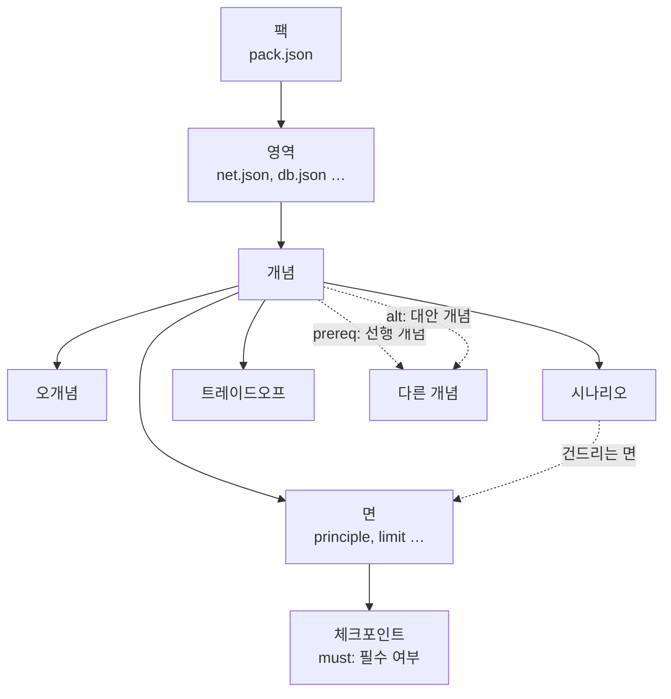
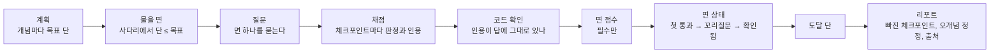

# 지식 팩(온톨로지)

지식 팩은 면접에서 무엇을, 얼마나 깊게 물을지 정하는 자료다. 채점 기준(체크포인트)과 정정할 오개념, 질문 재료(시나리오, 트레이드오프)를 개념마다 담는다.

| 항목 | 값 |
|---|---|
| 위치 | `app/engine/interview/pack/backend/`(`pack.json`과 영역 파일 8개) |
| 싣는 방법 | 엔진 라이브러리에 글로 들어간다(`app/engine/interview/src/pack.rs`의 `include_str!`) |
| 검사 | 엔진이 읽을 때 `pack.rs`의 `check`를 통과해야 한다. 같은 규칙을 `app/scripts/pack_check.py`가 돌린다 |
| 직무 | 백엔드 개발(`pack.json`의 `role`) |
| 언어 | 한국어(`lang: ko`) |

## 한눈에 보기



| 용어 | 뜻 |
|---|---|
| 영역 | 개념을 묶는 주제. 파일 하나가 영역 하나다 |
| 개념 | 면접에서 다루는 기술 주제 하나(예: B-트리 인덱스) |
| 유형 | 개념의 성격. 메커니즘형, 결정형, 운영형 셋이고, 유형이 그 개념의 면을 정한다 |
| 면 | 개념을 보는 관점(원리, 한계, 대안 등). 질문과 채점은 면 단위로 한다 |
| 단 | 면의 깊이를 나타내는 1~5의 눈금 |
| 체크포인트 | 그 면에 대한 좋은 답에 들어 있어야 할 내용 하나 |
| 필수(`must`) | 면의 점수에 드는 체크포인트 |
| 오개념 | 지원자가 말할 수 있는 틀린 생각과 그 정정 |
| 시나리오 | 면을 묻는 데 쓰는 구체적 상황 |
| 트레이드오프 | 저울질의 축과 두 쪽 |

## 유형과 면

| 유형 | `kind` | 꼭 있는 면(낮은 단부터) | 선택 면 |
|---|---|---|---|
| 메커니즘형 | `mechanism` | `principle` → `limit` → `alternative` | `estimate`, `verify` |
| 결정형 | `decision` | `rationale` → `tradeoff` → `alternative` | `principle`, `estimate`, `verify` |
| 운영형 | `operation` | `observe` → `recover` → `prevent` | `principle`, `estimate`, `verify` |

- 결정형과 운영형의 `principle`(어떻게 동작하는가)은 있으면 그 개념의 가장 낮은 면이다.
- `estimate`, `verify`는 공통 면이다. 단이 없어(0) 목표 단과 물을 면에 들지 않는다.
- 위의 면 밖의 면은 검사에서 거절된다.

| 면 | 이름 | 단 |
|---|---|---|
| `principle` | 원리 | 1 |
| `rationale` | 선택 근거 | 2 |
| `observe` | 관측 | 2 |
| `limit` | 한계 | 3 |
| `recover` | 복구 | 3 |
| `tradeoff` | 트레이드오프 | 4 |
| `alternative` | 대안 | 5 |
| `prevent` | 재발 방지 | 5 |
| `estimate` | 정량 추정 | 없음 |
| `verify` | 검증 방법 | 없음 |

개념의 사다리: 그 개념이 가진 면을 단의 순서로 늘어놓은 것(선택 면 `principle` 포함, 공통 면 제외). 면접은 이 사다리를 따라 아래에서 위로 묻는다(`pack.rs`의 `Concept::ladder`).

## 필드

### 개념

| 필드 | 뜻 | 규칙 |
|---|---|---|
| `id` | `<영역>.<이름>` | 소문자 영문·숫자·점. 영역 id로 시작. 팩 안에서 하나뿐 |
| `name`, `summary` | 이름, 한두 문장의 정의 | 비어 있으면 안 됨 |
| `kind` | 유형 | `mechanism`, `decision`, `operation` |
| `core` | 직무 핵심 주제인가 | 참/거짓. 목표 단을 높인다 |
| `aliases` | 이력서·공고의 말을 개념에 잇는 낱말 | 2~8개 |
| `prereq`, `alt` | 선행 개념, 대안 개념의 id | 팩 안의 다른 개념만 |
| `faces` | 면마다 체크포인트 목록 | 아래 |
| `misconceptions` | 오개념 | 1~3개 |
| `scenarios` | 시나리오 | 1~3개 |
| `tradeoffs` | 트레이드오프 | 0~2개 |

### 체크포인트

| 필드 | 뜻 | 규칙 |
|---|---|---|
| `id` | `<개념>.<면>.<번호>` | 번호는 1부터 차례로 |
| `must` | 필수 여부 | 꼭 있는 면과 `principle`에는 필수가 2~3개. 공통 면에는 두지 않는다 |
| `text` | 답에 들어 있어야 할 내용 하나 | 10자 이상 |
| `source` | 출처: `title`, `url`, `where`(절 이름) | `url`은 `https://` |

체크포인트 수: 꼭 있는 면과 `principle`은 2~5개, 공통 면은 1~3개.

`must`의 쓰임:

| 쓰는 곳 | 필수 | 필수 아님 |
|---|---|---|
| 면의 점수 | 든다 | 들지 않는다 |
| 채점 판정 | 받는다 | 받는다 |
| 꼬리질문을 버텼는지(새로 충족된 체크포인트가 있나) | 본다 | 보지 않는다 |
| 질문의 겨냥과 힌트의 재료(충족되지 않은 것을 팩의 순서로) | 고른다 | 고르지 않는다 |
| 리포트의 "빠진 내용" | 질문이 겨냥한 것을 싣는다 | 싣지 않는다 |

### 오개념, 시나리오, 트레이드오프

| 대상 | 필드 | 쓰임 |
|---|---|---|
| 오개념 | `id`(`<개념>.m<번호>`), `claim`(틀린 생각), `fix`(바른 설명), `probe`(반례가 되는 상황 질문), `source` | 채점은 이 목록의 id만, 인용이 답에 있을 때만 받는다. 잡히면 `probe`로 반례를 묻고, 리포트에 `claim`, `fix`, 출처로 정정한다 |
| 시나리오 | `id`(`<개념>.s<번호>`), `text`, `faces`(건드리는 면) | 그 면을 시나리오 유형으로 물을 때의 재료 |
| 트레이드오프 | `axis`, `a`, `b` | 트레이드오프 유형 질문의 재료 |
| 별칭 | `aliases` | 이력서 주장과 공고 항목을 개념 id에 잇는 색인 |

## 면접에서 쓰이는 길



목표 단(`app/engine/interview/src/plan.rs`의 `target`). 연차는 공고에 요구 연차가 있으면 그것을, 없으면 사용자가 고른 것을 쓴다.

| 개념 | 신입 | 1~3년, 4년 이상 |
|---|---|---|
| 핵심 개념 | 2(계획의 앞 두 핵심 개념은 3) | 4 |
| 핵심이 아닌 개념 | 1 | 2 |
| 이력서 주장에 걸린 개념 | 2(겪은 문제 주장이면 3) | 5 |
| 공고의 필수 항목에 걸린 개념 | 위 값 + 1(최대 5) | 위 값 + 1(최대 5) |

- 한 개념이 여러 줄에 걸리면 가장 높은 값을 쓴다.
- 물을 면은 사다리에서 단이 목표 이하인 면이다. 신입은 가장 낮은 면부터, 그 밖은 물을 면이 둘 이상이면 둘째 면부터 시작한다.
- 질문을 만드는 호출에는 그 질문이 겨냥한 필수 체크포인트 하나의 글만 넣는다(지원자에게 보이지 않는 채점 기준으로). 근거나 입장을 묻는 질문과 요약에는 넣지 않는다.

채점과 점수(`grade.rs`, `score.rs`, `pick.rs`):

| 판정 | 값 | 받는 조건 |
|---|---|---|
| `met`(충족) | 1 | 인용이 이번 답에 그대로 있다(공백만 정리해 견준다) |
| `partial`(부분) | 0.5 | 같음 |
| `contra`(반대 진술) | 0 | 같음 |
| `unmet`(미충족) | 0 | 판정이 없거나 인용 확인에 실패한 체크포인트 |

- 면 점수 = 필수 체크포인트의 (met + 0.5 × partial) / 필수 체크포인트 수. 같은 면을 여러 턴에 물으면 체크포인트마다 가장 좋은 판정을 쓴다.
- 주제를 묻는 질문은 필수 체크포인트 하나를 겨냥한다. 첫 질문의 점수(겨냥한 것의 점수와 면 점수 가운데 큰 값)가 0.6 이상이면 첫 통과, 0.3 이상이면 빠진 쪽으로 한 번 더 묻는다. 첫 통과 뒤 꼬리질문을 버티면(필수 체크포인트가 새로 충족되거나, 근거와 입장을 묻는 질문에서는 방어 점수 0.6 이상) 확인됨이다. 자세한 기준은 [면접 엔진](interview-engine.md#질문-고르기)에 있다.
- 도달 단은 사다리의 낮은 면부터 이어서 확인된 가장 높은 면의 단이다. 깊이는 확인됨만 인정한다.
- 리포트는 모델을 부르지 않고 채점 결과와 팩으로 만든다.

면접 엔진 전체는 [면접 엔진](interview-engine.md)에 있다.

## 영역과 개념

이 절의 표는 팩에서 만든다(`python3 app/scripts/pack_check.py --table`). 팩과 같은지는 `python3 app/scripts/pack_check.py --doc Docs/architecture/knowledge-pack.md`로 본다.

<!-- pack-table:start -->

개념 50개(핵심 15개), 체크포인트 604개(필수 379개), 오개념 117개, 시나리오 100개, 트레이드오프 50개.

| 영역 id | 이름 | 개념 수 |
|---|---|---|
| `net` | 네트워크와 HTTP | 7 |
| `db` | 데이터베이스 | 10 |
| `cache` | 캐시 | 4 |
| `sec` | 인증과 보안 | 4 |
| `os` | 동시성과 운영체제 | 6 |
| `dist` | 분산 시스템 | 8 |
| `arch` | 아키텍처와 설계 | 5 |
| `ops` | 운영과 관측 | 6 |

| id | 이름 | 유형 | 핵심 |
|---|---|---|---|
| `net.tcp` | TCP 연결과 신뢰성(핸드셰이크, 흐름·혼잡 제어) | 메커니즘형 | ○ |
| `net.http` | HTTP/1.1, HTTP/2, HTTP/3의 차이 | 메커니즘형 | ○ |
| `net.tls` | TLS 핸드셰이크와 인증서 | 메커니즘형 |  |
| `net.dns` | DNS 조회와 캐시 | 메커니즘형 |  |
| `net.lb` | 로드 밸런싱(L4·L7, 분배 방식, 상태 확인) | 결정형 |  |
| `net.rest` | REST API 설계와 메서드의 멱등성 | 결정형 | ○ |
| `net.timeout` | 타임아웃, 재시도, 백오프 | 결정형 |  |
| `db.index` | B-트리 인덱스 | 메커니즘형 | ○ |
| `db.tx` | 트랜잭션과 ACID | 메커니즘형 | ○ |
| `db.isolation` | 격리 수준과 MVCC | 메커니즘형 | ○ |
| `db.lock` | 락과 교착 상태(DB) | 메커니즘형 |  |
| `db.plan` | 쿼리 실행 계획과 튜닝 | 운영형 |  |
| `db.normal` | 정규화와 반정규화 | 결정형 |  |
| `db.replication` | 복제와 읽기 분산 | 결정형 |  |
| `db.sharding` | 파티셔닝과 샤딩 | 결정형 |  |
| `db.pool` | 커넥션 풀 | 운영형 |  |
| `db.nplus1` | N+1 쿼리 문제 | 운영형 |  |
| `cache.strategy` | 캐시 전략(cache-aside, write-through, write-behind) | 결정형 | ○ |
| `cache.invalidate` | 캐시 무효화와 TTL | 결정형 |  |
| `cache.stampede` | 캐시 쇄도(stampede) | 운영형 |  |
| `cache.redis` | Redis의 자료구조, 단일 스레드, 영속성 | 메커니즘형 |  |
| `sec.session` | 세션과 토큰(JWT) 인증 | 결정형 | ○ |
| `sec.oauth` | OAuth 2.0 인가 코드 흐름 | 메커니즘형 |  |
| `sec.password` | 비밀번호 저장(솔트, 느린 해시) | 메커니즘형 |  |
| `sec.injection` | SQL 인젝션과 입력 검증 | 메커니즘형 |  |
| `os.thread` | 프로세스와 스레드 | 메커니즘형 | ○ |
| `os.context` | 컨텍스트 스위칭의 비용 | 메커니즘형 |  |
| `os.sync` | 뮤텍스, 세마포어, 경쟁 상태 | 메커니즘형 | ○ |
| `os.deadlock` | 교착 상태의 조건과 회피 | 메커니즘형 |  |
| `os.io` | 블로킹·논블로킹 I/O와 이벤트 루프 | 메커니즘형 | ○ |
| `os.pool` | 스레드 풀과 백프레셔 | 결정형 |  |
| `dist.cap` | CAP 정리와 일관성 모델 | 메커니즘형 | ○ |
| `dist.consensus` | 합의(Raft)와 리더 선출 | 메커니즘형 |  |
| `dist.tx` | 분산 트랜잭션(2PC, Saga) | 결정형 |  |
| `dist.idempotency` | 멱등성과 중복 요청 처리 | 결정형 | ○ |
| `dist.mq` | 메시지 큐와 전달 보장 | 결정형 | ○ |
| `dist.kafka` | Kafka의 파티션, 순서, 컨슈머 그룹 | 메커니즘형 |  |
| `dist.lock` | 분산 락 | 결정형 |  |
| `dist.breaker` | 서킷 브레이커와 격벽 | 운영형 |  |
| `arch.msa` | 모놀리식과 마이크로서비스 | 결정형 |  |
| `arch.gateway` | API 게이트웨이와 BFF | 결정형 |  |
| `arch.ratelimit` | 처리율 제한(토큰 버킷 등) | 메커니즘형 |  |
| `arch.paging` | 페이지네이션(오프셋 대 커서) | 결정형 |  |
| `arch.outbox` | 이중 쓰기 문제와 트랜잭셔널 아웃박스 | 결정형 |  |
| `ops.observability` | 로그, 메트릭, 트레이스 | 운영형 | ○ |
| `ops.slo` | SLI, SLO, 에러 예산 | 결정형 |  |
| `ops.deploy` | 배포 전략(롤링, 블루그린, 카나리) | 결정형 |  |
| `ops.incident` | 장애 대응과 사후 검토 | 운영형 |  |
| `ops.capacity` | 부하 시험과 용량 계획 | 운영형 |  |
| `ops.autoscale` | 오토스케일링 | 운영형 |  |

<!-- pack-table:end -->

## 예시: `db.index`

실제 팩(`db.json`)의 개념 하나를 줄인 것이다. 체크포인트 3개, 오개념·시나리오 1개씩만 남겼다.

```json
{
  "id": "db.index",
  "name": "B-트리 인덱스",
  "kind": "mechanism",
  "core": true,
  "aliases": ["인덱스", "index", "B-Tree", "B+Tree", "복합 인덱스", "커버링 인덱스", "클러스터드 인덱스"],
  "prereq": [],
  "alt": [],
  "summary": "B-트리 인덱스(B-tree index)는 키를 정렬된 균형 트리로 유지해, 같음·범위 조건과 정렬을 테이블 전체를 읽지 않고 처리하게 하는 자료 구조다. 읽기를 빠르게 하는 대신 쓰기마다 인덱스도 고쳐야 한다.",
  "faces": {
    "principle": [
      {
        "id": "db.index.principle.1",
        "must": true,
        "text": "B-트리는 루트에서 모든 리프까지의 깊이가 같은 균형 트리이고, 데이터가 늘어도 깊이가 아주 느리게(로그로) 자라 몇 단계만 내려가면 원하는 키를 찾는다는 점을 설명한다",
        "source": {
          "title": "Markus Winand, Use The Index, Luke: The Search Tree (B-Tree)",
          "url": "https://use-the-index-luke.com/sql/anatomy/the-tree",
          "where": "The Search Tree (B-Tree) Makes the Index Fast"
        }
      },
      {
        "id": "db.index.principle.2",
        "must": true,
        "text": "B-트리 인덱스는 정렬할 수 있는 값의 같음과 범위 조건(<, <=, =, >=, >, BETWEEN 등)을 처리하고, 데이터를 정렬된 순서로 꺼내는 데도 쓰인다는 점을 설명한다",
        "source": {
          "title": "PostgreSQL 18 문서: Index Types",
          "url": "https://www.postgresql.org/docs/current/indexes-types.html",
          "where": "11.2.1 B-Tree"
        }
      }
    ],
    "limit": [
      {
        "id": "db.index.limit.1",
        "must": true,
        "text": "인덱스를 만들면 데이터를 바꿀 때마다 인덱스도 함께 고쳐야 해 쓰기에 부담이 붙는다는 점을 말한다",
        "source": {
          "title": "PostgreSQL 18 문서: Indexes - Introduction",
          "url": "https://www.postgresql.org/docs/current/indexes-intro.html",
          "where": "Introduction"
        }
      }
    ]
  },
  "misconceptions": [
    {
      "id": "db.index.m1",
      "claim": "인덱스는 많을수록 빠르다",
      "fix": "인덱스는 해당 조건의 조회를 빠르게 하지만, 데이터를 바꿀 때마다 모든 인덱스를 함께 고쳐야 해 쓰기가 느려진다. 쓰이지 않는 인덱스는 지운다.",
      "probe": "초당 수천 건이 들어오는 주문 테이블에 인덱스가 12개 있다면, INSERT 한 건마다 어떤 일이 생길까요?",
      "source": {
        "title": "PostgreSQL 18 문서: Indexes - Introduction",
        "url": "https://www.postgresql.org/docs/current/indexes-intro.html",
        "where": "Introduction"
      }
    }
  ],
  "scenarios": [
    {
      "id": "db.index.s1",
      "text": "1억 행 주문 테이블에서 '특정 고객의 최근 주문 20건' 조회가 느리다. 인덱스는 created_at 하나뿐이다.",
      "faces": ["principle", "limit"]
    }
  ],
  "tradeoffs": [
    {
      "axis": "읽기 속도 대 쓰기 비용",
      "a": "인덱스를 더하면 해당 조건의 조회와 정렬이 빨라진다",
      "b": "쓰기마다 모든 인덱스를 고쳐야 해 INSERT·UPDATE가 느려지고 저장 공간이 는다"
    }
  ]
}
```

이 예시는 줄인 것이라 검사를 통과하지 않는다(실제 팩에는 면마다 체크포인트가 2~5개 있다). 개념을 더하는 법은 [지식 팩 작성](../contributing/knowledge-pack-authoring.md)에 있다.
