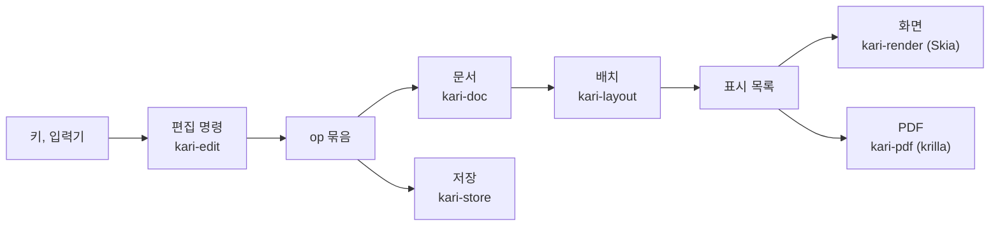
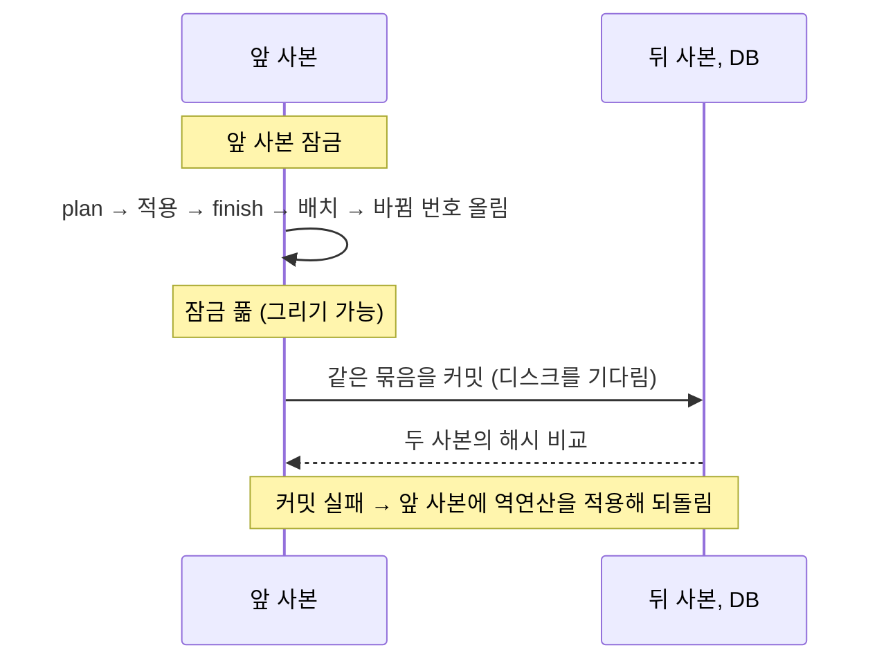
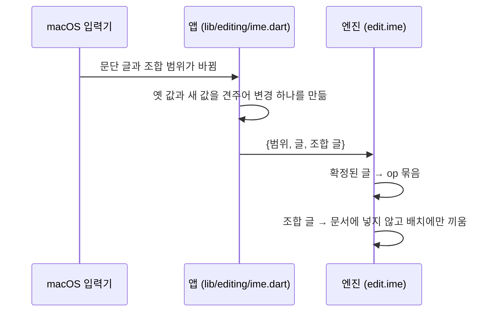

# 배치, 편집, 그리기, PDF

키 하나가 화면과 PDF에 이르는 길이다. 문서 자료의 모양은 [document-model.md](document-model.md)에 있다.

**표시 목록**: 배치가 내는 그릴 것의 목록. 쪽마다 글리프 묶음, 밑줄·취소선, 형광펜, 표의 선과 바탕, 그림, 링크 영역이 pt 좌표로 들어 있다. 화면과 PDF가 같은 표시 목록을 쓴다.

## 배치 (`app/engine/layout`)

### 글꼴

- 앱이 `kari_font_add`로 넘긴 글꼴만 쓴다(`app/assets/fonts/Pretendard-Regular.ttf`, `Pretendard-Bold.ttf`). 운영체제의 글꼴과 대체 글꼴은 쓰지 않는다.
- 단위는 pt(1/72인치)이고 힌팅을 하지 않는다. 화면 배율과 상관없이 같은 배치가 나온다.
- 글꼴에 없는 글자는 빈 네모로 놓는다: 폭 1em, 높이 0.7em, 선 0.5pt, 글자색. 문서 상태의 `missing`에 그 수가 들어가고, 앱이 상태 줄에 "글꼴에 없는 글자 N자(네모로 보임)"로 보인다. PDF에도 같은 네모가 들어간다.

### 줄 나눔

- Parley로 글의 모양을 잡는다.
- 어절 규칙: 공백 뒤에서만 줄을 바꾼다. 한글 어절이 가운데에서 끊기지 않는다.
- 탭: 문단의 탭 정지(왼쪽, 가운데, 오른쪽, 소수점 맞춤, 채움선 없음·점·대시·선) 가운데 지금 자리보다 큰 가장 가까운 것으로 간다. 없으면 36pt마다 있는 기본 정지(왼쪽 맞춤).
- 목록 표지: 글머리표는 수준에 따라 `•` `◦` `▪`. 번호는 수준 0~8에 `1.` `가.` `1)` `가)` `(1)` `(가)` `①` `㉮` `1.`.
- 링크 글은 run에 색이 없으면 링크 색으로 그린다.
- 줄 간격: `AUTO`는 글자 크기의 1.2배, `PERCENT`는 글자 크기 × 값/100, `PT`는 고정 높이.
- 위·아래 첨자(`vertical`): 글자 크기의 0.65배로 모양을 잡고, 기준선을 원래 크기의 0.33배 위(위 첨자)나 0.15배 아래(아래 첨자)로 옮겨 그린다. 줄 상자는 원래 크기의 것 그대로다. 고정 pt 줄 간격의 문단에서는 첨자 조각의 줄 높이도 0.65배로 줄여 원래 줄 상자 안에 넣는다. 밑줄과 취소선은 옮긴 기준선에 긋는다.
- 자간(`spacing`, pt): 글자 묶음마다 뒤에 더한다. 줄의 마지막 묶음 뒤에는 더하지 않는다: 줄마다 그 줄 마지막 묶음의 자간만큼 폭을 넓혀 나누고 맞춰, 오른쪽·가운데·양쪽 맞춤에서 마지막 글자의 잉크가 본문 끝에 닿고 줄 끝의 커서가 잉크 끝에 선다.
- 형광펜(`bg`): 그 조각의 폭과 줄 높이만큼의 사각형을 글자 아래에 그린다.
- 그림 개체가 줄 폭이나 본문 높이보다 크면 비율을 지켜 줄여 놓는다. 자료의 크기는 그대로다.
- 문단마다 줄 나눔 결과를 기억한다. 고친 뒤에는 바뀐 문단만 다시 줄을 나누고 쪽 나눔은 처음부터 한다.

### 쪽 나눔

앞으로만 진행하고 지난 쪽으로 돌아가지 않는다. 쪽마다 최소 한 줄은 놓는다.

| 규칙 | 내용 |
|---|---|
| 문단 앞에서 쪽 나누기(`breakBefore`) | 쪽이 비어 있지 않으면 새 쪽에서 시작한다 |
| 문단을 나누지 않기(`keepLines`) | 문단 전체가 한 쪽 높이 이하이고 지금 쪽에 다 들어가지 않으면 새 쪽에서 시작한다 |
| 외톨이 줄 방지 | 문단의 마지막 한 줄만 다음 쪽으로 가거나 첫 한 줄만 쪽 아래에 남지 않게 한다 |
| 다음 문단과 함께(`keepNext`) | 이 문단이 지금 쪽에 다 들어가는데 다음 블록이 외톨이 줄 규칙을 적용한 뒤 이 쪽에 한 줄도 놓이지 않으면 함께 다음 쪽으로 넘긴다(다음 블록이 표면 머리 행들과 첫 본문 행이 들어가야 한다). `제목 1`, `제목 2` 스타일은 기본으로 켜져 있다 |
| 표 | 행은 나누지 않는다. 머리 행과 첫 본문 행이 들어가지 않으면 표 전체를 다음 쪽에서 시작한다. 넘어간 쪽마다 맨 위에 머리 행을 다시 놓는다 |
| 합친 셀 | 여러 행에 걸친 셀로 이어진 행들은 함께 움직인다 |
| 한 쪽보다 높은 것 | 빈 쪽에 놓고 넘치게 둔다 |

### 표

- 열 폭은 `cols`(pt). 합이 본문 폭을 넘으면 같은 비율로 줄여 놓는다(자료는 그대로).
- 행 높이 = 그 행에서 끝나는 셀들의 (내용 높이 + 위아래 안쪽 여백) 가운데 가장 큰 값과 `row.h` 가운데 큰 값.
- 셀은 세로 맞춤(위, 가운데, 아래)과 바탕색을 가진다.
- 셀 수가 모자라거나 합친 영역이 겹친 자료를 읽어도 멈추지 않고 할 수 있는 만큼 놓는다.

### 머리글과 바닥글

- 왼쪽·가운데·오른쪽 세 칸의 글이다. `{쪽}`은 쪽 번호, `{전체}`는 전체 쪽 수로 바뀐다.
- 본문을 다 놓은 뒤 얹으므로 쪽 나눔에 영향을 주지 않는다.
- `hfSkipFirst`가 켜져 있으면 첫 쪽에는 넣지 않는다.

### 위치 질의

커서 자리, 누른 자리, 선택 영역, 줄 이동을 답한다. 줄마다 글자 묶음 경계의 (바이트, x) 표 하나로 커서 자리와 누른 자리를 함께 계산해, 누른 자리의 커서가 늘 그 자리로 돌아온다. 커서는 글자 묶음(그림 글자 등) 가운데에 서지 않는다.

## 편집 (`app/engine/edit`)

`kari-edit`은 문서를 직접 바꾸지 않는다. 선택과 명령을 받아 op 묶음과 그 뒤의 선택을 낸다.

1. `plan`: 명령 뒤의 상태를 계산한다. 편집기의 상태는 바꾸지 않는다.
2. 문서에 묶음을 적용한다.
3. 성공하면 `finish`, 실패하면 `reject`.

### 명령

`edit.cmd`의 `cmd.k` 값이다(`app/engine/ffi/src/cmd.rs`).

| 갈래 | 명령 |
|---|---|
| 글 | `insert`, `paste`, `enter`, `softBreak`, `backspace`, `delete`, `backspaceWord`, `deleteWord`, `backspaceLine`, `cut`, `selectAll` |
| 이동과 선택 | `move`(`left`, `right`, `wordLeft`, `wordRight`, `lineStart`, `lineEnd`, `up`, `down`, `docStart`, `docEnd`, `pageUp`, `pageDown`), `click`, `drag` |
| 입력기 | `compose`, `commitCompose` |
| 글자 모양 | `toggle`(`bold`, `italic`, `underline`, `strike`), `setChar`(`size`, `sizeStep`, `color`, `bg`, `vertical`, `spacing`, `font`), `clearChar` |
| 문단 | `setStyle`, `setPara`(`align`, `indentLeft`, `indentRight`, `indentFirst`, `spaceBefore`, `spaceAfter`, `line`, `tabs`, `keepNext`, `keepLines`, `breakBefore`), `clearPara`, `pageBreak` |
| 목록 | `toggleList`(`bullet`, `ordered`), `indent`, `tab`, `setList`(시작 번호) |
| 링크 | `setLink`, `insertLink` |
| 쪽 | `setPage`(용지, 방향, 사용자 지정 크기, 여백), `setHeaderFooter` |
| 표 | `insertTable`, `tableRow`, `tableCol`, `tableDeleteRow`, `tableDeleteCol`, `tableDelete`, `tableMerge`, `tableSplit`, `setTable`, `setCell` |
| 그림 | `setImage`(크기, 대체 글). 넣기는 `edit.insertImage` |
| 찾기 | `findNext`, `replaceOne`, `replaceAll` |

- `tab`: 목록 문단이면 들여쓰기·내어쓰기, 셀 안이면 다음 셀(마지막 셀이면 아래에 행을 넣고 그 첫 셀), 그 밖에는 탭 문자.
- 글자 모양 명령은 선택이 있으면 그 글의 run `s`를, 커서뿐이면 다음에 칠 글자에 줄 모양을 바꾼다. 문단 스타일과 같아지는 키는 run에 남기지 않는다.
- `sizeStep`(1, −1): 글자 크기 단계표(8, 9, 10, 10.5, 11, 12, 14, 16, 18, 20, 24, 28, 32, 36, 48, 72pt)의 다음, 앞 값. 조각마다 자기 크기에서 한 단계 간다. `spacing`은 −2~10pt로 자른다.
- `clearChar`: run의 직접 글자 모양을 걷는다(`keys`를 주면 그 키만). 링크는 `s` 밖에 있어 남는다. `keys` 없이 문단 전체들을 골랐으면 `clearPara`도 한다.
- `clearPara`: 고른 문단의 직접 문단 모양(`pf`)에서 목록과 탭 정지만 남기고 걷는다.
- `pageBreak`: 커서 자리에서 문단을 나누고 새 문단에 `breakBefore`를 켠다. 그 문단의 맨 앞에서 `backspace`는 먼저 `breakBefore`만 끈다. 표 안에서는 거절한다.
- `setList`: 고른 범위의 첫 번호 목록 문단의 `list.start`를 정한다. 그 문단부터 그 값으로 다시 센다.
- 앱의 ⌘., ⌘,(`toggleVertical`)는 엔진 명령이 아니다. 앱이 지금 상태의 `char.vertical`을 보고 `setChar`의 `vertical`을 켜거나(`super`, `sub`) 끈다(`none`).
- 이어 친 글은 1.5초 안이면 되돌리기 한 단위로 묶는다.
- 받을 수 없는 명령은 문서를 바꾸지 않고 거절 사유를 돌려준다: 글이 길이 제한(run 100,000자, run 10,000개)을 넘음, 값이 틀림, 링크 주소가 틀림(`http`, `https`, `mailto`, `tel`만, 2,000자까지), 표 안에 표, 표 안의 쪽 나누기, 여백을 뺀 본문이 가로나 세로 72pt 미만.
- `setPage`에 `w`, `h`를 주면 사용자 지정 용지(`preset: CUSTOM`)가 된다. 한 변은 50~2,000pt로 자르고, 방향은 두 변에서 정한다.

### 상태 보고

편집 호출(`edit.*`)은 문서 상태 JSON을 돌려준다(`app/engine/ffi/src/state.rs`). 앱의 도구 줄, 창, 상태 줄이 이 값을 보인다.

| 묶음 | 값 |
|---|---|
| 보기 | `zoom`(실제 배율), `contentWidth`, `contentHeight`, `pages`, `caret`(내용 기준 논리 화소) |
| 글자(`char`) | `size`, `color`, `bg`, `vertical`, `spacing`. 선택이 있으면 그 안의 글, 커서뿐이면 다음에 칠 글자의 모양 |
| 문단(`para`) | `indentLeft`, `indentRight`, `indentFirst`, `spaceBefore`, `spaceAfter`, `line {unit, value}`, `keepNext`, `keepLines`, `breakBefore`. 선택에 걸친 문단들의 값 |
| 그 밖 | `marks`(굵게, 기울임, 밑줄, 취소선), `style`, `align`, `list {kind, level, start}`, `link`, `find`, `tabs`, `page`, `header`, `footer`, `table`, `image`, `missing`, `ime`, `savedAt`, `canUndo`, `canRedo` |

- 글자와 문단의 값은 섞였으면 `null`이다. 화면은 섞인 칸을 비워 둔다.
- 값은 스타일을 푼 결과다(스타일에서 온 값과 직접 준 값을 가리지 않는다). 수는 소수 둘째 자리까지.

### 앞 사본과 뒤 사본

편집 세션은 문서마다 사본 둘을 둔다(`app/engine/ffi/src/session.rs`, `edit.rs`).

| 사본 | 쓰임 | 잠금 |
|---|---|---|
| 앞 사본 | 배치기, 편집기, 선택과 함께 화면에 그리는 상태 | 앞 사본 잠금 |
| 뒤 사본 | 저장소에 커밋하는 상태 | 명령 잠금 |

키를 친 결과는 디스크를 기다리지 않고 화면에 나온다. 커밋이 끝날 때까지 그리기가 막히지 않는다. 되돌리기와 버전으로 돌아가기는 뒤 사본에서 먼저 하고, 적용된 op를 앞 사본에 반영한다.

### 한글 입력

- 입력기에 보여 주는 글은 커서가 있는 문단 하나다. 위치는 UTF-16 단위다.
- 조합 중인 글은 문서에 넣지 않는다. 배치가 그 문단의 자리에 끼워 그리고, 밑줄을 긋는다. 확정된 글만 op가 된다.
- 바로 앞 입력이 넣은 글의 끝을 고치는 변경(조합의 다음 단계)은 같은 되돌리기 단위로 잇는다.
- 조합 중에는 지우기, 방향키, Enter를 입력기에 맡긴다. 입력기가 조합을 끝내고 넘긴 키는 macOS 선택자(`deleteBackward:` 등)로 와서 편집 명령이 된다(`lib/editing/keys.dart`).

### 복사와 붙여넣기

- 시스템 클립보드에는 글만 나간다.
- 엔진은 앱 안에서 마지막으로 복사한 조각(글자 모양, 링크, 그림, 문단 모양)을 기억한다. 붙여넣는 글이 그 조각의 글과 같으면 조각을 넣는다. 앱 안에서 잘라내고 붙여도 모양과 그림이 남는다.

### 그림 넣기

엔진이 파일을 직접 읽어 검사한다(`edit.insertImage`, `app/engine/render/src/image.rs`).

| 검사와 정리 | 값 |
|---|---|
| 파일 크기 | 20MB까지 |
| 형식 | PNG, JPEG로 실제로 풀리는 것, 1px 이상 |
| 방향 | JPEG의 방향 정보대로 똑바로 돌려 다시 담는다 |
| 크기 | 긴 변이 4,000px를 넘으면 4,000px로 줄여 같은 형식으로 다시 담는다(JPEG 품질 90) |
| 놓는 크기 | 1px = 0.75pt. 본문 상자보다 크면 비율을 지켜 줄인다 |

정리한 바이트는 에셋으로 저장하고 커서 자리에 그림 개체 run을 넣는다.

### 찾기와 글자 수

- 찾기는 본문과 셀의 문단을 문서 순서(행 → 셀 → 문단)로 훑는다. 대소문자 구분을 고를 수 있다. 글자 묶음을 가르는 일치는 세지 않는다.
- 글자 수는 쪽 수, 글자 수, 공백 제외 글자 수, 선택 안의 글자 수를 낸다. 글자는 사람이 보는 글자(확장 자소 묶음) 단위로 센다.

## 그리기 (`app/engine/render`)

- Skia의 CPU 래스터로 화소 버퍼(BGRA, 미리 곱한 알파)에 바로 그린다.
- 순서: 바탕색 → 보이는 쪽마다 그림자와 흰 종이 → 선택 영역 → 표시 목록 → 조합 밑줄. 커서는 앱이 위에 올린다.
- 그림은 처음 그릴 때 풀어 화면 화소 크기로 맞춰 기억한다. 기억의 합계가 64MB를 넘으면 오래 안 쓴 것부터 버린다. 읽지 못한 그림은 회색 상자로 그린다.
- 텍스처로 올리는 길 → [overview.md](overview.md#화면-그리기).

### 보기 배율과 좌표

`app/engine/render/src/geo.rs`의 `Geo`가 쪽을 보이는 영역에 놓는다. 단위는 논리 화소이고, 좌표는 스크롤을 빼지 않은 내용 기준이다.

| 값 | 정하는 법 |
|---|---|
| `k`(1pt의 논리 화소) | 4/3 × 배율. 100%에서 1pt는 96dpi 기준의 논리 화소다 |
| 배율 | 0이면 쪽 너비에 맞춤(양옆에 24를 남기는 배율). 어느 쪽이든 50~300%로 자른다 |
| 쪽의 놓임 | 위 여백 24, 쪽 사이 24, 아래 여백 24. 쪽은 가로 가운데 |
| 내용 너비 | 쪽 너비 + 48과 보이는 영역 너비 가운데 큰 값. 영역보다 넓으면 가로로 스크롤한다 |
| 쪽 사이의 점 | 틈의 가운데에서 위아래 쪽으로 나눈다 |

- `edit.zoom {zoom, x?, y?}`: 보기만 바꾸고 문서와 배치는 그대로다. `x`, `y`(옛 배율의 내용 좌표)를 주면 그 점이 새 배율에서 놓이는 자리를 `kept`로 돌려준다(같은 쪽의 같은 pt 점).
- 앱(`app/lib/screens/paper.dart`)은 화면 가운데 점을 넘겨 받은 자리로 스크롤해 보던 곳을 지킨다. 쪽 너비에 맞춤과 문서를 처음 열 때는 보이는 영역의 맨 위를 지킨다.
- 트랙패드로 벌리는 동안 앱은 그린 그림을 늘려 보이고, 손을 떼면 1% 단위로 맞춘 배율을 엔진에 넘겨 다시 그린다.
- 가로 스크롤이 있으면 `kari_edit_render_at`의 `scroll_x`로 그린다. 배율은 앱 설정 `view.zoom` 하나이고 문서마다 두지 않는다.

### 명령 뒤 커서 따라가기

`app/lib/screens/paper.dart`. 편집 세션은 편집·이동 명령(글 넣기, 이동, 붙여넣기, 되돌리기, 서식 바꾸기 등)이 끝날 때마다 `commands`를 올린다. 실패한 명령도 올린다. 종이 영역은 이 값이 바뀐 다음 프레임에 커서가 보이는 영역에서 24 논리 화소 안쪽에 있도록 세로·가로로 스크롤한다.

- 커서가 움직이지 않은 명령(글자 모양 바꾸기 등)도 따라간다. 커서가 화면 밖에 있으면 그 자리로 간다.
- 스크롤, 창 크기, 찾기 표시, 배율 같은 보기 갱신은 `commands`를 올리지 않아 화면을 커서로 끌고 가지 않는다.
- 배율을 넘기는 동안 끝난 명령은 넘긴 뒤에 따라간다.

## PDF (`app/engine/pdf`)

- 화면과 같은 표시 목록을 krilla로 PDF 바이트로 옮긴다. 글리프 위치는 표시 목록의 값 그대로다.
- 글리프 묶음마다 원문 글을 붙인다. PDF에서 뽑은 글이 원문과 같은 순서로 나온다.
- 글꼴은 PDF 안에 넣는다. 링크는 링크 주석으로 넣는다.
- 문서 이름을 제목으로, 문서 언어(`lang`)를 넣는다. 만든 시각을 넣지 않아 같은 문서는 같은 바이트가 된다.
- 쪽 한 변은 3pt~14,400pt여야 한다.
- 읽지 못한 그림은 화면과 같은 회색 상자로 넣는다.

`doc.exportPdf`는 명령 잠금을 문서를 복사하는 동안만 잡는다. 배치, PDF 만들기, 파일 쓰기는 잠금 밖에서 한다. 파일은 임시 이름으로 다 쓴 뒤 이름을 바꾼다. 샌드박스 때문에 같은 폴더에 임시 파일을 만들 수 없으면 앱의 임시 폴더에서 옮기고, 그것도 안 되면 고른 경로에 바로 쓴다. 어느 길이든 쓰다 만 파일을 남기지 않는다.

## 더 읽을 것

- [overview.md](overview.md): 경계와 스레드
- [document-model.md](document-model.md): op와 저장
- [../guide/writing.md](../guide/writing.md): 쓰는 사람을 위한 기능과 단축키
- [../contributing/code-map.md](../contributing/code-map.md): 파일 지도
