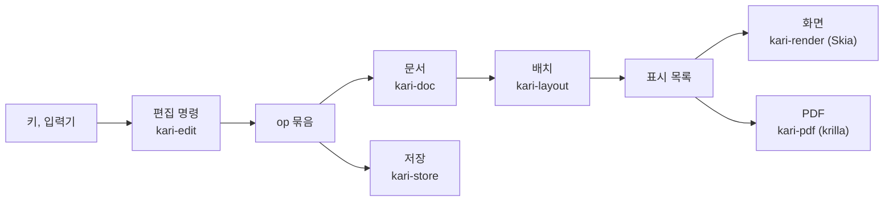
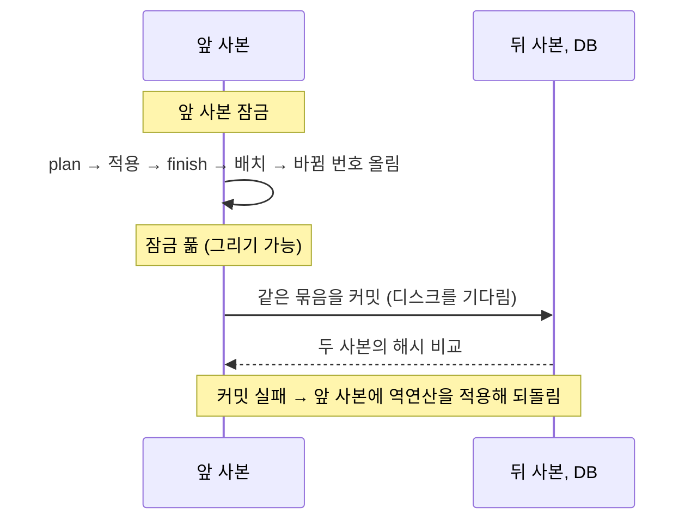
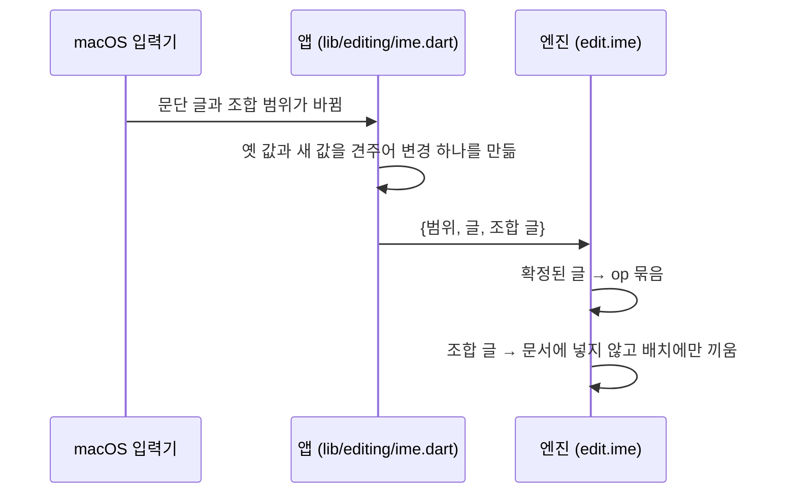

# 배치, 편집, 그리기, 내보내기

키 하나가 화면과 PDF에 이르는 길이다. 문서 자료의 모양은 [document-model.md](document-model.md)에 있다.

**표시 목록**: 배치가 내는 그릴 것의 목록. 쪽마다 글리프 묶음, 밑줄·취소선, 형광펜, 표의 선과 바탕, 문단의 테두리와 바탕, 그림, 링크 영역이 pt 좌표로 들어 있다. 화면과 PDF가 같은 표시 목록을 쓴다. 표에서 선이 없는 변의 자리(눈금선)는 따로 담고, 화면이 눈금선 보기일 때만 그린다. 눈금선은 PDF와 배치 해시에 들어가지 않는다.

## 배치 (`app/engine/layout`)

### 글꼴

- 앱이 `kari_font_add`로 넘긴 글꼴만 쓴다(`app/assets/fonts/Pretendard-Regular.ttf`, `Pretendard-Bold.ttf`). 운영체제의 글꼴과 대체 글꼴은 쓰지 않는다.
- 단위는 pt(1/72인치)이고 힌팅을 하지 않는다. 화면 배율과 상관없이 같은 배치가 나온다.
- 글꼴에 없는 글자는 빈 네모로 놓는다: 폭 1em, 높이 0.7em, 선 0.5pt, 글자색. 문서 상태의 `missing`에 그 수가 들어가고, 앱이 상태 줄에 "글꼴에 없는 글자 N자(네모로 보임)"로 보인다. PDF에도 같은 네모가 들어간다.

### 줄 나눔

- Parley로 글의 모양을 잡는다.
- 어절 규칙: 공백 뒤에서만 줄을 바꾼다. 한글 어절이 가운데에서 끊기지 않는다.
- 탭: 문단의 탭 정지(왼쪽, 가운데, 오른쪽, 소수점 맞춤, 채움선 없음·점·대시·선) 가운데 지금 자리보다 큰 가장 가까운 것으로 간다. 없으면 36pt마다 있는 기본 정지(왼쪽 맞춤).
- 목록 표지: 글머리표는 수준에 따라 `•` `◦` `▪`. 번호는 수준 0~8에 `1.` `가.` `1)` `가)` `(1)` `(가)` `①` `㉮` `1.`.
- 링크 글은 run에 색이 없으면 링크 색으로 그린다.
- 줄 간격: `AUTO`는 글자 크기의 1.2배, `PERCENT`는 글자 크기 × 값/100, `PT`는 고정 높이.
- 위·아래 첨자(`vertical`): 글자 크기의 0.65배로 모양을 잡고, 기준선을 원래 크기의 0.33배 위(위 첨자)나 0.15배 아래(아래 첨자)로 옮겨 그린다. 줄 상자는 원래 크기의 것 그대로다. 고정 pt 줄 간격의 문단에서는 첨자 조각의 줄 높이도 0.65배로 줄여 원래 줄 상자 안에 넣는다. 밑줄과 취소선은 옮긴 기준선에 긋는다.
- 자간(`spacing`, pt): 글자 묶음마다 뒤에 더한다. 줄의 마지막 묶음 뒤에는 더하지 않는다: 줄마다 그 줄 마지막 묶음의 자간만큼 폭을 넓혀 나누고 맞춰, 오른쪽·가운데·양쪽 맞춤에서 마지막 글자의 잉크가 본문 끝에 닿고 줄 끝의 커서가 잉크 끝에 선다.
- 형광펜(`bg`): 그 조각의 폭과 줄 높이만큼의 사각형을 글자 아래에 그린다.
- 그림 개체가 줄 폭이나 본문 높이보다 크면 비율을 지켜 줄여 놓는다. 자료의 크기는 그대로다.

### 배치 캐시

고친 뒤에는 바뀐 것만 다시 만들고, 쪽 나눔은 처음부터 한다(`app/engine/layout/src/layouter.rs`).

| 다시 쓰는 것 | 같아야 하는 값 |
|---|---|
| 문단의 줄 나눔 | 문단의 rev, 스타일 해시, 본문 폭과 높이, 조합 글. 스타일 해시는 바탕 스타일까지 푼 값의 해시이고 스타일 표가 바뀔 때만 다시 구한다. 그래서 스타일을 고치면 푼 값이 바뀐 스타일을 쓰는 문단만 다시 줄을 나눈다 |
| 표의 정해 둔 변 | 표·행·셀의 세대와 열 폭(글만 바뀌면 그대로) |
| 쪽의 표시 목록 | 쪽 크기와 여백, 머리글 설정과 전체 쪽 수, 쪽에 놓인 것마다 (세대, 줄, y) |

### 문단의 테두리와 바탕

`pf.border`의 변(위, 아래, 왼쪽, 오른쪽)마다 `{weight, color, gap}`, `pf.shade`가 바탕색이다(`app/engine/layout/src/frame.rs`). 굵기는 0~6pt(0이면 없음), 글과의 거리 `gap`은 0~31pt로 자른다.

- 상자는 문단의 글 상자(왼쪽·오른쪽 들여쓰기를 뺀 폭)다. 목록 표지와 내어쓴 첫 줄도 상자 안에 든다.
- 위 선은 첫 줄 위에, 아래 선은 마지막 줄 아래에 `gap`만큼 띄워 긋는다. 선과 `gap`은 문단의 첫 줄, 마지막 줄 높이에 더해 쪽 나눔이 함께 옮긴다.
- 바탕은 선 안쪽(왼쪽·오른쪽 선과 글 사이의 `gap`까지)을 칠한다. 위·아래 선은 왼쪽·오른쪽 선의 바깥 끝까지 그어 모서리를 메운다.
- 같은 그릇(본문이나 같은 셀)에서 바로 이웃한 두 문단의 지정(네 변, 바탕, 들여쓰기)이 같으면 한 상자로 잇는다. 사이에 위·아래 선을 긋지 않고 그 높이도 더하지 않는다. 사이에 표가 있으면 잇지 않는다.
- 문단이 쪽에서 나뉘면 잘린 자리에는 위·아래 선을 긋지 않는다.

### 쪽 나눔

앞으로만 진행하고 지난 쪽으로 돌아가지 않는다. 쪽마다 최소 한 줄은 놓는다.

| 규칙 | 내용 |
|---|---|
| 문단 앞에서 쪽 나누기(`breakBefore`) | 쪽이 비어 있지 않으면 새 쪽에서 시작한다 |
| 문단을 나누지 않기(`keepLines`) | 문단 전체가 한 쪽 높이 이하이고 지금 쪽에 다 들어가지 않으면 새 쪽에서 시작한다 |
| 외톨이 줄 방지 | 문단의 마지막 한 줄만 다음 쪽으로 가거나 첫 한 줄만 쪽 아래에 남지 않게 한다 |
| 다음 문단과 함께(`keepNext`) | 이 문단이 지금 쪽에 다 들어가는데 다음 블록이 외톨이 줄 규칙을 적용한 뒤 이 쪽에 한 줄도 놓이지 않으면 함께 다음 쪽으로 넘긴다(다음 블록이 표면 머리 행들과 첫 본문 행이 들어가야 한다). `제목 1`, `제목 2` 스타일은 기본으로 켜져 있다 |
| 표 | 행은 나누지 않는다. 머리 행과 첫 본문 행이 들어가지 않으면 표 전체를 다음 쪽에서 시작한다. 넘어간 쪽마다 맨 위에 머리 행을 다시 놓는다 |
| 합친 셀 | 여러 행에 걸친 셀로 이어진 행들은 함께 움직인다 |
| 한 쪽보다 높은 것 | 빈 쪽에 놓고 넘치게 둔다 |

### 표

- 열 폭은 `cols`(pt). 합이 본문 폭을 넘으면 같은 비율로 줄여 놓는다(자료는 그대로).
- 표 맞춤(`align`): 본문 폭에서 표가 차지하고 남는 폭을 왼쪽, 가운데, 오른쪽에 둔다.
- 행 높이 = 그 행에서 끝나는 셀들의 (내용 높이 + 위아래 안쪽 여백) 가운데 가장 큰 값과 `row.h` 가운데 큰 값.
- 셀은 세로 맞춤(위, 가운데, 아래), 바탕색, 안쪽 여백(`pad`, 기본 위 4·오른쪽 6·아래 4·왼쪽 6pt)을 가진다.
- 셀 수가 모자라거나 합친 영역이 겹친 자료를 읽어도 멈추지 않고 할 수 있는 만큼 놓는다.

변의 선은 `app/engine/layout/src/table.rs`가 정한다.

| 규칙 | 내용 |
|---|---|
| 기본 선 | 표의 `border`(기본 0.5pt, `#8C8C8C`). 굵기 0이면 그리지 않는다 |
| 칸의 지정 | 셀의 `border`가 변(위, 오른쪽, 아래, 왼쪽)마다 `{weight, color}`를 정한다. 굵기 0은 "선 없음"이다 |
| 나눠 가진 변 | 둘 다 정하지 않았으면 기본 선, 하나만 정했으면 그것, 둘이 다르면 굵은 쪽, 굵기가 같으면 위·왼쪽 칸의 것 |
| 모서리 | 선 끝을 만나는 선 가운데 가장 굵은 것의 절반만큼 늘여 모서리를 채운다 |
| 행 묶음 사이 | 같은 쪽에서 맞닿은 두 행 묶음 사이의 가로 변은 아래 묶음이 그린다. 넘어간 쪽에서 다시 그린 머리 행과 그 아래 행 사이의 변도 같은 규칙으로 정한다 |
| 눈금선 | 굵기 0인 변은 선 대신 눈금선 자리로 낸다 |

### 머리글과 바닥글

- 왼쪽·가운데·오른쪽 세 칸의 글이다. `{쪽}`은 쪽 번호, `{전체}`는 전체 쪽 수로 바뀐다.
- 본문을 다 놓은 뒤 얹으므로 쪽 나눔에 영향을 주지 않는다.
- `hfSkipFirst`가 켜져 있으면 첫 쪽에는 넣지 않는다.

### 위치 질의

커서 자리, 누른 자리, 선택 영역, 줄 이동을 답한다. 줄마다 글자 묶음 경계의 (바이트, x) 표 하나로 커서 자리와 누른 자리를 함께 계산해, 누른 자리의 커서가 늘 그 자리로 돌아온다. 커서는 글자 묶음(그림 글자 등) 가운데에 서지 않는다.

### 캔버스 장면 (`app/engine/layout/src/scene.rs`)

캔버스 문서는 흐름 배치와 따로 `Layouter::scene`이 배치한다. 대지(`page`)마다 표시 목록 하나(`Board`)를 내고, 흐름 배치와 그 결과는 건드리지 않는다.

- 항목의 좌표는 대지 왼쪽 위가 원점인 pt다(캔버스의 1px를 1pt로 본다). 대지의 판 위 자리(`cx`, `cy`)와 크기는 `Board`에 따로 든다.
- 표시 목록에 항목 셋이 더해진다: `Path`(경로에 칠과 선), `Push`(변환, 잘라내기, 불투명도 묶음을 연다), `Pop`(가장 가까운 `Push`를 닫는다). 흐름 문서는 이 항목을 내지 않는다.
- 노드마다 `Push` 하나를 열고 그 노드의 좌표계(왼쪽 위가 원점)로 칠, 자식, 선을 놓는다. 변환 행렬은 상자 가운데를 기준으로 뒤집은 뒤 시계 방향으로 돌린다. 프레임과 대지는 `clip`이 켜져 있으면 자식을 자신의 윤곽 안으로 자른다. 대지 안팎의 중첩 깊이는 64단까지 놓는다.
- 사각형(네 모서리 반지름), 프레임, 타원은 3차 베지어 경로로 풀어 낸다. 화면과 PDF가 같은 꼭짓점을 받는다. 선 위치(`INSIDE`, `CENTER`, `OUTSIDE`)는 윤곽을 선 굵기의 절반만큼 들이거나 내밀어 가운데를 긋는 것으로 낸다.
- 노드의 불투명도는 묶음 하나로 합성한다. 칠만 있거나 선만 있는 경로 하나는 겹쳐 그려지는 곳이 없어서 묶음을 열지 않고 알파에 곱한다. 묶음 안의 그림이 닿는 범위(`bounds`)를 함께 실어 화면이 합성 층을 그 크기로만 만든다.
- 글 상자는 흐름의 문단 배치(어절 줄바꿈, 굵기 맞추기)를 그대로 쓴다. 글 전체가 문단 하나이고 `\n`은 줄바꿈이다. `autoResize`가 `WIDTH_AND_HEIGHT`면 줄바꿈 없이 펼친 너비(올림한 정수)와 줄 높이의 합이 상자 크기이고, `HEIGHT`면 노드의 너비와 줄 높이의 합, 그 밖에는 노드의 너비와 높이다. 가로 맞춤과 세로 맞춤은 그 상자 안에서 맞춘다. 배치한 글 상자는 노드가 바뀌지 않으면(그리고 끼워 넣은 조합 글이 같으면) 다시 배치하지 않는다. 글 상자는 문단 배치(줄 표)를 그대로 가지고 있어 아래의 위치 질의가 흐름 문단과 같은 계산을 쓴다. `Layouter::set_text_overlay`로 조합 중인 글을 그 글 상자에 끼워 배치한다(문서에는 넣지 않는다).
- 잘라내기가 켜진 프레임의 윤곽에 넓이가 없으면(너비나 높이가 0) 자식을 내지 않는다. 안쪽 선이 짧은 변의 절반 이상이면 선 색으로 상자 전체를 채운다. 글 칠이 비었거나 숨겨져 있으면 글은 투명이다(run의 `fill`이 있는 글만 보인다).
- 글 상자의 기본 글꼴은 Pretendard다. 앱에 실린 굵기(400, 700)가 아니면 가장 가까운 굵기로 놓는다.
- 그림은 `IMAGE` 칠로 놓는다. `FILL`은 상자를 덮게, `FIT`은 안에 들게 놓고 윤곽으로 자른다. 그림의 화소 크기는 `scene`을 부를 때 넘기는 함수로 받는다.
- 지금 그리는 노드: 대지, 프레임, 그룹, 구역(자식만), 사각형, 타원, 선, 글 상자. 칠은 단색과 그림이다.

### 캔버스 노드 기하와 누른 자리 찾기

`app/engine/layout/src/scene/pick.rs`. 장면이 그리는 것과 같은 변환(`matrix64`, 장면의 `matrix`를 f64로 낸 값)과 같은 글 상자 크기로 판 좌표를 되짚으므로, 눌린 곳과 그려진 곳이 어긋나지 않는다.

- `Layouter::node_geo(doc, id)`: 노드의 크기(글 상자는 자동 크기를 푼 값), 노드 좌표 → 부모 좌표 변환, 부모 좌표 → 판 변환, 판 위의 네 모서리. 대지의 좌표는 판 위의 자리(`cx`, `cy`)만큼 옮긴 것이다.
- `Layouter::pick(doc, x, y, slop)`: 판 좌표의 점을 위(나중에 놓인 것)부터 본다. 대지 바로 아래 자식부터 맞은 가장 깊은 노드까지를 사슬로 낸다. 맞은 것이 없으면 `None`. `slop`(판 단위)은 선과 선분을 맞히는 여유다.
  - 숨긴 노드와 잠근 노드는 자식까지 가지째 건너뛴다.
  - 잘라내기(`clip`)가 켜진 프레임과 대지는 윤곽 밖에서 자식이 맞지 않는다(둥근 모서리를 따른다).
  - 칠이 보이면 윤곽 안쪽이 맞는다. 칠이 없으면 안쪽은 맞지 않고, 선이 보이면 선 띠(`INSIDE`, `CENTER`, `OUTSIDE`와 굵기)가 맞는다. 선(`line`)은 굵기의 절반과 여유 안이다. 글 상자는 푼 크기의 상자다. 그룹과 구역은 자기 영역이 없다.
  - 장면이 그리지 않는 종류(다각형, 별, 벡터, 동영상, 표, 불리언)는 상자로 맞힌다. 타원의 선 띠는 근사 거리라 아주 납작한 타원에서 조금 틀린다.
- `Layouter::marquee(doc, from, rect)`: 끌어서 영역 고르기. 누른 자리가 든 대지가 있으면 그 대지의 직계 자식 가운데 사각형에 닿은 것을(회전한 상자의 네 모서리로 겹침을 본다. 구역은 완전히 든 것만, 대지가 잘라내기이면 사각형을 대지로 자른다), 대지 바깥에서 시작하면 사각형에 완전히 든 대지를 낸다.

### 캔버스 글 상자 안의 위치 질의

`app/engine/layout/src/scene/text.rs`. 흐름 문단의 위치 질의와 같은 줄 표(줄마다 글자 묶음 경계의 (바이트, x))와 글자·어절 경계 함수(`nav.rs`의 `next_in`, `prev_in`, `next_word_in`, `prev_word_in`, `word_at_in`)를 글 상자 하나에 대해 부른다. 좌표는 글 상자 노드의 좌표(왼쪽 위가 원점, pt)이고 위치는 글의 UTF-8 바이트(조합 중인 글을 뺀 문서 글 기준)다. 질의 때 상자가 낡았으면 다시 배치한다.

- `text_caret(doc, id, off, after_wrap)`: 너비 0의 커서 사각형. `text_hit(doc, id, x, y)`: 상자 안의 한 점에서 가장 가까운 커서 자리와 `after_wrap`. 커서 자리에서 그 가운데를 누르면 같은 자리가 나온다.
- `text_selection(doc, id, a, b)`: 줄마다 사각형 하나(순서는 상관없다).
- `text_step(doc, id, step, off, after_wrap, goal_x)`: 한 걸음(`Prev`, `Next`, `PrevWord`, `NextWord`, `LineStart`, `LineEnd`, `Up`, `Down`). 글의 처음과 끝, 첫 줄과 마지막 줄 밖으로는 `None`이다. `text_word_at`은 두 번 누른 자리의 어절이다.
- `text_preedit`, `text_preedit_caret`: 조합 중인 글이 놓인 자리(밑줄과 후보 창 위치).

## 편집 (`app/engine/edit`)

`kari-edit`은 문서를 직접 바꾸지 않는다. 선택과 명령을 받아 op 묶음과 그 뒤의 선택을 낸다.

1. `plan`: 명령 뒤의 상태를 계산한다. 편집기의 상태는 바꾸지 않는다.
2. 문서에 묶음을 적용한다.
3. 성공하면 `finish`, 실패하면 `reject`.

### 명령

`edit.cmd`의 `cmd.k` 값이다(`app/engine/ffi/src/cmd.rs`).

| 갈래 | 명령 |
|---|---|
| 글 | `insert`, `paste`, `pasteHtml`(`html`, `text`), `enter`, `softBreak`, `backspace`, `delete`, `backspaceWord`, `deleteWord`, `backspaceLine`, `cut`, `selectAll`, `insertDate`, `setCase`(`upper`, `lower`, `title`) |
| 이동과 선택 | `move`(`left`, `right`, `wordLeft`, `wordRight`, `lineStart`, `lineEnd`, `up`, `down`, `docStart`, `docEnd`, `pageUp`, `pageDown`), `click`, `drag`, `goTo`(`para` 또는 `page`) |
| 입력기 | `compose`, `commitCompose` |
| 글자 모양 | `toggle`(`bold`, `italic`, `underline`, `strike`), `setChar`(`size`, `sizeStep`, `color`, `bg`, `vertical`, `spacing`, `font`), `clearChar` |
| 문단 | `setStyle`, `setPara`(`align`, `indentLeft`, `indentRight`, `indentFirst`, `spaceBefore`, `spaceAfter`, `line`, `tabs`, `keepNext`, `keepLines`, `breakBefore`, `border`, `shade`), `clearPara`, `pageBreak`, `rule` |
| 스타일 | `styleSet`, `styleFromSelection`, `styleNew`, `styleDelete`, `styleReset` |
| 목록 | `toggleList`(`bullet`, `ordered`), `indent`, `tab`, `setList`(시작 번호) |
| 링크 | `setLink`, `insertLink` |
| 쪽 | `setPage`(용지, 방향, 사용자 지정 크기, 여백), `setHeaderFooter` |
| 표 | `insertTable`, `tableRow`, `tableCol`, `tableDeleteRow`, `tableDeleteCol`, `tableDelete`, `tableMerge`, `tableSplit`, `setTable`(`headerRows`, `cols`, `align`, `border`), `setRow`(`h`), `tableRowsEven`, `setCell`(`fill`, `alignV`, `pad`, `borders`), `clearCell`, `tableProps` |
| 그림 | `setImage`(`w`, `h`, 대체 글. 하나만 주면 비율을 지키고 둘을 주면 그 크기, 각 12pt 이상 본문 상자 이하), `moveImage`(`x`, `y`, `copy`: 고른 그림을 그 점에서 가장 가까운 글 자리로 옮기거나 복사). 넣기는 `edit.insertImage` |
| 찾기 | `findNext`, `replaceOne`, `replaceAll`(`case`, `word`) |

- `tab`: 목록 문단이면 들여쓰기·내어쓰기, 셀 안이면 다음 셀(마지막 셀이면 아래에 행을 넣고 그 첫 셀), 그 밖에는 탭 문자.
- 글자 모양 명령은 선택이 있으면 그 글의 run `s`를, 커서뿐이면 다음에 칠 글자에 줄 모양을 바꾼다. 문단 스타일과 같아지는 키는 run에 남기지 않는다.
- `sizeStep`(1, −1): 글자 크기 단계표(8, 9, 10, 10.5, 11, 12, 14, 16, 18, 20, 24, 28, 32, 36, 48, 72pt)의 다음, 앞 값. 조각마다 자기 크기에서 한 단계 간다. `spacing`은 −2~10pt로 자른다.
- `clearChar`: run의 직접 글자 모양을 걷는다(`keys`를 주면 그 키만). 링크는 `s` 밖에 있어 남는다. `keys` 없이 문단 전체들을 골랐으면 `clearPara`도 한다.
- `clearPara`: 고른 문단의 직접 문단 모양(`pf`)에서 목록과 탭 정지만 남기고 걷는다.
- `pageBreak`: 커서 자리에서 문단을 나누고 새 문단에 `breakBefore`를 켠다. 그 문단의 맨 앞에서 `backspace`는 먼저 `breakBefore`만 끈다. 표 안에서는 거절한다.
- `setList`: 고른 범위의 첫 번호 목록 문단의 `list.start`를 정한다. 그 문단부터 그 값으로 다시 센다.
- `rule`(가로줄): 커서 문단 바로 뒤에 아래 선(0.5pt, 본문 스타일의 글자색, `gap` 1pt)만 가진 빈 문단을 넣는다. 커서는 그대로다.
- `setCase`: 고른 글의 라틴 문자만 바꾸고 run은 그대로 둔다. 바꾸면 바이트 길이가 달라지는 글자는 그대로 둔다.
- `goTo`: 문단(`para`)의 처음이나 쪽(`page`, 1부터. 마지막 쪽보다 크면 마지막 쪽)의 첫 줄로 커서를 옮긴다.
- `paste`에 `plain: true`를 주면 앱 안의 조각을 쓰지 않고 글만 붙인다.
- 자동 서식은 앱이 보내는 명령이 아니다. 공백으로 끝나는 입력이나 `enter`가 문서를 바꿨고 자동 서식이 켜져 있으면(앱 설정 `edit.autoFormat`, 편집 세션을 열 때 읽는다) 엔진이 자동 서식(`app/engine/edit/src/auto.rs`)을 따로 된 묶음으로 잇는다. 그래서 되돌리기 한 번이면 자동 서식만 걷힌다. 문단 맨 앞의 `-`·`*`(글머리표), `N.`·`N)`(번호, 1~9999), `#`·`##`·`###`(제목 1~3)과 공백이나 Enter 바로 앞의 주소(`http://`, `https://`, `www.`, 전자우편)를 본다. 조합 중이거나 선택이 있으면 하지 않는다. 자동 서식의 묶음만 저장하지 못하면 앞 명령은 이미 저장됐으므로 호출은 성공으로 돌아오고 상태의 `refused`로 알린다(오류로 돌려주면 앱이 호출 전체를 다시 보내 앞 명령이 두 번 들어간다).
- 앱의 ⌃⌘+, ⌃⌘−(`toggleVertical`)는 엔진 명령이 아니다. 앱이 지금 상태의 `char.vertical`을 보고 `setChar`의 `vertical`을 켜거나(`super`, `sub`) 끈다(`none`).
- 이어 친 글은 1.5초 안이면 되돌리기 한 단위로 묶는다.
- 받을 수 없는 명령은 문서를 바꾸지 않고 거절 사유를 돌려준다: 글이 길이 제한(run 100,000자, run 10,000개)을 넘음, 값이 틀림, 링크 주소가 틀림(`http`, `https`, `mailto`, `tel`만, 2,000자까지), 표 안에 표, 표 안의 쪽 나누기, 여백을 뺀 본문이 가로나 세로 72pt 미만.
- `setPage`에 `w`, `h`를 주면 사용자 지정 용지(`preset: CUSTOM`)가 된다. 한 변은 50~2,000pt로 자르고, 방향은 두 변에서 정한다.

### 스타일

`app/engine/edit/src/style.rs`. 스타일은 루트의 `styles` 하나에 있다.

- 스타일 명령은 그 표 전체를 `set` 하나로 바꾼다(되돌리기 한 단위). 기본값과 같아지면 저장된 값을 지운다.
- 문단에 처음 쓰는 기본 스타일이 저장된 표에 없으면 함께 저장한다. 기본값이 바뀌어도 문서가 그대로 보이게 하려는 것이다.
- `styleFromSelection`: 고른 첫 문단에 직접 준 모양을 스타일에 합치고, 그 문단에 그 스타일을 쓰고, 직접 모양을 걷는다.
- `styleNew`: `from`이 `selection`이면 지금 문단의 스타일을 바탕으로 그 문단의 직접 모양을 담아 만들고 그 문단에 쓴다. 스타일 id면 그것을 바탕으로 만든다. 새 id는 `u` + 번호다.
- `styleDelete`: 사용자 스타일만 지운다. 그 스타일을 쓰던 문단과 그것을 바탕으로 한 스타일은 지운 스타일의 바탕(없으면 `body`)으로 옮기고, 다음 문단의 스타일로 가리키던 것은 지운다.
- `styleReset`: 기본 스타일을 스키마 기본값으로 되돌린다.
- 이름은 1~40자이고 겹치지 않는다. 스타일은 100개까지다. 없는 스타일을 가리키거나 바탕 스타일이 돌고 도는 것은 거절한다.
- `edit.style`은 스타일 하나의 자세한 값(스타일 자신의 값과 바탕 스타일에서 오는 값)을 돌려준다(`app/engine/ffi/src/styles.rs`).
- 새 문서의 기본: `docs.create`에 `styles`를 주면 새 문서가 그 표로 시작한다. 앱은 그 표를 설정 `doc.styles`에, 쓸지를 `doc.newStyles`(`app`, `saved`)에 둔다.

### 표 모양

`app/engine/edit/src/table_look.rs`. 고른 칸 범위는 선택이 같은 표의 칸들에 걸치면 그 사각 범위, 커서뿐이면 그 칸이다.

- `setCell`의 `borders {which, weight, color}`: `which`는 `all`, `outer`, `inner`, `innerH`, `innerV`, `top`, `bottom`, `left`, `right`, `none`. 범위 안 칸의 해당 변에 같은 값을 적는다. 범위의 바깥 변이면 맞은편 칸(그 변이 범위의 변 안에 다 드는 칸)에도 같은 값을 적어 배치의 규칙에서 부딪히지 않게 한다. `none`은 굵기 0으로 적는다.
- `clearCell {borders: true}`: 범위 칸들의 변 지정과, 바깥 변이면 맞은편 칸의 그 변 지정을 지운다(표의 기본 선을 따른다).
- 행·열을 넣으면 새 칸은 옆 칸의 변 지정 가운데 새 자리에도 맞는 것을 물려받는다. 합치면 변마다 그 변에 놓인 칸들의 지정 가운데 가장 굵은 것(같으면 먼저 것)을, 되나누면 영역의 바깥 변에 놓인 칸만 그 변의 지정을 가진다.
- 선 굵기는 0~6pt, 행 높이는 0~1,000pt, 안쪽 여백은 0~100pt로 자른다. 열 폭은 12pt 이상이고, 합이 본문 폭을 넘으면 같은 비율로 줄여 적는다. NaN, 열 수가 다른 `cols`, 없는 행, 행 수 이상의 머리 행 수는 거절한다.
- `tableRowsEven`(`rowsEven`): 고른 행(한 행이면 표의 모든 행)의 `h`를 그 행들의 지금 높이 가운데 가장 큰 값으로 정한다.
- `tableProps`: 표 속성 창의 적용 한 번. 고친 값만 담아 한 묶음으로 바꾼다.
- `edit.dropAt {x, y}`: 그림을 끄는 동안 놓일 글 자리. 그 점에서 가장 가까운 커서 자리(`caret`: 내용 기준 논리 화소의 x, y, 높이. 없으면 null). 문서와 선택을 바꾸지 않는다. 앱은 놓을 때 `moveImage`를 보낸다(`app/lib/screens/paper.dart`). 선택이 그림 하나일 때 상태의 `image`에 크기(pt), 본문 상자, 가장 작은 한 변(`min`)과 화면에 놓인 상자(`rect`, 내용 기준 논리 화소, `k`는 pt당 논리 화소)가 실린다.
- `pasteHtml`: HTML을 `kari-edit`의 `html_fragment`가 조각으로 읽고 `paste_fragment`가 붙인다. 파서는 html5ever이고 입력 상한(6MB, 태그 20만 개, 겹침 512단, 만드는 노드 60만 개. 노드와 단 수는 트리를 만드는 쪽이 세어 상한을 넘으면 읽기를 그만둔다)을 넘거나 읽을 글이 없으면 `text`를 평문으로 붙인다. 문단이 5만 개를 넘으면 거절한다. 판에서 HTML을 읽는 것은 앱(`MainFlutterWindow.swift`의 `pasteRich`. `public.html`, 없으면 512KB 이하의 `public.rtf`를 HTML로 바꾼 것)이고, 붙여넣기로 온 글이 앱 안에서 마지막으로 복사한 조각의 글과 같으면 HTML이 아니라 그 조각을 붙인다.
- `edit.tableEdge {x, y}`: 그 점에서 4 논리 화소 안의 표 경계(열이나 행, 번호, 열 폭들, 그 행의 가장 작은 높이). 앱은 경계를 끌어 놓을 때 `setTable`의 `cols`나 `setRow`의 `h`를 보낸다(`app/lib/screens/table_props.dart`).
- `edit.guides {on}`: 눈금선 보기를 켜고 끈다. 보기만 바뀐다. 앱 설정 `view.tableGuides` 하나이고 문서마다 두지 않는다.

### 상태 보고

편집 호출(`edit.*`)은 문서 상태 JSON을 돌려준다(`app/engine/ffi/src/state.rs`). 앱의 도구 줄, 창, 상태 줄이 이 값을 보인다.

| 묶음 | 값 |
|---|---|
| 보기 | `zoom`(실제 배율), `contentWidth`, `contentHeight`, `pages`, `caret`(내용 기준 논리 화소) |
| 글자(`char`) | `size`, `color`, `bg`, `vertical`, `spacing`. 선택이 있으면 그 안의 글, 커서뿐이면 다음에 칠 글자의 모양 |
| 문단(`para`) | `indentLeft`, `indentRight`, `indentFirst`, `spaceBefore`, `spaceAfter`, `line {unit, value}`, `keepNext`, `keepLines`, `breakBefore`, `border`, `shade`. 선택에 걸친 문단들의 값 |
| 스타일 | `style`(커서 문단의 스타일), `styles`(스타일 목록), `styleDirty`(커서 문단에 직접 준 모양이 있는지) |
| 표(`table`) | 커서가 표 안일 때: 행·열 수, 열 폭, 머리 행 수, 맞춤, 기본 선, 커서 칸이 합친 칸인지, 여러 칸을 골랐는지, 커서 칸의 바탕과 세로 맞춤, 고른 칸 범위(`range`: 범위, 고른 열의 폭, 고른 행의 `h`, 칸의 여백·바탕·세로 맞춤) |
| 그 밖 | `selection`, `marks`(굵게, 기울임, 밑줄, 취소선), `align`, `list {kind, level, start}`, `link`, `find`, `tabs`, `bodyWidth`, `page`, `header`, `footer`, `hfSkipFirst`, `image`, `missing`, `ime`, `savedAt`, `canUndo`, `canRedo` |

- 글자와 문단의 값은 섞였으면 `null`이다. 화면은 섞인 칸을 비워 둔다.
- 값은 스타일을 푼 결과다(스타일에서 온 값과 직접 준 값을 가리지 않는다). 수는 소수 둘째 자리까지.

### 앞 사본과 뒤 사본

편집 세션은 문서마다 사본 둘을 둔다(`app/engine/ffi/src/session.rs`, `edit.rs`).

| 사본 | 쓰임 | 잠금 |
|---|---|---|
| 앞 사본 | 배치기, 편집기, 선택과 함께 화면에 그리는 상태 | 앞 사본 잠금 |
| 뒤 사본 | 저장소에 커밋하는 상태 | 명령 잠금 |

키를 친 결과는 디스크를 기다리지 않고 화면에 나온다. 커밋이 끝날 때까지 그리기가 막히지 않는다. 되돌리기와 버전으로 돌아가기는 뒤 사본에서 먼저 하고, 적용된 op를 앞 사본에 반영한다.

### 한글 입력

- 입력기에 보여 주는 글은 커서가 있는 문단 하나다. 위치는 UTF-16 단위다.
- 조합 중인 글은 문서에 넣지 않는다. 배치가 그 문단의 자리에 끼워 그리고, 밑줄을 긋는다. 확정된 글만 op가 된다.
- 바로 앞 입력이 넣은 글의 끝을 고치는 변경(조합의 다음 단계)은 같은 되돌리기 단위로 잇는다.
- 조합 중에는 지우기, 방향키, Enter를 입력기에 맡긴다. 입력기가 조합을 끝내고 넘긴 키는 macOS 선택자(`deleteBackward:` 등)로 와서 편집 명령이 된다(`lib/editing/keys.dart`).

### 복사와 붙여넣기

- 시스템 클립보드에는 글만 나간다. 표가 낀 선택은 행을 줄 바꿈, 칸을 탭으로 나눈 글이 나간다.
- 엔진은 앱 안에서 마지막으로 복사한 조각(글자 모양, 링크, 그림, 문단 모양, 표)을 기억한다(`app/engine/edit/src/clip.rs`). 붙여넣는 글이 그 조각의 글과 같으면 조각을 넣는다. 앱 안에서 잘라내고 붙여도 모양과 그림이 남는다.
- 표 조각은 표 전체나 칸 범위다. 본문에 붙이면 새 표가 되고, 칸 범위를 표 안에 붙이면 커서 칸(칸을 골랐으면 범위의 왼쪽 위)부터 칸의 내용을 덮어쓴다. 표가 모자라면 들어가는 만큼이고, 합친 칸에 가려진 자리에 오는 칸은 건너뛴다. 표 전체나 문단이 섞인 조각을 표 안에 붙이면 표 안의 표로 거절한다.
- 조각은 문단이 쓰는 스타일을 바탕 스타일까지 펼쳐 함께 가진다. 다른 문서에 붙이면 같은 id에 같은 이름이면 그대로, 같은 이름의 스타일이 있으면 그것을, 없으면 새 id로 들여온다(100개가 차면 본문).

### 그림 넣기

엔진이 파일을 직접 읽어 검사한다(`edit.insertImage`, `app/engine/render/src/image.rs`).

| 검사와 정리 | 값 |
|---|---|
| 파일 크기 | 20MB까지 |
| 형식 | PNG, JPEG로 실제로 풀리는 것, 1px 이상 |
| 방향 | JPEG의 방향 정보대로 똑바로 돌려 다시 담는다 |
| 크기 | 긴 변이 4,000px를 넘으면 4,000px로 줄여 같은 형식으로 다시 담는다(JPEG 품질 90) |
| 놓는 크기 | 1px = 0.75pt. 본문 상자보다 크면 비율을 지켜 줄인다 |

정리한 바이트는 에셋으로 저장하고 커서 자리에 그림 개체 run을 넣는다.

### 찾기와 글자 수

- 찾기는 본문과 셀의 문단을 문서 순서(행 → 셀 → 문단)로 훑는다. 대소문자 구분과 단어 단위(`word`: 앞뒤가 글자·숫자인 일치는 뺀다)를 고를 수 있다. 글자 묶음을 가르는 일치는 세지 않는다.
- 글자 수(`edit.count`)는 쪽 수, 글자 수, 공백 제외 글자 수, 낱말 수와 선택 안의 같은 수를 낸다. 글자는 사람이 보는 글자(확장 자소 묶음) 단위로 센다. 낱말은 공백(줄바꿈, 탭 포함)과 개체로 나눈 덩어리이고, 문단 경계에서도 나뉜다.

### 개요

`edit.outline`은 제목 스타일(`title`, `subtitle`, `h1`~`h6`) 문단을 문서 순서(본문과 셀)로 돌려준다: 문단 id, 단계(`title` 0, `subtitle`과 `h1` 1, `h2`~`h6` 2~6), 글(줄바꿈·탭을 공백으로, 개체를 빼고 앞 120자), 첫 줄의 쪽(1부터), 커서 문단이 속한 제목인지(`app/engine/edit/src/outline.rs`).

### 캔버스 고르기와 끌기

캔버스 문서의 편집은 `canvas.*` 명령이 맡는다(`app/engine/ffi/src/canvas.rs`). 고르기와 끌기 계산은 `app/engine/edit/src/canvas.rs`의 `CanvasEditor`가 하고, 화면 좌표를 판 좌표로 바꾸는 것은 세션의 보기다. 끌기는 옮기기, 크기 바꾸기, 돌리기, 사본 끌기, 도구로 만들기다. 이름과 인자로 부르는 편집(만들기, 지우기, 복제, 방향키, 속성, 뒤집기, 맞춤, 붙여넣기, 글 상자 안 편집)은 아래 "캔버스 편집 명령"에 있다. 옮기기와 크기 바꾸기는 `canvas/snap.rs`가 형제와 부모의 변·가운데, 같은 간격에 맞춰 붙인다(후보는 끌기를 시작할 때 축마다 정렬해 두고 걸음마다 이분 탐색으로 찾는다. 붙는 거리는 화면 6 논리 화소, `ctrl`이면 붙지 않는다). 숨긴 형제는 후보가 아니고, 잠근 형제는 보이는 것이라 후보다(함께 고른 잠근 것도 움직이지 않으므로 후보다). 그룹인 형제는 그 상자(자식의 경계)다. 그룹 안에서 끌 때 부모의 상자는 그룹이 아니라 가장 가까운 프레임이나 대지의 상자다(그룹은 자식을 따라가는 상자라, 그 상자에 붙으면 끄는 것이 제 옛 자리에 끌려간다. 사이의 그룹이 돌거나 뒤집혔으면 부모의 상자는 후보가 아니다). 붙기는 미리 보기의 계산일 뿐이라 놓을 때의 커밋은 그대로 하나다. 다른 부모로 끌어 넣기(부모는 바뀌지 않는다)는 아직 없다.

| 명령 | 인자 | 하는 일 |
|---|---|---|
| `canvas.open` | `id` | 열린 캔버스 문서의 편집 세션을 연다(글꼴을 먼저 넘겨야 한다). 흐름 문서는 거절한다 |
| `canvas.close` | `id` | 세션을 닫는다. `doc.close`와 `lib.close`도 닫는다 |
| `canvas.state` | `id` | 상태 |
| `canvas.layers` | `id` | 레이어 패널의 줄 `{seq, rows}`(저장된 문서). 아래 "레이어" |
| `canvas.view` | `id`, `width`+`height`(논리 화소), `colors.bg`, `op` | 보기를 바꾼다. `op`: `pan {dx, dy}`(화면 델타), `zoom {zoom 또는 by, x?, y?}`(커서 자리를 고정한 확대. `x`, `y`는 화면 점이고 기본은 영역의 가운데), `fitAll {margin?}`, `fitSelection {margin?}`, `actual`(100%), `board {to: next, prev}`(보이는 영역의 가운데가 든, 없으면 가장 가까운 대지의 다음·앞 대지에 맞춘다. 문서 차례이고 끝에서 돈다) |
| `canvas.pointer` | `id`, `phase`, `x`, `y`(화면 논리 화소), `shift`, `meta`, `alt`, `ctrl` | `phase`: `down`, `move`, `up`, `double`, `hover`, `cancel`, `context`(오른쪽 누름). `alt`인 `hover`는 고른 것에서 그 자리의 노드(없으면 부모)까지 거리를 잰다 |

- **보기**(`app/engine/render/src/view.rs`): 배율과 화면 왼쪽 위에 놓인 판 좌표 둘이다. 화면 = (판 − 왼쪽 위) × 배율이고 배율은 2%~25600%로 자른다. 모두 보기는 대지 전부를, 고른 것에 맞추기는 고른 노드의 경계를 여백(기본 48 논리 화소)을 두고 가운데에 놓는다. 100%를 넘겨 키울 수 있다. 대지가 없으면 100%로 돌아간다.
- **상태 JSON**: `seq`, `hash`, `gen`(바뀜 번호), `changed`, `canUndo`, `canRedo`, `view {zoom, x, y, width, height}`, `boards`(대지마다 `id`, `name`, 판 위의 자리와 크기, 화면 논리 화소의 이름표 자리 `label`), `selection`(고른 노드마다 `id`, `type`, `parent`, 부모 좌표의 `x`, `y`와 푼 크기 `w`, `h`, `rotation`, 판 위의 네 모서리 `quad`), `handles`(화면 논리 화소의 손잡이 가운데), `marquee`(영역 고르기 사각형), `marks`(맞춰 끌기의 안내선 `guides`, 점선 `dashed`, 거리 `measures {a, b, value, label, gap}`, 화면 논리 화소), `dragging`. `canvas.pointer`는 눌렀을 때 맞은 손잡이 이름(돌리기 자리면 `rotate`)을 `handle`로 더한다(`hover`도 같다). 만들기 도구와 글 상자 편집이 더하는 값은 "캔버스 편집 명령"에 있다.
- **고르기**: 대지 바로 아래의 맨 위 자식이 골라진다. 구역은 투명해 안의 자식이 골라진다. 고른 것의 부모(대지가 아닌)가 누른 자리의 사슬에 있으면 들어간 깊이를 지킨다(같은 프레임의 다른 자식이 바로 골라진다). 이미 고른 것 안을 두 번 누르면 한 단계 들어가고(잎이면 그대로), ⌘를 누르면 가장 깊은 노드가 골라진다. ⇧는 더하기와 빼기이고(영역 고르기도), 더하던 선택과 부모가 다르면 새로 고른다. 빈 곳을 누르면 비우고 영역 고르기를 시작한다. 영역 고르기는 누르는 동안 고르고, 끌기 문턱은 화면 3 논리 화소다.
- **대지 이름표**: 대지 왼쪽 위 바로 위(높이 18, 간격 2 논리 화소, 화면 너비가 24 미만이면 숨김)다. 눌러서 대지를 고르고 끌어 옮긴다. 너비는 글자 수에 가중을 준 값이다(`label_rect`).
- **손잡이**: 한 노드면 노드의 지역 좌표계(회전·뒤집기를 따른다)에 가장자리 여덟이다. 선(`line`)은 두 끝(`p0`, `p1`)이다. 여럿이면 부모 좌표의 경계에 여덟이다. 화면 6 논리 화소 안에서 가장 가까운 것이 잡히고, 같으면 모서리가 먼저다. 한 노드의 손잡이는 반대쪽 손잡이를 기준점으로 고정한다(회전·뒤집기한 노드도 기준점이 판에서 움직이지 않는다). 기준점을 넘기면 그 축의 뒤집기(`flipX`, `flipY`)를 토글하고 크기는 절댓값이다(대지는 뒤집지 않고 0에서 멈춘다). 선은 움직인 끝이 포인터로 가고 다른 끝은 그대로이며 `w`, `rotation`, `x`, `y`로 낸다. 글 상자의 가로 손잡이는 `autoResize`를 `HEIGHT`로, 세로 손잡이와 모서리는 `NONE`으로 바꾼다. 여럿은 경계를 가로세로 비율로 키우고 기준점을 넘기면 0에서 멈춘다(90도 곱절이 아닌 각도로 돌린 노드는 지역 가로세로에 비율을 그대로 곱한다).
- **수정 키**: ⇧와 ⌥는 포인터 입력마다 읽는다(상태로 두지 않는다). 끌기 도중에 키만 바뀌면 앱이 마지막 자리로 `move`를 다시 보내고, 엔진은 시작 값에서 다시 계산하므로 바로 반영된다. 크기 바꾸기에서 ⌥는 기준점을 맞은편 변 대신 가운데로 옮기고(양쪽으로 같은 길이), ⇧는 두 축의 배율을 같게 한다(모서리는 큰 배율을 따르고, 가장자리는 끈 축의 배율로 다른 축이 제 가운데 기준으로 자란다). 여럿의 크기 바꾸기도 경계에서 같은 규칙이다. 옮기기에서 ⇧는 판의 가로나 세로 가운데 더 많이 움직인 축만 남긴다. 선의 끝점에서 ⇧는 고정 끝에서 끈 끝으로의 각을 15도로 맞춘다(길이는 그대로).
- **돌리기**: 고른 상자의 밖이고 모서리에서 화면 18 논리 화소 안이면 돌리기 자리다(손잡이 자리가 먼저다. 선과 대지를 골랐을 때와 글 상자 편집 중에는 없다). 기준점은 고른 상자의 가운데(여럿이면 부모 좌표 경계의 가운데)의 판 좌표이고, 돌린 각은 기준점에서 본 누른 자리와 포인터의 각 차이다. 노드의 변환은 가운데를 기준으로 뒤집은 뒤 돌리므로, 노드마다 가운데를 기준점 둘레로 옮기고 `rotation`에 그 각을 더하면 된다(하나만 골랐으면 `rotation`만 바뀐다). 부모의 판 행렬은 돌림·뒤집기·옮김뿐이라 판에서 잰 각을 부모 좌표에서 그대로 쓰되, 뒤집힌 조상이 홀수 개면(행렬식이 음수) 부호를 바꾼다. 노드 자신의 뒤집기는 방향을 바꾸지 않는다. ⇧는 15도: 하나면 결과 각이, 여럿이면 돌린 각이 15의 배수다. 각은 (−180, 180]로 접어 소수 셋째 자리로 저장한다. 장면, PDF, 누른 자리 찾기, 손잡이가 같은 변환식을 쓰므로 돌린 뒤에도 그려진 곳과 눌리는 곳이 같다. 돌리기 자리를 끌지 않고 떼면 그 자리를 보통대로 눌렀다 뗀 것으로 본다(고른 것의 모서리 바로 옆에 있는 다른 노드를 고를 수 있다).
- **⌥ 끌어 복제**: 옮기기가 문턱을 넘는 순간 ⌥가 눌려 있으면 사본을 끈다. 그때 제자리 복제의 묶음과 새 id를 한 번 만들고, 걸음마다 뿌리의 자리만 바꿔 낸다(미리 보기는 앞 사본의 사본을 지우고 다시 만든다). 뗄 때 `add`만 있는 한 묶음이라 원본은 바뀌지 않고 되돌리기 한 번에 사본이 사라진다. 끄는 동안 선택은 원본 그대로이고 표시만 사본을 따르며, 뗄 때 사본이 골라진다.
- **오른쪽 누름**(`context`): 누른 자리의 노드가 이미 고른 것이 아니면 그것을 고른다. 고른 것이나 고른 상자 안이면 그대로 두고, 빈 곳이면 선택을 비운다. 끌기는 걸지 않는다.
- **끌기 = 되돌리기 한 번**: 끌기 중에는 앞 사본에만 시작 값 기준의 절대 값 `set`을 적용하고 장면을 다시 낸다(커밋 없음). 손을 떼면 앞 사본을 뒤 사본에서 새로 만들어 마지막 묶음을 앞 적용 → 뒤 커밋 → 해시 비교로 낸다. 되돌리기 한 번에 원래 자리로 돌아오고, 바뀐 것이 없으면 커밋하지 않는다. 끌기 도중 문서가 밖에서 바뀌거나(`doc.undo`, 다른 곳의 커밋) `cancel`이 오면 미리 본 것을 버린다. 떼는 신호(`up`) 없이 끊긴 끌기 뒤에 새 `down`이나 `double`이 와도 앞의 끌기는 커밋 없이 버리고 새 입력을 처리한다. 위치는 소수 셋째 자리로 반올림한다(시작 값에서 반 밀리 안이면 시작 값 그대로).
- **덧그림**: 고른 노드의 네 모서리 선과 손잡이, 영역 고르기 사각형을 `draw_canvas_overlay`가 장면 위에 같은 버퍼로 그린다. 맞춰 끌기의 안내선과 거리 숫자는 그 뒤에 `draw_canvas_marks`가 그린다(지나가기는 거리 표시가 바뀔 때만 바뀜 번호를 올린다). 선 굵기와 손잡이는 논리 화소로 일정하고, 엔진은 좌표를 화면 논리 화소로 넘겨 먼 판 좌표에서도 흔들리지 않게 한다.

### 캔버스 편집 명령

계산은 `app/engine/edit/src/canvas/`(`make.rs` 만들기·지우기·복제, `props.rs` 속성, `arrange.rs` 뒤집기·맞춤·간격, `clip.rs` 노드 복사와 붙여넣기, `text.rs` 글 상자 안 편집, `cmd.rs` 명령)가 하고, 경계는 `app/engine/ffi/src/canvas/edit.rs`다. 모든 명령은 op 묶음을 내므로 저장, 되돌리기, 버전, 충돌 규칙을 그대로 탄다. 순서는 흐름의 `edit.cmd`와 같다: 앞 사본에서 계산하고 적용한 뒤 뒤 사본에 커밋하고 두 사본의 해시를 견준다. 커밋이 실패하면 앞 사본을 뒤 사본에서 새로 만들고 편집기를 명령 전으로 되돌린다. 응답은 상태 JSON에 `refused`(거절 이유 한 문장, 없으면 null)를 더한 것이다.

| 명령 | 인자 | 하는 일 |
|---|---|---|
| `canvas.cmd` | `name`과 이름마다의 인자, `now`(ms) | 노드 단위 편집. 아래 표 |
| `canvas.text` | `cmd {k, ...}`, `now` | 글 상자 안 명령. `k`: `insert`, `enter`, `backspace`, `delete`, `backspaceWord`, `deleteWord`, `backspaceLine`, `paste`, `cut`, `selectAll`, `move {to, extend}`, `click {x, y, count, extend}`, `drag {x, y}`, `compose`, `commitCompose`. `to`: `left`, `right`, `wordLeft`, `wordRight`, `lineStart`, `lineEnd`, `up`, `down`, `docStart`, `docEnd` |
| `canvas.ime` | `now`, `start16`+`end16`, `text`, `composing` | 입력기의 변경. `edit.ime`과 같은 규칙(범위는 편집 중인 글 상자의 글, 조합 중인 글을 뺀 UTF-16 위치) |
| `canvas.copy` | | 글 상자 편집 중이면 고른 글 `{text}`. 아니면 고른 노드를 조각으로 기억하고 `{text}`(조각 안 글 상자들의 글) |

| `canvas.cmd`의 `name` | 인자 | 하는 일 |
|---|---|---|
| `tool` | `tool`: `frame`, `rect`, `ellipse`, `line`, `text`, `image`(`path`), `select`나 없음 | 만들기 도구를 고른다. 다음 `canvas.pointer`의 누름이 만든다 |
| `create` | `tool`(`path`), `x`, `y`, `x2`?, `y2`?(판 좌표), `shift` | 노드 하나를 만든다. 두 점이면 끈 상자, 점 하나면 기본 크기 |
| `delete` | | 고른 것을 지운다 |
| `duplicate` | `dx`, `dy`? | 고른 것을 복제한다 |
| `nudge` | `dir`: `left`, `right`, `up`, `down`와 `shift`, 또는 `dx`, `dy` | 판의 가로세로로 1(⇧ 10) 옮긴다 |
| `selectAll`, `select` | `ids` | 같은 부모의 모든 노드를 고른다. 선택을 정한다 |
| `set` | `props`, `preview`? | 고른 노드마다 속성을 바꾼다 |
| `flip` | `axis`: `h`, `v` | 고른 것을 가로나 세로로 뒤집는다 |
| `align` | `to`: `left`, `centerH`, `right`, `top`, `centerV`, `bottom` | 고른 것을 맞춘다 |
| `distribute` | `axis`: `h`, `v` | 고른 것(셋 이상) 사이의 간격을 같게 한다 |
| `paste` | `text`, `image`?, `inPlace`? | 기억한 조각이나 클립보드의 그림을 붙인다 |
| `editText`, `endText` | | 고른 글 상자 하나의 편집을 시작한다. 편집을 끝낸다 |
| `cancel` | | `preview`로 미리 본 것을 버린다 |
| `group`, `ungroup` | | 같은 부모의 고른 것을 그룹 하나로 묶는다. 고른 그룹을 푼다 |
| `order` | `to`: `forward`, `backward`, `front`, `back` | 쌓임 순서를 한 칸 앞·뒤, 맨 앞·뒤로 |
| `place` | `ids`, `parent`(id나 null), `behind`(id나 null) | 레이어 패널의 끌어 놓기: `parent` 아래, 형제 `behind` 바로 앞(null이면 맨 뒤)에 놓는다 |
| `toggle` | `key`: `visible`, `locked`, `ids`? | 숨기기·잠그기를 켜고 끈다(`ids`가 없으면 고른 것) |
| `addBoard` | `preset`? | 새 대지를 가장 오른쪽 대지 옆에 놓고 고른다 |
| `rename` | `node`, `text` | 노드 하나의 이름을 바꾼다(고른 것은 그대로다. 레이어 패널의 이름 칸) |

- **만들기**: 놓은 자리의 가장 깊은 대지나 프레임(숨기거나 잠근 것은 건너뛴다)이 부모다. 판의 빈 곳의 프레임은 새 대지(`cx`, `cy`, 이름 `페이지 N`, `preset: CUSTOM`)이고, 판의 빈 곳에 다른 것을 놓으면 거절한다. 한 번 누르면 사각형, 타원, 프레임, 새 대지는 100×100, 선은 가로 100, 글 상자는 자동 너비, 그림은 자연 크기다. 끌면 끈 상자이고 ⇧는 정사각형이다(선은 15도 단위). 끌기 중에는 앞 사본에만 미리 보이고(미리 보기 노드를 지우고 같은 id로 다시 만든다) 뗄 때 한 번 커밋한다. 만든 것이 골라지고 도구는 고르기로 돌아온다. 글 상자는 바로 편집을 시작하고, 끝낼 때 글이 비었으면 지워진다. 새 노드의 id는 문서 코어가 매기는 차례를 미리 계산해 묶음에 적는다.
- **그림**: `rect` 노드의 `IMAGE` 칠(`FILL`)로 놓는다. `path`의 파일은 흐름의 `edit.insertImage`와 같은 함수가 검사해(20MB, PNG나 JPEG로 풀림, 1px 이상) 방향을 돌리고 4,000px로 줄여 다시 담은 뒤 에셋으로 저장한다. 받을 수 없는 파일은 `refused`로 알리고 문서는 그대로다.
- **지우기와 복제**: 지우기는 고른 것의 뿌리만 `del`한다(자손은 코어가 함께 지운다). 마지막 대지는 지울 수 없다. 복제는 같은 부모의 원본 바로 위에 부모 좌표로 (10, 10) 비켜 놓고 자손은 같은 구조로 새 id를 받는다. 대지는 원본의 오른쪽에 간격 100을 두고 놓고 이름에 ` 사본`을 붙인다. 복제본이 골라진다.
- **뒤집기**: 부모 좌표에서 기준점(고른 상자의 가운데)을 지나는 세로축(`h`)이나 가로축(`v`)에 비춘다. 거울에 비춘 돌림은 반대 방향이므로 그 축의 `flipX`나 `flipY`를 토글하고 `rotation`의 부호를 바꾸며, 가운데를 기준점의 맞은편으로 옮긴다(하나면 가운데는 그대로다). 대지는 뒤집지 않는다.
- **맞춤과 간격**: 상자는 노드 네 모서리의 부모 좌표 경계다(돌아간 노드는 축에 나란한 경계 상자). `align`은 하나만 골랐으면 부모의 상자에(그룹 안이면 가장 가까운 프레임이나 대지의 상자에), 여럿이면 고른 것들의 경계에 맞춘다(대지 하나는 거절한다). `distribute`는 가운데 자리 순으로 늘어놓고 처음의 시작과 끝의 끝을 그대로 둔 채 사이 간격을 같게 한다. 옮기는 값은 `x`나 `y`(대지는 `cx`, `cy`)의 델타 하나이고 한 묶음이다.
- **레이어**(`app/engine/edit/src/canvas/layers.rs`):
  - 그룹은 자기 좌표계를 가진 상자이고(장면이 자식을 그 안에 놓는다) 상자는 늘 자식의 경계를 따라간다. 묶음을 커밋할 때 자식이 바뀐 그룹마다(깊은 것부터) 상자를 자식의 부모 좌표 경계로 다시 맞추고 자식의 자리를 그만큼 되돌린다. 돌거나 뒤집힌 그룹도 새 상자의 가운데를 옛 변환으로 옮기므로 판에서 본 자리는 그대로다. 자식이 모두 없어진 그룹은 지운다. 그룹의 크기를 바꾸면(손잡이, `set`) 자식의 가운데와 크기가 축마다 같은 비율로 따라간다. 크기가 있던 축은 1보다 작게 줄이지 않고(`set`은 거절, 손잡이는 1에서 멈춘다), 크기가 있던 자식은 반올림으로 0이 되지 않게 0.001을 남긴다(0이 되면 다시 키워도 0배라 돌아오지 않는다). 다만 값은 소수 셋째 자리로 저장되므로, 그룹을 아주 작게 줄였다가 다시 키우면 반올림 한 칸이 그 배율만큼 커져 자식의 네 모서리가 그룹 폭 × 0.0015까지 어긋날 수 있다(1920 폭이면 약 2.9). 크기가 0이던 축(가로선만 든 그룹의 높이)은 배율이 1이다(90도로 돈 자식은 가로세로 배율을 맞바꾸고, 자동 크기인 글 상자는 그 축을 두며, 그 밖의 각으로 돈 자식은 크기에 배율을 그대로 곱한다). 따라온 op는 같은 묶음에 붙어 되돌리기 한 번이다. 끌기 미리 보기에서는 자식 비례만 하고 상자 맞추기는 뗄 때 한 번 한다(미리 보기는 시작 값 기준의 절대 값이라 도중에 그룹의 원점이 옮겨지면 다음 걸음이 어긋난다). 맞출 때 조합 중인 글은 넣지 않는다.
  - 묶기는 그룹을 고른 것 가운데 맨 앞의 자리에 놓고, 자식의 쌓임 차례와 판의 자리를 지킨다. 대지와 구역, 부모가 다른 것은 묶지 않는다. 풀기는 자식을 그룹이 있던 쌓임 자리에 차례대로 꺼내고(판의 자리·각·뒤집기는 그대로, 그룹의 불투명도는 자식에 곱한다) 자식을 고른다. 그룹 안의 노드를 고르려면 두 번 누르거나 ⌘를 누른다(위 "고르기").
  - 그룹 안 노드의 상태 `x`, `y`와 `set`의 `x`, `y`는 가장 가까운 프레임이나 대지의 좌표다(사이의 그룹이 돌거나 뒤집혔으면 그룹의 좌표). 그룹이 자식을 따라 맞춰져도 칸의 값이 그대로다.
  - 순서: 앞으로는 고른 것이 이어진 덩어리마다 바로 앞의 고르지 않은 형제 하나를 넘고, 맨 앞은 고르지 않은 것 뒤에 고른 것을 모은다(뒤로, 맨 뒤는 거울). 부모마다 따로 하고 이미 그 자리면 묶음이 없다. 대지의 차례는 PDF의 쪽 차례다.
  - 끌어 놓기(`place`): 고른 것끼리의 그리는 차례를 지켜 `behind` 바로 앞에 놓는다. 부모가 바뀌는 노드는 새 부모의 판 행렬의 역으로 지역 변환을 다시 풀어 자리·각·뒤집기를 정한다(판에서 본 모양이 그대로다). 대지는 맨 위에만, 구역은 대지 안에만, 그 밖은 대지·프레임·구역·그룹 안에만 놓고 자기 안으로는 옮기지 않는다(거절).
  - 숨기기·잠그기(`toggle`): 하나라도 켜져 있으면(보이거나 잠기지 않았으면) 모두 끄고 아니면 모두 켠다. 기본값으로 돌아가면 값을 지운다. 숨긴 노드와 그 자손은 장면·PDF에 나오지 않고(숨긴 대지는 쪽이 되지 않는다) 판에서 눌리지 않는다. 잠근 노드와 그 자손은 판에서 눌리지 않는다. 레이어 패널(`select`)로 고른 잠근 노드는 테두리만 보이고 손잡이와 돌리기 자리가 없으며 판에서 끌거나 방향키로 옮기지 않는다(속성과 메뉴 명령으로는 바꾼다). 숨긴 노드는 테두리도 그리지 않는다.
  - 대지 더하기(`addBoard`): 가장 오른쪽 대지의 오른쪽에 간격 100을 두고 맨 뒤 차례(PDF의 마지막 쪽)에 놓는다. 크기는 `preset`, 없으면 고른 대지나 마지막 대지의 크기다. `preset`은 `A4`, `LETTER`, `SLIDE_16_9`, `IPHONE_16`, `IPHONE_16_PRO_MAX`, `ANDROID_COMPACT`와 스키마의 용지 이름을 받는다. `set`의 `preset`은 그 크기와 방향을, `orientation`(`portrait`, `landscape`)은 가로와 세로를 맞바꾼다. 대지의 `w`, `h`를 직접 주면 `preset`이 `CUSTOM`이 된다.
  - 레이어 줄(`canvas.layers`): 대지를 문서 차례로, 그 아래는 앞에 놓인 것이 먼저(Figma와 같다), 부모 먼저다. 줄마다 `id`, `type`, `parent`, `depth`, `name`(저장된 이름), `label`(이름이 없으면 글 상자는 첫 줄, 그 밖은 종류 이름), `visible`, `locked`, `hiddenUp`, `lockedUp`(조상이 숨기거나 잠갔는가), `kids`, 대지는 `w`, `h`, `preset`.
  - 되돌리기로 묶기·풀기·옮기기가 되돌려져 고른 것의 부모가 갈리면 첫째의 부모인 것만 남긴다.
- **노드 복사와 붙여넣기**: `canvas.copy`는 고른 뿌리(조상이 함께 고른 것이 아닌 노드, 쌓임 순서)마다 가지 전체의 종류·부모·속성·쌓임 순서를 조각에 담아 엔진이 기억한다(문서를 넘어 쓰고, 라이브러리를 닫으면 사라진다). 시스템 클립보드로는 조각 안 글 상자들의 글만 나간다. `paste`는 `text`(클립보드의 글)가 조각의 글과 같으면 조각을 붙이고(그 사이 다른 것을 복사하지 않았다), 아니면 우리 조각이 아닌 글이 있는 것이라 그림이 함께 있어도 거절한다(캔버스에는 글을 붙이는 길이 없고, 글과 함께 그림 표현을 싣는 앱에서 복사한 글을 그림 노드로 만들지 않으려는 것이다). 글이 비었으면 `image`(앱이 알려 준 그림 파일의 경로)를 `create`의 그림과 같은 검사를 거쳐 자연 크기의 그림 노드로 붙인다(글 없는 노드를 복사한 뒤 다른 앱에서 그림을 복사한 경우도 그림이다). 둘 다 아니면 거절한다. 붙일 때마다 새 id를 매기고 자식은 새 부모를 가리킨다. 속성 안의 에셋 해시는 그대로 두므로(에셋은 라이브러리 전체에서 해시로 하나다) 다른 문서에 붙여도 같은 그림이고, 조각이 가리키는 에셋은 복사한 문서를 완전히 지워도 남긴다. 복사한 문서를 완전히 지우면 조각은 다른 문서에서 온 것으로 친다(문서 번호는 다시 쓰이므로, 같은 번호를 받은 새 문서를 "같은 문서"로 보지 않는다).
- **붙는 자리**: 부모는 프레임이나 대지 하나를 골랐으면 그것(조각의 원본 자신이면 그 부모), 다른 것을 골랐으면 그 부모, 고른 것이 없으면 보이는 영역의 가운데가 든 대지(없으면 가장 가까운 대지. 잠근 대지는 건너뛰고, 모두 잠겼으면 거절한다: 만들기와 같은 규칙)다. 고른 것으로 정한 부모가 조각이 온 부모면 원래 자리에서 (10, 10)씩 비켜 놓고(거듭 붙이면 그만큼 더), 다른 부모면 원래 좌표가 그 안에 들면 그대로이고 넘치면 가운데다. 고른 것이 없으면 보이는 영역의 가운데를 대지 안으로 당긴 점이 조각의 가운데다. `inPlace`면 판 위의 원래 자리다. 대지 조각은 맨 위에, 있는 대지들의 오른쪽 끝에서 100 떨어뜨려 놓는다. 붙인 뿌리들이 부모의 맨 위에 쌓이고 골라진다. 자리는 옮김만 계산하므로 돌아가거나 뒤집힌 프레임 사이로 붙이면 판에서 본 각도가 부모만큼 달라진다.
- **속성**(`set`의 `props`): `x`, `y`, `w`, `h`(대지는 `cx`, `cy`), `rotation`(도. 노드마다 제 가운데 둘레의 각이고 대지는 건너뛴다), `opacity`(0~1), `name`, `radius`(수 하나나 네 모서리), `fill {color, opacity}`나 null, `stroke {weight, align, color, opacity}`나 null, 글 상자는 `fontSize`, `fontWeight`(100~900), `textAlign`(`left`, `center`, `right`, `justified`), `autoResize`. 여러 개를 골랐으면 노드마다 같은 값을 준다. 현재 값과 같은 속성은 묶음에 싣지 않고, 쓸 수 없는 노드는 건너뛴다. 칠은 첫 겹이 단색이면 그 겹을, 아니면 단색 하나로 바꾼다. 글 모양은 노드에 주고, run에 직접 지정이 있으면 그 키를 걷어 모든 글에 보이게 한다. 글 상자는 너비를 주면 `HEIGHT`, 높이를 주면 `NONE`이고, 고정으로 바꿀 때 주지 않은 축은 지금 크기로 고정한다. 자동 크기의 `w`, `h`는 문서에 쓰지 않는다(장면이 푼 값이 상태의 `w`, `h`다).
- **수치 끌기**: `preview: true`는 앞 사본에만 적용하고 커밋하지 않는다. 놓을 때 `preview` 없이 같은 요청을 보내면 미리 본 것을 버린 문서를 기준으로 다시 계산해 한 번 커밋한다(시작 값으로 돌아왔으면 커밋이 없다). `cancel`은 미리 본 것을 버린다.
- **글 상자 안 편집**: 위치 질의는 위 "캔버스 글 상자 안의 위치 질의"를 쓰고, 흐름 편집기(`Editor`)는 건드리지 않는다. 글 상자 하나가 문단 하나이고 `\n`이 줄바꿈이다. 글을 바꾸는 명령은 `text` op 하나를 내고 바꾸지 않는 명령은 선택만 옮긴다. 두 번 누르면(`canvas.pointer`의 `double`) 글 상자가 사슬의 끝일 때 그 자리에 커서를 두고 편집을 시작하고, `editText`는 글 전체를 고른다. 편집 중에는 크기 손잡이가 없고, 글 상자 안의 누르기와 끌기는 글 위치를 고르고(두 번 누르면 어절), 밖을 누르면 편집이 끝나고 그 입력이 보통대로 이어진다. 지우기, 복제, 방향키, 만들기, 뒤집기, 맞춤, 노드 붙여넣기는 거절하고 속성과 고르기는 된다.
- **한글 조합**: 조합 중인 글은 문서에 넣지 않고 그 글 상자에 끼워 배치한다(`canvas.ime`의 `composing`). 조합을 시작하면 선택한 글을 먼저 지운다. 조합 중에 다른 `canvas.text` 명령이 오면 조합 글을 먼저 확정하고 그 명령을 이어 한다. 조합 중에 `canvas.pointer`를 누르거나 미리 보기가 아닌 `canvas.cmd`를 부르면 조합을 먼저 확정한다.
- **되돌리기 단위**: 같은 갈래(입력, 뒤로 지우기, 앞으로 지우기)가 1.5초 안에 커서에서 이어지면 같은 `group`을 달아 되돌리기 한 번이다. 입력기가 조합 표시 없이 앞 입력의 끝부분을 "넣고 바꾸기"로 보낼 때도 이어 묶는다. 커서 이동, 붙여넣기, 줄바꿈, 속성은 끊는다. 붙여넣기는 글만 넣고 줄 끝을 줄바꿈 하나로 맞추며, 제어 문자는 뺀다. 한 글 상자의 글이 100,000자를 넘으면 거절한다.
- **밖의 변경**: 되돌리기나 다른 곳의 커밋 뒤에도 편집하던 글 상자가 남아 있으면 조합만 버리고 커서를 글 안으로 맞춰 편집을 이어 간다(커서를 바뀐 자리로 옮기지는 않는다).
- **상태 JSON에 더한 것**: `tool`(만들기 도구 이름이나 null), `selection[i].props`(`name`, `opacity`, `radius`, `visible`, `locked`, `fill`(첫 겹의 `type`, `color`, `opacity`, `visible`), `stroke`(선 값 묶음에 첫 겹의 `paintType`, `paintColor`, `paintOpacity`, `paintVisible`을 더한 것, 선이 없으면 null), 글 상자는 `text {size, weight, font, align, autoResize}`), `text`(편집 중이 아니면 null): `id`, `start`와 `end`(글의 바이트), `ime`(`edit.state`의 `ime`와 같은 모양: `text`, `selStart`, `selEnd`, `composingStart`, `composingEnd`), `composing`, `caret`(위·아래 끝의 화면 점 둘), `rects`(선택 영역 사각형마다 화면 점 넷), `preedit`. 글 상자의 `selection[i].w`, `h`는 자동 크기를 푼 값이다.
- **덧그림**: 글 상자 편집 중의 선택 영역(반투명), 조합 밑줄, 커서를 `draw_canvas_text`가 `draw_canvas_overlay` 뒤에 같은 버퍼로 그린다. 커서는 깜박이지 않는다.

## 그리기 (`app/engine/render`)

- Skia의 CPU 래스터로 화소 버퍼(BGRA, 미리 곱한 알파)에 바로 그린다.
- 순서: 바탕색 → 보이는 쪽마다 그림자와 흰 종이 → 선택 영역 → 표시 목록 → 눈금선(보기가 켜졌을 때. 화면 화소 한 줄 굵기의 점선) → 조합 밑줄. 커서는 앱이 위에 올린다.
- 그림은 처음 그릴 때 풀어 화면 화소 크기로 맞춰 기억한다. 기억의 합계가 64MB를 넘으면 오래 안 쓴 것부터 버린다. 읽지 못한 그림은 회색 상자로 그린다.
- 텍스처로 올리는 길 → [overview.md](overview.md#화면-그리기).
- 캔버스 장면은 `draw_canvas`가 그린다. 대지마다 판 위의 자리에 놓고 `Push`의 변환, 잘라내기, 불투명도를 쌓는다. 판의 1 단위가 `scale`개의 논리 화소이고 스크롤도 판 좌표다.
- 캔버스 화면이 충분히 크면 `draw_canvas`는 버퍼를 몇 개의 가로 띠(코어 수 이하)로 나눠 띠마다 다른 스레드에서 같은 표시 목록을 그린다. 시간의 대부분이 도형의 화소 칠하기라 레티나 화면에서 효과가 크다. 띠는 서로 겹치지 않는 줄 묶음이고, 그림 기억은 잠가 함께 쓴다. 띠 경계를 지나는 도형(곡선과 비스듬한 선, 글자, 잘라내기)과 돌린 그림의 가장자리 화소는 한 장으로 그린 것과 조금 다를 수 있다. 칠 안쪽과 바탕은 같다.
- 그림을 맞출 화면 크기는 행렬의 옮김을 뺀 부분으로 구한다. 띠 나눔이나 스크롤 때문에 같은 그림을 다른 크기로 다시 맞추지 않는다.

### 보기 배율과 좌표

`app/engine/render/src/geo.rs`의 `Geo`가 쪽을 보이는 영역에 놓는다. 단위는 논리 화소이고, 좌표는 스크롤을 빼지 않은 내용 기준이다.

| 값 | 정하는 법 |
|---|---|
| `k`(1pt의 논리 화소) | 4/3 × 배율. 100%에서 1pt는 96dpi 기준의 논리 화소다 |
| 배율 | 0이면 쪽 너비에 맞춤(양옆에 24를 남기는 배율). 어느 쪽이든 50~300%로 자른다 |
| 쪽의 놓임 | 위 여백 24, 쪽 사이 24, 아래 여백 24. 쪽은 가로 가운데 |
| 내용 너비 | 쪽 너비 + 48과 보이는 영역 너비 가운데 큰 값. 영역보다 넓으면 가로로 스크롤한다 |
| 쪽 사이의 점 | 틈의 가운데에서 위아래 쪽으로 나눈다 |

- `edit.zoom {zoom, x?, y?}`: 보기만 바꾸고 문서와 배치는 그대로다. `x`, `y`(옛 배율의 내용 좌표)를 주면 그 점이 새 배율에서 놓이는 자리를 `kept`로 돌려준다(같은 쪽의 같은 pt 점).
- 앱(`app/lib/screens/paper.dart`)은 화면 가운데 점을 넘겨 받은 자리로 스크롤해 보던 곳을 지킨다. 쪽 너비에 맞춤과 문서를 처음 열 때는 보이는 영역의 맨 위를 지킨다.
- 트랙패드로 벌리는 동안 앱은 그린 그림을 늘려 보이고, 손을 떼면 1% 단위로 맞춘 배율을 엔진에 넘겨 다시 그린다.
- 가로 스크롤이 있으면 `kari_edit_render_at`의 `scroll_x`로 그린다. 배율은 앱 설정 `view.zoom` 하나이고 문서마다 두지 않는다.

### 명령 뒤 커서 따라가기

`app/lib/screens/paper.dart`. 편집 세션은 편집·이동 명령(글 넣기, 이동, 붙여넣기, 되돌리기, 서식 바꾸기 등)이 끝날 때마다 `commands`를 올린다. 실패한 명령도 올린다. 종이 영역은 이 값이 바뀐 다음 프레임에 커서가 보이는 영역에서 24 논리 화소 안쪽에 있도록 세로·가로로 스크롤한다.

- 커서가 움직이지 않은 명령(글자 모양 바꾸기 등)도 따라간다. 커서가 화면 밖에 있으면 그 자리로 간다.
- 스크롤, 창 크기, 찾기 표시, 배율 같은 보기 갱신은 `commands`를 올리지 않아 화면을 커서로 끌고 가지 않는다.
- 배율을 넘기는 동안 끝난 명령은 넘긴 뒤에 따라간다.

## PDF (`app/engine/pdf`)

- 화면과 같은 표시 목록을 krilla로 PDF 바이트로 옮긴다. 글리프 위치는 표시 목록의 값 그대로다.
- 글리프 묶음마다 원문 글을 붙인다. PDF에서 뽑은 글이 원문과 같은 순서로 나온다.
- 글꼴은 PDF 안에 넣는다. 링크는 링크 주석으로 넣는다.
- 문서 이름을 제목으로, 문서 언어(`lang`)를 넣는다. 만든 시각을 넣지 않아 같은 문서는 같은 바이트가 된다.
- 쪽 한 변은 3pt~14,400pt여야 한다.
- 캔버스 문서는 `export_canvas`가 같은 길로 낸다(`doc.exportPdf`가 문서 종류로 가른다. 그림 크기는 화면과 같은 `Images`로 읽고, 저장한 뒤 사본을 쓰므로 끌기 미리 보기와 조합 중인 글은 들어가지 않는다). 대지마다 쪽 하나이고 쪽 크기가 대지 크기다. `Push`는 변환, 잘라내기 경로, 불투명도로 옮기고, 링크 영역은 쌓인 변환을 거친 경계 상자로 넣는다.
- 읽지 못한 그림은 화면과 같은 회색 상자로 넣는다.

`doc.exportPdf`는 명령 잠금을 문서를 복사하는 동안만 잡는다. 배치, PDF 만들기, 파일 쓰기는 잠금 밖에서 한다. 파일은 임시 이름으로 다 쓴 뒤 이름을 바꾼다. 샌드박스 때문에 같은 폴더에 임시 파일을 만들 수 없으면 앱의 임시 폴더에서 옮기고, 그것도 안 되면 고른 경로에 바로 쓴다. 어느 길이든 쓰다 만 파일을 남기지 않는다.

## Word 문서와 텍스트 (`app/engine/docx`)

- 배치가 아니라 문서 모델에서 WordprocessingML을 직접 쓴다. 줄과 쪽은 여는 프로그램이 다시 나눈다. 글꼴은 이름만 적고 담지 않는다.
- 같은 문서면 같은 바이트다. 문서 속성의 날짜는 문서를 마지막으로 고친 때다.
- 표의 변은 배치와 같은 규칙으로 칸마다 정한 선을 적는다. DOCX는 칸의 한 변에 선이 하나라, 합친 칸의 한 변을 맞은편 여러 칸이 나눠 가지면 가장 굵은 구간의 선을 적는다.
- 행은 쪽에서 나누지 않게(`cantSplit`), 머리 행은 쪽마다 반복하게(`tblHeader`) 적는다.
- 문단의 테두리는 `w:pBdr`에 네 변을 모두 적는다(굵기 `w:sz`는 8분의 1 pt, 글과의 거리 `w:space`는 정수 pt). 선이 없거나 굵기 0으로 끈 변은 `nil`이라 스타일의 선이 살아나지 않는다. 바탕은 `w:shd`의 `w:fill`이고, 투명한 바탕(스타일의 바탕을 끈 것)은 `auto`다.
- 이웃한 문단을 한 상자로 잇는 규칙이 다르다. 배치는 네 변, 바탕, 들여쓰기가 모두 같아야 잇고, 규격(ECMA-376 `w:pBdr`)은 테두리 지정이 같으면 잇는다. 그래서 테두리는 같고 바탕만 다른 이웃 문단은 Kari에서는 두 상자, DOCX에서는 한 상자다.
- 문서의 스타일 표에 없는 기본 스타일은 배치처럼 스키마의 기본값으로 채운다. 본문·제목·부제·제목 1~6은 Word의 기본 스타일(`Normal`, `Title`, `Subtitle`, `Heading1`~`Heading6`)로 적는다.
- 시험이 문서 스키마의 값 자리(`kari_doc::prop_paths`)마다 그 값만 다른 두 문서를 내보내, DOCX가 달라지거나 `lost`에 드는지 본다. 스키마에 새 값 자리가 생기면 이 시험이 실패한다.
- 옮기지 못했거나 비슷하게만 옮긴 것을 `lost`(사람이 읽는 한 줄씩)로 돌려준다: 읽지 못했거나 PNG·JPEG가 아닌 그림, 열 수 없는 주소의 링크, 반투명 색(흰 바탕에 섞은 색으로), 굵게·보통이 아닌 굵기, 변경 표시.
- 텍스트는 문단마다 한 줄, 목록 표지는 글로, 표는 행마다 한 줄(칸은 탭)이다. UTF-8, 줄 끝 `\n`.
- `doc.exportDocx`, `doc.exportTxt`는 `doc.exportPdf`와 같은 길로 잠금을 잡고 파일을 쓴다(`app/engine/ffi/src/docx.rs`).

## 더 읽을 것

- [overview.md](overview.md): 경계와 스레드
- [document-model.md](document-model.md): op와 저장
- [../guide/writing.md](../guide/writing.md): 쓰는 사람을 위한 기능과 단축키
- [../contributing/code-map.md](../contributing/code-map.md): 파일 지도
