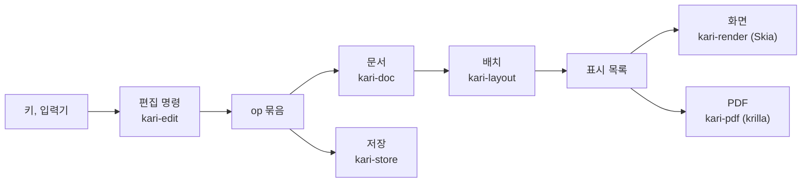
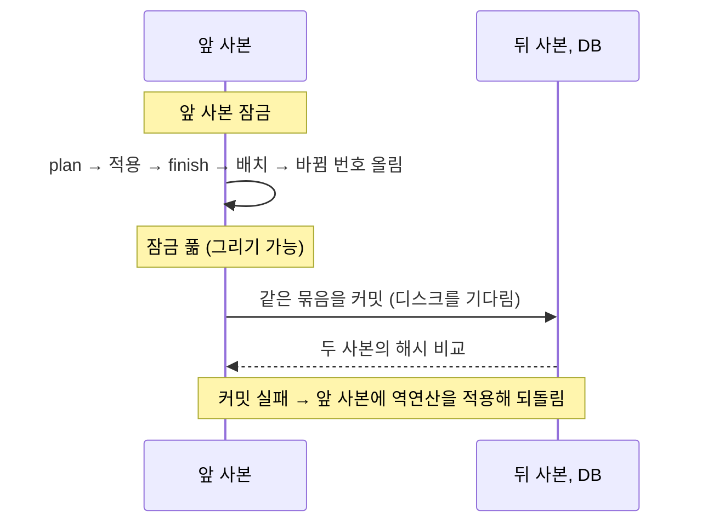
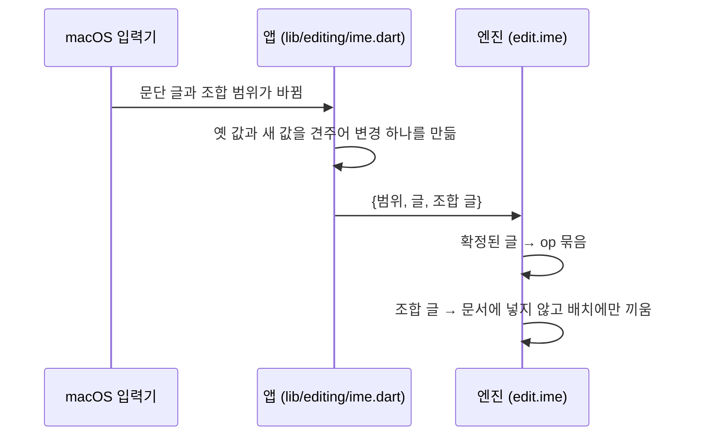

# 배치, 편집, 그리기, 내보내기

키 하나가 화면과 PDF에 이르는 길이다. 문서 자료의 모양은 [document-model.md](document-model.md)에 있다.

**표시 목록**: 배치가 내는 그릴 것의 목록. 쪽마다 글리프 묶음, 밑줄·취소선, 형광펜, 표의 선과 바탕, 문단의 테두리와 바탕, 그림, 링크 영역이 pt 좌표로 들어 있다. 화면과 PDF가 같은 표시 목록을 쓴다. 표에서 선이 없는 변의 자리(눈금선)는 따로 담고, 화면이 눈금선 보기일 때만 그린다. 눈금선은 PDF와 배치 해시에 들어가지 않는다.

## 배치 (`app/engine/layout`)

### 글꼴

- 앱이 `kari_font_add`로 넘긴 글꼴만 쓴다(`app/assets/fonts/Pretendard-Regular.ttf`, `Pretendard-Bold.ttf`). 운영체제의 글꼴과 대체 글꼴은 쓰지 않는다.
- 단위는 pt(1/72인치)이고 힌팅을 하지 않는다. 화면 배율과 상관없이 같은 배치가 나온다.
- 글꼴에 없는 글자는 빈 네모로 놓는다: 폭 1em, 높이 0.7em, 선 0.5pt, 글자색. 문서 상태의 `missing`에 그 수가 들어가고, 앱이 상태 줄에 "글꼴에 없는 글자 N자(네모로 보임)"로 보인다. PDF에도 같은 네모가 들어간다.

### 줄 나눔

- Parley로 글의 모양을 잡는다.
- 어절 규칙: 공백 뒤에서만 줄을 바꾼다. 한글 어절이 가운데에서 끊기지 않는다.
- 탭: 문단의 탭 정지(왼쪽, 가운데, 오른쪽, 소수점 맞춤, 채움선 없음·점·대시·선) 가운데 지금 자리보다 큰 가장 가까운 것으로 간다. 없으면 36pt마다 있는 기본 정지(왼쪽 맞춤).
- 목록 표지: 글머리표는 수준에 따라 `•` `◦` `▪`. 번호는 수준 0~8에 `1.` `가.` `1)` `가)` `(1)` `(가)` `①` `㉮` `1.`.
- 링크 글은 run에 색이 없으면 링크 색으로 그린다.
- 줄 간격: `AUTO`는 글자 크기의 1.2배, `PERCENT`는 글자 크기 × 값/100, `PT`는 고정 높이.
- 위·아래 첨자(`vertical`): 글자 크기의 0.65배로 모양을 잡고, 기준선을 원래 크기의 0.33배 위(위 첨자)나 0.15배 아래(아래 첨자)로 옮겨 그린다. 줄 상자는 원래 크기의 것 그대로다. 고정 pt 줄 간격의 문단에서는 첨자 조각의 줄 높이도 0.65배로 줄여 원래 줄 상자 안에 넣는다. 밑줄과 취소선은 옮긴 기준선에 긋는다.
- 자간(`spacing`, pt): 글자 묶음마다 뒤에 더한다. 줄의 마지막 묶음 뒤에는 더하지 않는다: 줄마다 그 줄 마지막 묶음의 자간만큼 폭을 넓혀 나누고 맞춰, 오른쪽·가운데·양쪽 맞춤에서 마지막 글자의 잉크가 본문 끝에 닿고 줄 끝의 커서가 잉크 끝에 선다.
- 형광펜(`bg`): 그 조각의 폭과 줄 높이만큼의 사각형을 글자 아래에 그린다.
- 그림 개체가 줄 폭이나 본문 높이보다 크면 비율을 지켜 줄여 놓는다. 자료의 크기는 그대로다.

### 배치 캐시

고친 뒤에는 바뀐 것만 다시 만들고, 쪽 나눔은 처음부터 한다(`app/engine/layout/src/layouter.rs`).

| 다시 쓰는 것 | 같아야 하는 값 |
|---|---|
| 문단의 줄 나눔 | 문단의 rev, 스타일 해시, 본문 폭과 높이, 조합 글. 스타일 해시는 바탕 스타일까지 푼 값의 해시이고 스타일 표가 바뀔 때만 다시 구한다. 그래서 스타일을 고치면 푼 값이 바뀐 스타일을 쓰는 문단만 다시 줄을 나눈다 |
| 표의 정해 둔 변 | 표·행·셀의 세대와 열 폭(글만 바뀌면 그대로) |
| 쪽의 표시 목록 | 쪽 크기와 여백, 머리글 설정과 전체 쪽 수, 쪽에 놓인 것마다 (세대, 줄, y) |

### 문단의 테두리와 바탕

`pf.border`의 변(위, 아래, 왼쪽, 오른쪽)마다 `{weight, color, gap}`, `pf.shade`가 바탕색이다(`app/engine/layout/src/frame.rs`). 굵기는 0~6pt(0이면 없음), 글과의 거리 `gap`은 0~31pt로 자른다.

- 상자는 문단의 글 상자(왼쪽·오른쪽 들여쓰기를 뺀 폭)다. 목록 표지와 내어쓴 첫 줄도 상자 안에 든다.
- 위 선은 첫 줄 위에, 아래 선은 마지막 줄 아래에 `gap`만큼 띄워 긋는다. 선과 `gap`은 문단의 첫 줄, 마지막 줄 높이에 더해 쪽 나눔이 함께 옮긴다.
- 바탕은 선 안쪽(왼쪽·오른쪽 선과 글 사이의 `gap`까지)을 칠한다. 위·아래 선은 왼쪽·오른쪽 선의 바깥 끝까지 그어 모서리를 메운다.
- 같은 그릇(본문이나 같은 셀)에서 바로 이웃한 두 문단의 지정(네 변, 바탕, 들여쓰기)이 같으면 한 상자로 잇는다. 사이에 위·아래 선을 긋지 않고 그 높이도 더하지 않는다. 사이에 표가 있으면 잇지 않는다.
- 문단이 쪽에서 나뉘면 잘린 자리에는 위·아래 선을 긋지 않는다.

### 쪽 나눔

앞으로만 진행하고 지난 쪽으로 돌아가지 않는다. 쪽마다 최소 한 줄은 놓는다.

| 규칙 | 내용 |
|---|---|
| 문단 앞에서 쪽 나누기(`breakBefore`) | 쪽이 비어 있지 않으면 새 쪽에서 시작한다 |
| 문단을 나누지 않기(`keepLines`) | 문단 전체가 한 쪽 높이 이하이고 지금 쪽에 다 들어가지 않으면 새 쪽에서 시작한다 |
| 외톨이 줄 방지 | 문단의 마지막 한 줄만 다음 쪽으로 가거나 첫 한 줄만 쪽 아래에 남지 않게 한다 |
| 다음 문단과 함께(`keepNext`) | 이 문단이 지금 쪽에 다 들어가는데 다음 블록이 외톨이 줄 규칙을 적용한 뒤 이 쪽에 한 줄도 놓이지 않으면 함께 다음 쪽으로 넘긴다(다음 블록이 표면 머리 행들과 첫 본문 행이 들어가야 한다). `제목 1`, `제목 2` 스타일은 기본으로 켜져 있다 |
| 표 | 행은 나누지 않는다. 머리 행과 첫 본문 행이 들어가지 않으면 표 전체를 다음 쪽에서 시작한다. 넘어간 쪽마다 맨 위에 머리 행을 다시 놓는다 |
| 합친 셀 | 여러 행에 걸친 셀로 이어진 행들은 함께 움직인다 |
| 한 쪽보다 높은 것 | 빈 쪽에 놓고 넘치게 둔다 |

### 표

- 열 폭은 `cols`(pt). 합이 본문 폭을 넘으면 같은 비율로 줄여 놓는다(자료는 그대로).
- 표 맞춤(`align`): 본문 폭에서 표가 차지하고 남는 폭을 왼쪽, 가운데, 오른쪽에 둔다.
- 행 높이 = 그 행에서 끝나는 셀들의 (내용 높이 + 위아래 안쪽 여백) 가운데 가장 큰 값과 `row.h` 가운데 큰 값.
- 셀은 세로 맞춤(위, 가운데, 아래), 바탕색, 안쪽 여백(`pad`, 기본 위 4·오른쪽 6·아래 4·왼쪽 6pt)을 가진다.
- 셀 수가 모자라거나 합친 영역이 겹친 자료를 읽어도 멈추지 않고 할 수 있는 만큼 놓는다.

변의 선은 `app/engine/layout/src/table.rs`가 정한다.

| 규칙 | 내용 |
|---|---|
| 기본 선 | 표의 `border`(기본 0.5pt, `#8C8C8C`). 굵기 0이면 그리지 않는다 |
| 칸의 지정 | 셀의 `border`가 변(위, 오른쪽, 아래, 왼쪽)마다 `{weight, color}`를 정한다. 굵기 0은 "선 없음"이다 |
| 나눠 가진 변 | 둘 다 정하지 않았으면 기본 선, 하나만 정했으면 그것, 둘이 다르면 굵은 쪽, 굵기가 같으면 위·왼쪽 칸의 것 |
| 모서리 | 선 끝을 만나는 선 가운데 가장 굵은 것의 절반만큼 늘여 모서리를 채운다 |
| 행 묶음 사이 | 같은 쪽에서 맞닿은 두 행 묶음 사이의 가로 변은 아래 묶음이 그린다. 넘어간 쪽에서 다시 그린 머리 행과 그 아래 행 사이의 변도 같은 규칙으로 정한다 |
| 눈금선 | 굵기 0인 변은 선 대신 눈금선 자리로 낸다 |

### 머리글과 바닥글

- 왼쪽·가운데·오른쪽 세 칸의 글이다. `{쪽}`은 쪽 번호, `{전체}`는 전체 쪽 수로 바뀐다.
- 본문을 다 놓은 뒤 얹으므로 쪽 나눔에 영향을 주지 않는다.
- `hfSkipFirst`가 켜져 있으면 첫 쪽에는 넣지 않는다.

### 위치 질의

커서 자리, 누른 자리, 선택 영역, 줄 이동을 답한다. 줄마다 글자 묶음 경계의 (바이트, x) 표 하나로 커서 자리와 누른 자리를 함께 계산해, 누른 자리의 커서가 늘 그 자리로 돌아온다. 커서는 글자 묶음(그림 글자 등) 가운데에 서지 않는다.

## 편집 (`app/engine/edit`)

`kari-edit`은 문서를 직접 바꾸지 않는다. 선택과 명령을 받아 op 묶음과 그 뒤의 선택을 낸다.

1. `plan`: 명령 뒤의 상태를 계산한다. 편집기의 상태는 바꾸지 않는다.
2. 문서에 묶음을 적용한다.
3. 성공하면 `finish`, 실패하면 `reject`.

### 명령

`edit.cmd`의 `cmd.k` 값이다(`app/engine/ffi/src/cmd.rs`).

| 갈래 | 명령 |
|---|---|
| 글 | `insert`, `paste`, `enter`, `softBreak`, `backspace`, `delete`, `backspaceWord`, `deleteWord`, `backspaceLine`, `cut`, `selectAll`, `insertDate`, `setCase`(`upper`, `lower`, `title`) |
| 이동과 선택 | `move`(`left`, `right`, `wordLeft`, `wordRight`, `lineStart`, `lineEnd`, `up`, `down`, `docStart`, `docEnd`, `pageUp`, `pageDown`), `click`, `drag`, `goTo`(`para` 또는 `page`) |
| 입력기 | `compose`, `commitCompose` |
| 글자 모양 | `toggle`(`bold`, `italic`, `underline`, `strike`), `setChar`(`size`, `sizeStep`, `color`, `bg`, `vertical`, `spacing`, `font`), `clearChar` |
| 문단 | `setStyle`, `setPara`(`align`, `indentLeft`, `indentRight`, `indentFirst`, `spaceBefore`, `spaceAfter`, `line`, `tabs`, `keepNext`, `keepLines`, `breakBefore`, `border`, `shade`), `clearPara`, `pageBreak`, `rule` |
| 스타일 | `styleSet`, `styleFromSelection`, `styleNew`, `styleDelete`, `styleReset` |
| 목록 | `toggleList`(`bullet`, `ordered`), `indent`, `tab`, `setList`(시작 번호) |
| 링크 | `setLink`, `insertLink` |
| 쪽 | `setPage`(용지, 방향, 사용자 지정 크기, 여백), `setHeaderFooter` |
| 표 | `insertTable`, `tableRow`, `tableCol`, `tableDeleteRow`, `tableDeleteCol`, `tableDelete`, `tableMerge`, `tableSplit`, `setTable`(`headerRows`, `cols`, `align`, `border`), `setRow`(`h`), `tableRowsEven`, `setCell`(`fill`, `alignV`, `pad`, `borders`), `clearCell`, `tableProps` |
| 그림 | `setImage`(크기, 대체 글). 넣기는 `edit.insertImage` |
| 찾기 | `findNext`, `replaceOne`, `replaceAll`(`case`, `word`) |

- `tab`: 목록 문단이면 들여쓰기·내어쓰기, 셀 안이면 다음 셀(마지막 셀이면 아래에 행을 넣고 그 첫 셀), 그 밖에는 탭 문자.
- 글자 모양 명령은 선택이 있으면 그 글의 run `s`를, 커서뿐이면 다음에 칠 글자에 줄 모양을 바꾼다. 문단 스타일과 같아지는 키는 run에 남기지 않는다.
- `sizeStep`(1, −1): 글자 크기 단계표(8, 9, 10, 10.5, 11, 12, 14, 16, 18, 20, 24, 28, 32, 36, 48, 72pt)의 다음, 앞 값. 조각마다 자기 크기에서 한 단계 간다. `spacing`은 −2~10pt로 자른다.
- `clearChar`: run의 직접 글자 모양을 걷는다(`keys`를 주면 그 키만). 링크는 `s` 밖에 있어 남는다. `keys` 없이 문단 전체들을 골랐으면 `clearPara`도 한다.
- `clearPara`: 고른 문단의 직접 문단 모양(`pf`)에서 목록과 탭 정지만 남기고 걷는다.
- `pageBreak`: 커서 자리에서 문단을 나누고 새 문단에 `breakBefore`를 켠다. 그 문단의 맨 앞에서 `backspace`는 먼저 `breakBefore`만 끈다. 표 안에서는 거절한다.
- `setList`: 고른 범위의 첫 번호 목록 문단의 `list.start`를 정한다. 그 문단부터 그 값으로 다시 센다.
- `rule`(가로줄): 커서 문단 바로 뒤에 아래 선(0.5pt, 본문 스타일의 글자색, `gap` 1pt)만 가진 빈 문단을 넣는다. 커서는 그대로다.
- `setCase`: 고른 글의 라틴 문자만 바꾸고 run은 그대로 둔다. 바꾸면 바이트 길이가 달라지는 글자는 그대로 둔다.
- `goTo`: 문단(`para`)의 처음이나 쪽(`page`, 1부터. 마지막 쪽보다 크면 마지막 쪽)의 첫 줄로 커서를 옮긴다.
- `paste`에 `plain: true`를 주면 앱 안의 조각을 쓰지 않고 글만 붙인다.
- 자동 서식은 앱이 보내는 명령이 아니다. 공백으로 끝나는 입력이나 `enter`가 문서를 바꿨고 자동 서식이 켜져 있으면(앱 설정 `edit.autoFormat`, 편집 세션을 열 때 읽는다) 엔진이 자동 서식(`app/engine/edit/src/auto.rs`)을 따로 된 묶음으로 잇는다. 그래서 되돌리기 한 번이면 자동 서식만 걷힌다. 문단 맨 앞의 `-`·`*`(글머리표), `N.`·`N)`(번호, 1~9999), `#`·`##`·`###`(제목 1~3)과 공백이나 Enter 바로 앞의 주소(`http://`, `https://`, `www.`, 전자우편)를 본다. 조합 중이거나 선택이 있으면 하지 않는다.
- 앱의 ⌘., ⌘,(`toggleVertical`)는 엔진 명령이 아니다. 앱이 지금 상태의 `char.vertical`을 보고 `setChar`의 `vertical`을 켜거나(`super`, `sub`) 끈다(`none`).
- 이어 친 글은 1.5초 안이면 되돌리기 한 단위로 묶는다.
- 받을 수 없는 명령은 문서를 바꾸지 않고 거절 사유를 돌려준다: 글이 길이 제한(run 100,000자, run 10,000개)을 넘음, 값이 틀림, 링크 주소가 틀림(`http`, `https`, `mailto`, `tel`만, 2,000자까지), 표 안에 표, 표 안의 쪽 나누기, 여백을 뺀 본문이 가로나 세로 72pt 미만.
- `setPage`에 `w`, `h`를 주면 사용자 지정 용지(`preset: CUSTOM`)가 된다. 한 변은 50~2,000pt로 자르고, 방향은 두 변에서 정한다.

### 스타일

`app/engine/edit/src/style.rs`. 스타일은 루트의 `styles` 하나에 있다.

- 스타일 명령은 그 표 전체를 `set` 하나로 바꾼다(되돌리기 한 단위). 기본값과 같아지면 저장된 값을 지운다.
- 문단에 처음 쓰는 기본 스타일이 저장된 표에 없으면 함께 저장한다. 기본값이 바뀌어도 문서가 그대로 보이게 하려는 것이다.
- `styleFromSelection`: 고른 첫 문단에 직접 준 모양을 스타일에 합치고, 그 문단에 그 스타일을 쓰고, 직접 모양을 걷는다.
- `styleNew`: `from`이 `selection`이면 지금 문단의 스타일을 바탕으로 그 문단의 직접 모양을 담아 만들고 그 문단에 쓴다. 스타일 id면 그것을 바탕으로 만든다. 새 id는 `u` + 번호다.
- `styleDelete`: 사용자 스타일만 지운다. 그 스타일을 쓰던 문단과 그것을 바탕으로 한 스타일은 지운 스타일의 바탕(없으면 `body`)으로 옮기고, 다음 문단의 스타일로 가리키던 것은 지운다.
- `styleReset`: 기본 스타일을 스키마 기본값으로 되돌린다.
- 이름은 1~40자이고 겹치지 않는다. 스타일은 100개까지다. 없는 스타일을 가리키거나 바탕 스타일이 돌고 도는 것은 거절한다.
- `edit.style`은 스타일 하나의 자세한 값(스타일 자신의 값과 바탕 스타일에서 오는 값)을 돌려준다(`app/engine/ffi/src/styles.rs`).
- 새 문서의 기본: `docs.create`에 `styles`를 주면 새 문서가 그 표로 시작한다. 앱은 그 표를 설정 `doc.styles`에, 쓸지를 `doc.newStyles`(`app`, `saved`)에 둔다.

### 표 모양

`app/engine/edit/src/table_look.rs`. 고른 칸 범위는 선택이 같은 표의 칸들에 걸치면 그 사각 범위, 커서뿐이면 그 칸이다.

- `setCell`의 `borders {which, weight, color}`: `which`는 `all`, `outer`, `inner`, `innerH`, `innerV`, `top`, `bottom`, `left`, `right`, `none`. 범위 안 칸의 해당 변에 같은 값을 적는다. 범위의 바깥 변이면 맞은편 칸(그 변이 범위의 변 안에 다 드는 칸)에도 같은 값을 적어 배치의 규칙에서 부딪히지 않게 한다. `none`은 굵기 0으로 적는다.
- `clearCell {borders: true}`: 범위 칸들의 변 지정과, 바깥 변이면 맞은편 칸의 그 변 지정을 지운다(표의 기본 선을 따른다).
- 행·열을 넣으면 새 칸은 옆 칸의 변 지정 가운데 새 자리에도 맞는 것을 물려받는다. 합치면 변마다 그 변에 놓인 칸들의 지정 가운데 가장 굵은 것(같으면 먼저 것)을, 되나누면 영역의 바깥 변에 놓인 칸만 그 변의 지정을 가진다.
- 선 굵기는 0~6pt, 행 높이는 0~1,000pt, 안쪽 여백은 0~100pt로 자른다. 열 폭은 12pt 이상이고, 합이 본문 폭을 넘으면 같은 비율로 줄여 적는다. NaN, 열 수가 다른 `cols`, 없는 행, 행 수 이상의 머리 행 수는 거절한다.
- `tableRowsEven`(`rowsEven`): 고른 행(한 행이면 표의 모든 행)의 `h`를 그 행들의 지금 높이 가운데 가장 큰 값으로 정한다.
- `tableProps`: 표 속성 창의 적용 한 번. 고친 값만 담아 한 묶음으로 바꾼다.
- `edit.tableEdge {x, y}`: 그 점에서 4 논리 화소 안의 표 경계(열이나 행, 번호, 열 폭들, 그 행의 가장 작은 높이). 앱은 경계를 끌어 놓을 때 `setTable`의 `cols`나 `setRow`의 `h`를 보낸다(`app/lib/screens/table_props.dart`).
- `edit.guides {on}`: 눈금선 보기를 켜고 끈다. 보기만 바뀐다. 앱 설정 `view.tableGuides` 하나이고 문서마다 두지 않는다.

### 상태 보고

편집 호출(`edit.*`)은 문서 상태 JSON을 돌려준다(`app/engine/ffi/src/state.rs`). 앱의 도구 줄, 창, 상태 줄이 이 값을 보인다.

| 묶음 | 값 |
|---|---|
| 보기 | `zoom`(실제 배율), `contentWidth`, `contentHeight`, `pages`, `caret`(내용 기준 논리 화소) |
| 글자(`char`) | `size`, `color`, `bg`, `vertical`, `spacing`. 선택이 있으면 그 안의 글, 커서뿐이면 다음에 칠 글자의 모양 |
| 문단(`para`) | `indentLeft`, `indentRight`, `indentFirst`, `spaceBefore`, `spaceAfter`, `line {unit, value}`, `keepNext`, `keepLines`, `breakBefore`, `border`, `shade`. 선택에 걸친 문단들의 값 |
| 스타일 | `style`(커서 문단의 스타일), `styles`(스타일 목록), `styleDirty`(커서 문단에 직접 준 모양이 있는지) |
| 표(`table`) | 커서가 표 안일 때: 행·열 수, 열 폭, 머리 행 수, 맞춤, 기본 선, 커서 칸이 합친 칸인지, 여러 칸을 골랐는지, 커서 칸의 바탕과 세로 맞춤, 고른 칸 범위(`range`: 범위, 고른 열의 폭, 고른 행의 `h`, 칸의 여백·바탕·세로 맞춤) |
| 그 밖 | `selection`, `marks`(굵게, 기울임, 밑줄, 취소선), `align`, `list {kind, level, start}`, `link`, `find`, `tabs`, `bodyWidth`, `page`, `header`, `footer`, `hfSkipFirst`, `image`, `missing`, `ime`, `savedAt`, `canUndo`, `canRedo` |

- 글자와 문단의 값은 섞였으면 `null`이다. 화면은 섞인 칸을 비워 둔다.
- 값은 스타일을 푼 결과다(스타일에서 온 값과 직접 준 값을 가리지 않는다). 수는 소수 둘째 자리까지.

### 앞 사본과 뒤 사본

편집 세션은 문서마다 사본 둘을 둔다(`app/engine/ffi/src/session.rs`, `edit.rs`).

| 사본 | 쓰임 | 잠금 |
|---|---|---|
| 앞 사본 | 배치기, 편집기, 선택과 함께 화면에 그리는 상태 | 앞 사본 잠금 |
| 뒤 사본 | 저장소에 커밋하는 상태 | 명령 잠금 |

키를 친 결과는 디스크를 기다리지 않고 화면에 나온다. 커밋이 끝날 때까지 그리기가 막히지 않는다. 되돌리기와 버전으로 돌아가기는 뒤 사본에서 먼저 하고, 적용된 op를 앞 사본에 반영한다.

### 한글 입력

- 입력기에 보여 주는 글은 커서가 있는 문단 하나다. 위치는 UTF-16 단위다.
- 조합 중인 글은 문서에 넣지 않는다. 배치가 그 문단의 자리에 끼워 그리고, 밑줄을 긋는다. 확정된 글만 op가 된다.
- 바로 앞 입력이 넣은 글의 끝을 고치는 변경(조합의 다음 단계)은 같은 되돌리기 단위로 잇는다.
- 조합 중에는 지우기, 방향키, Enter를 입력기에 맡긴다. 입력기가 조합을 끝내고 넘긴 키는 macOS 선택자(`deleteBackward:` 등)로 와서 편집 명령이 된다(`lib/editing/keys.dart`).

### 복사와 붙여넣기

- 시스템 클립보드에는 글만 나간다. 표가 낀 선택은 행을 줄 바꿈, 칸을 탭으로 나눈 글이 나간다.
- 엔진은 앱 안에서 마지막으로 복사한 조각(글자 모양, 링크, 그림, 문단 모양, 표)을 기억한다(`app/engine/edit/src/clip.rs`). 붙여넣는 글이 그 조각의 글과 같으면 조각을 넣는다. 앱 안에서 잘라내고 붙여도 모양과 그림이 남는다.
- 표 조각은 표 전체나 칸 범위다. 본문에 붙이면 새 표가 되고, 칸 범위를 표 안에 붙이면 커서 칸(칸을 골랐으면 범위의 왼쪽 위)부터 칸의 내용을 덮어쓴다. 표가 모자라면 들어가는 만큼이고, 합친 칸에 가려진 자리에 오는 칸은 건너뛴다. 표 전체나 문단이 섞인 조각을 표 안에 붙이면 표 안의 표로 거절한다.
- 조각은 문단이 쓰는 스타일을 바탕 스타일까지 펼쳐 함께 가진다. 다른 문서에 붙이면 같은 id에 같은 이름이면 그대로, 같은 이름의 스타일이 있으면 그것을, 없으면 새 id로 들여온다(100개가 차면 본문).

### 그림 넣기

엔진이 파일을 직접 읽어 검사한다(`edit.insertImage`, `app/engine/render/src/image.rs`).

| 검사와 정리 | 값 |
|---|---|
| 파일 크기 | 20MB까지 |
| 형식 | PNG, JPEG로 실제로 풀리는 것, 1px 이상 |
| 방향 | JPEG의 방향 정보대로 똑바로 돌려 다시 담는다 |
| 크기 | 긴 변이 4,000px를 넘으면 4,000px로 줄여 같은 형식으로 다시 담는다(JPEG 품질 90) |
| 놓는 크기 | 1px = 0.75pt. 본문 상자보다 크면 비율을 지켜 줄인다 |

정리한 바이트는 에셋으로 저장하고 커서 자리에 그림 개체 run을 넣는다.

### 찾기와 글자 수

- 찾기는 본문과 셀의 문단을 문서 순서(행 → 셀 → 문단)로 훑는다. 대소문자 구분과 단어 단위(`word`: 앞뒤가 글자·숫자인 일치는 뺀다)를 고를 수 있다. 글자 묶음을 가르는 일치는 세지 않는다.
- 글자 수(`edit.count`)는 쪽 수, 글자 수, 공백 제외 글자 수, 낱말 수와 선택 안의 같은 수를 낸다. 글자는 사람이 보는 글자(확장 자소 묶음) 단위로 센다. 낱말은 공백(줄바꿈, 탭 포함)과 개체로 나눈 덩어리이고, 문단 경계에서도 나뉜다.

### 개요

`edit.outline`은 제목 스타일(`title`, `subtitle`, `h1`~`h6`) 문단을 문서 순서(본문과 셀)로 돌려준다: 문단 id, 단계(`title` 0, `subtitle`과 `h1` 1, `h2`~`h6` 2~6), 글(줄바꿈·탭을 공백으로, 개체를 빼고 앞 120자), 첫 줄의 쪽(1부터), 커서 문단이 속한 제목인지(`app/engine/edit/src/outline.rs`).

## 그리기 (`app/engine/render`)

- Skia의 CPU 래스터로 화소 버퍼(BGRA, 미리 곱한 알파)에 바로 그린다.
- 순서: 바탕색 → 보이는 쪽마다 그림자와 흰 종이 → 선택 영역 → 표시 목록 → 눈금선(보기가 켜졌을 때. 화면 화소 한 줄 굵기의 점선) → 조합 밑줄. 커서는 앱이 위에 올린다.
- 그림은 처음 그릴 때 풀어 화면 화소 크기로 맞춰 기억한다. 기억의 합계가 64MB를 넘으면 오래 안 쓴 것부터 버린다. 읽지 못한 그림은 회색 상자로 그린다.
- 텍스처로 올리는 길 → [overview.md](overview.md#화면-그리기).

### 보기 배율과 좌표

`app/engine/render/src/geo.rs`의 `Geo`가 쪽을 보이는 영역에 놓는다. 단위는 논리 화소이고, 좌표는 스크롤을 빼지 않은 내용 기준이다.

| 값 | 정하는 법 |
|---|---|
| `k`(1pt의 논리 화소) | 4/3 × 배율. 100%에서 1pt는 96dpi 기준의 논리 화소다 |
| 배율 | 0이면 쪽 너비에 맞춤(양옆에 24를 남기는 배율). 어느 쪽이든 50~300%로 자른다 |
| 쪽의 놓임 | 위 여백 24, 쪽 사이 24, 아래 여백 24. 쪽은 가로 가운데 |
| 내용 너비 | 쪽 너비 + 48과 보이는 영역 너비 가운데 큰 값. 영역보다 넓으면 가로로 스크롤한다 |
| 쪽 사이의 점 | 틈의 가운데에서 위아래 쪽으로 나눈다 |

- `edit.zoom {zoom, x?, y?}`: 보기만 바꾸고 문서와 배치는 그대로다. `x`, `y`(옛 배율의 내용 좌표)를 주면 그 점이 새 배율에서 놓이는 자리를 `kept`로 돌려준다(같은 쪽의 같은 pt 점).
- 앱(`app/lib/screens/paper.dart`)은 화면 가운데 점을 넘겨 받은 자리로 스크롤해 보던 곳을 지킨다. 쪽 너비에 맞춤과 문서를 처음 열 때는 보이는 영역의 맨 위를 지킨다.
- 트랙패드로 벌리는 동안 앱은 그린 그림을 늘려 보이고, 손을 떼면 1% 단위로 맞춘 배율을 엔진에 넘겨 다시 그린다.
- 가로 스크롤이 있으면 `kari_edit_render_at`의 `scroll_x`로 그린다. 배율은 앱 설정 `view.zoom` 하나이고 문서마다 두지 않는다.

### 명령 뒤 커서 따라가기

`app/lib/screens/paper.dart`. 편집 세션은 편집·이동 명령(글 넣기, 이동, 붙여넣기, 되돌리기, 서식 바꾸기 등)이 끝날 때마다 `commands`를 올린다. 실패한 명령도 올린다. 종이 영역은 이 값이 바뀐 다음 프레임에 커서가 보이는 영역에서 24 논리 화소 안쪽에 있도록 세로·가로로 스크롤한다.

- 커서가 움직이지 않은 명령(글자 모양 바꾸기 등)도 따라간다. 커서가 화면 밖에 있으면 그 자리로 간다.
- 스크롤, 창 크기, 찾기 표시, 배율 같은 보기 갱신은 `commands`를 올리지 않아 화면을 커서로 끌고 가지 않는다.
- 배율을 넘기는 동안 끝난 명령은 넘긴 뒤에 따라간다.

## PDF (`app/engine/pdf`)

- 화면과 같은 표시 목록을 krilla로 PDF 바이트로 옮긴다. 글리프 위치는 표시 목록의 값 그대로다.
- 글리프 묶음마다 원문 글을 붙인다. PDF에서 뽑은 글이 원문과 같은 순서로 나온다.
- 글꼴은 PDF 안에 넣는다. 링크는 링크 주석으로 넣는다.
- 문서 이름을 제목으로, 문서 언어(`lang`)를 넣는다. 만든 시각을 넣지 않아 같은 문서는 같은 바이트가 된다.
- 쪽 한 변은 3pt~14,400pt여야 한다.
- 읽지 못한 그림은 화면과 같은 회색 상자로 넣는다.

`doc.exportPdf`는 명령 잠금을 문서를 복사하는 동안만 잡는다. 배치, PDF 만들기, 파일 쓰기는 잠금 밖에서 한다. 파일은 임시 이름으로 다 쓴 뒤 이름을 바꾼다. 샌드박스 때문에 같은 폴더에 임시 파일을 만들 수 없으면 앱의 임시 폴더에서 옮기고, 그것도 안 되면 고른 경로에 바로 쓴다. 어느 길이든 쓰다 만 파일을 남기지 않는다.

## Word 문서와 텍스트 (`app/engine/docx`)

- 배치가 아니라 문서 모델에서 WordprocessingML을 직접 쓴다. 줄과 쪽은 여는 프로그램이 다시 나눈다. 글꼴은 이름만 적고 담지 않는다.
- 같은 문서면 같은 바이트다. 문서 속성의 날짜는 문서를 마지막으로 고친 때다.
- 표의 변은 배치와 같은 규칙으로 칸마다 정한 선을 적는다. DOCX는 칸의 한 변에 선이 하나라, 합친 칸의 한 변을 맞은편 여러 칸이 나눠 가지면 가장 굵은 구간의 선을 적는다.
- 행은 쪽에서 나누지 않게(`cantSplit`), 머리 행은 쪽마다 반복하게(`tblHeader`) 적는다.
- 문단의 테두리는 `w:pBdr`에 네 변을 모두 적는다(굵기 `w:sz`는 8분의 1 pt, 글과의 거리 `w:space`는 정수 pt). 선이 없거나 굵기 0으로 끈 변은 `nil`이라 스타일의 선이 살아나지 않는다. 바탕은 `w:shd`의 `w:fill`이고, 투명한 바탕(스타일의 바탕을 끈 것)은 `auto`다.
- 이웃한 문단을 한 상자로 잇는 규칙이 다르다. 배치는 네 변, 바탕, 들여쓰기가 모두 같아야 잇고, 규격(ECMA-376 `w:pBdr`)은 테두리 지정이 같으면 잇는다. 그래서 테두리는 같고 바탕만 다른 이웃 문단은 Kari에서는 두 상자, DOCX에서는 한 상자다.
- 문서의 스타일 표에 없는 기본 스타일은 배치처럼 스키마의 기본값으로 채운다. 본문·제목·부제·제목 1~6은 Word의 기본 스타일(`Normal`, `Title`, `Subtitle`, `Heading1`~`Heading6`)로 적는다.
- 시험이 문서 스키마의 값 자리(`kari_doc::prop_paths`)마다 그 값만 다른 두 문서를 내보내, DOCX가 달라지거나 `lost`에 드는지 본다. 스키마에 새 값 자리가 생기면 이 시험이 실패한다.
- 옮기지 못했거나 비슷하게만 옮긴 것을 `lost`(사람이 읽는 한 줄씩)로 돌려준다: 읽지 못했거나 PNG·JPEG가 아닌 그림, 열 수 없는 주소의 링크, 반투명 색(흰 바탕에 섞은 색으로), 굵게·보통이 아닌 굵기, 변경 표시.
- 텍스트는 문단마다 한 줄, 목록 표지는 글로, 표는 행마다 한 줄(칸은 탭)이다. UTF-8, 줄 끝 `\n`.
- `doc.exportDocx`, `doc.exportTxt`는 `doc.exportPdf`와 같은 길로 잠금을 잡고 파일을 쓴다(`app/engine/ffi/src/docx.rs`).

## 더 읽을 것

- [overview.md](overview.md): 경계와 스레드
- [document-model.md](document-model.md): op와 저장
- [../guide/writing.md](../guide/writing.md): 쓰는 사람을 위한 기능과 단축키
- [../contributing/code-map.md](../contributing/code-map.md): 파일 지도
