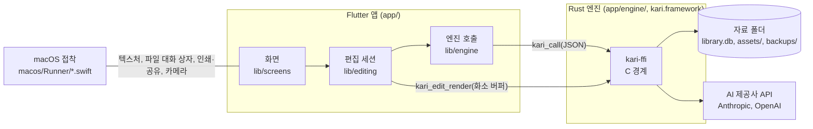
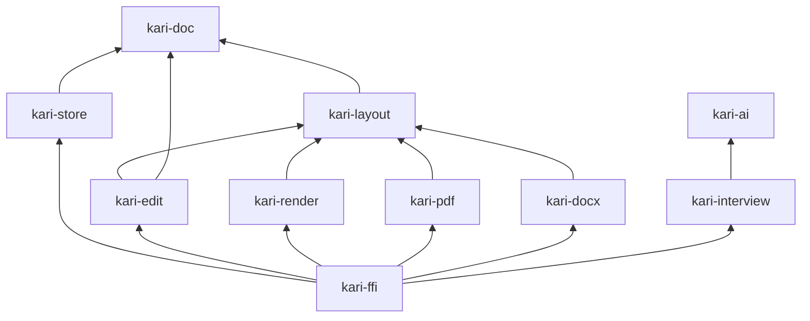
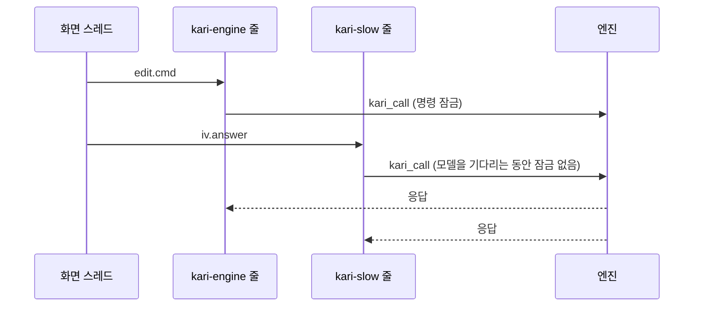

# 전체 구조

Kari는 Flutter 앱(화면)과 Rust 엔진(문서 규칙, 배치, 저장, 그리기, 내보내기, AI 호출, 면접)으로 나뉜다. 엔진은 동적 라이브러리로 앱 프로세스 안에 실린다.



## 엔진 크레이트

| 크레이트 | 폴더 | 하는 일 | 의존 |
|---|---|---|---|
| `kari-doc` | `app/engine/doc` | 문서 상태, op 검증·적용·역연산, 상태 해시, 스냅샷, 순서 키 | — |
| `kari-store` | `app/engine/store` | SQLite 라이브러리: 묶음 기록, 스냅샷, 버전, 되돌리기, 에셋, 설정, 백업 | doc |
| `kari-layout` | `app/engine/layout` | 줄 나눔, 쪽 나눔, 표와 변의 선, 문단 테두리, 표시 목록, 위치 질의 | doc |
| `kari-edit` | `app/engine/edit` | 선택과 편집 명령(스타일, 표 모양, 자동 서식 포함) → op 묶음 | doc, layout |
| `kari-render` | `app/engine/render` | 표시 목록을 Skia로 화소 버퍼에 그림, 그림 풀기, 보기 배율과 좌표 | layout |
| `kari-pdf` | `app/engine/pdf` | 표시 목록을 krilla로 PDF 바이트로 | doc, layout |
| `kari-docx` | `app/engine/docx` | 문서 모델을 Word 문서(DOCX)와 텍스트 바이트로 | doc, layout |
| `kari-ai` | `app/engine/ai` | 키 보관, 제공사(Anthropic, OpenAI) 어댑터 | — |
| `kari-interview` | `app/engine/interview` | 지식 팩, 면접 진행, 채점, 리포트, 홈 대시보드, 시선 기록의 구간 | ai |
| `kari-ffi` | `app/engine/ffi` | 앱과의 경계. 동적 라이브러리 `kari` | 위 전부 |



`kari-doc`, `kari-layout`, `kari-edit`, `kari-render`, `kari-pdf`, `kari-docx`는 파일, DB, 스레드를 모른다. 저장은 `kari-store`, 잠금과 스레드는 `kari-ffi`만 다룬다.

## 앱과 엔진의 경계

### C 함수

| 함수 | 부르는 곳 | 하는 일 | 명령 잠금 |
|---|---|---|---|
| `kari_call(request)` | 엔진 아이솔레이트 | JSON 요청 하나를 처리하고 JSON 응답을 돌려준다 | 잡음 (`ai.*`, `iv.*`, `doc.exportPdf`·`doc.exportDocx`·`doc.exportTxt`는 필요한 동안만) |
| `kari_free(response)` | 엔진 아이솔레이트 | `kari_call`의 응답 문자열을 푼다 | — |
| `kari_font_add(data, len)` | 앱 | 글꼴 파일 하나를 넘긴다. 엔진은 넘긴 글꼴로만 배치하고 그린다 | 안 잡음 |
| `kari_edit_gen(doc)` | 화면 스레드 | 문서의 바뀜 번호. 그릴 것이 달라지면 오른다 | 안 잡음 |
| `kari_edit_render(doc, pixels, …)` | 화면 스레드 | 문서를 화소 버퍼(BGRA, 미리 곱한 알파)에 그린다 | 안 잡음 |
| `kari_edit_render_at(doc, pixels, …, scroll_x, scroll_y)` | 화면 스레드 | 위와 같고 가로 스크롤을 더한다(배율을 키워 쪽이 영역보다 넓을 때) | 안 잡음 |

- **명령 잠금**: 엔진 상태(연 라이브러리와 메모리의 문서)를 지키는 잠금 하나. `kari_call` 하나를 처음부터 끝까지 감싼다.
- 엔진 안의 패닉은 경계를 넘지 않고 `{"err": {"code": "panic"}}` 응답이 된다.

### 요청과 응답

```json
요청  {"m": "edit.cmd", "a": {"id": 3, "cmd": {"k": "insert", "text": "안녕"}, "now": 1700000000000}}
응답  {"ok": …}  또는  {"err": {"code": "…", "message": "…", "detail": …}}
```

| 이름 앞머리 | 처리하는 파일 | 내용 |
|---|---|---|
| `lib.*`, `docs.*`, `doc.*`, `version.*`, `settings.*` | `app/engine/ffi/src/library.rs` | 라이브러리 열기·닫기·백업, 문서 목록, 커밋, 되돌리기, 기록, 버전, 설정 |
| `edit.*` | `app/engine/ffi/src/edit.rs` | 편집 세션, 편집 명령, 입력기, 찾기, 글자 수, 개요, 그림, 복사, 보기 배율, 표 경계, 눈금선, 스타일의 자세한 값(`styles.rs`) |
| `canvas.*` | `app/engine/ffi/src/canvas.rs` | 캔버스 문서의 편집 세션(`edit.*`과 같은 모양): `canvas.open`, `canvas.close`, `canvas.state`, `canvas.view`(보기 이동·확대·맞추기), `canvas.pointer`(누름·끌기·뗌·두 번 누름·지나감·취소), `canvas.cmd`(이름과 인자로 부르는 만들기·지우기·복제·방향키·속성·글 상자 편집 시작과 끝), `canvas.text`와 `canvas.ime`(글 상자 안 입력과 한글 조합), `canvas.copy` → [layout-and-editing.md](layout-and-editing.md#캔버스-고르기와-끌기) |
| `doc.exportPdf` | `app/engine/ffi/src/pdf.rs` | PDF 내보내기 |
| `doc.exportDocx`, `doc.exportTxt` | `app/engine/ffi/src/docx.rs` | Word 문서·텍스트 내보내기(옮기지 못한 것의 목록을 돌려준다) |
| `ai.*` | `app/engine/ffi/src/ai.rs` | 제공사, 키, 모델 목록 → [ai-connection.md](ai-connection.md) |
| `ai.tasks`, `ai.setTask`, `ai.resetTasks` | `app/engine/ffi/src/task.rs` | 일마다의 모델 |
| `iv.*` | `app/engine/ffi/src/iv.rs` | 면접 → [interview-engine.md](interview-engine.md) |
| `iv.dashboard` | `app/engine/ffi/src/dashboard.rs` | 홈 대시보드 |

Dart 쪽 함수는 `app/lib/engine/engine.dart`(`EngineApi`)에 이름마다 하나씩 있다. 시험은 같은 인터페이스의 가짜 엔진(`app/lib/engine/fake*.dart`)으로 돈다.

### 호출의 두 줄

`kari_call`은 디스크나 네트워크를 기다릴 수 있어 화면 스레드에서 부르지 않는다. `app/lib/engine/native.dart`의 `NativeEngine`이 요청을 두 줄로 나눈다. 줄마다 전용 아이솔레이트(Dart의 격리된 실행 단위) 하나가 받은 순서대로 실행한다.

| 줄 | 아이솔레이트 | 요청 |
|---|---|---|
| 느린 줄 | `kari-slow` | `ai.*`, `doc.exportPdf`, `doc.exportDocx`, `doc.exportTxt`, 아래 기본 줄의 것을 뺀 `iv.*` |
| 기본 줄 | `kari-engine` | 나머지 전부(편집 명령 포함)와 `iv.cancel`, `iv.pack`, `iv.postings`, `iv.session`, `iv.sessions`, `iv.report`, `iv.mastery`, `iv.preview`, `iv.gaze`, `iv.dashboard` |

느린 줄의 요청은 오래 걸리는 동안 명령 잠금을 쥐고 있지 않는다. 그래서 키 확인, PDF 내보내기, 면접 질문을 기다리는 동안에도 편집이 이어진다.



## 화면 그리기

편집 화면의 종이는 Flutter 위젯이 아니라 엔진이 그린 텍스처다.

1. Swift(`app/macos/Runner/MainFlutterWindow.swift`의 `TextureBridge`)가 `CVPixelBuffer` 세 장을 만들어 돌려 쓴다: Flutter가 가져간 것, 가장 최근에 다 그린 것, 지금 그리는 것.
2. 화면 스레드가 프레임마다 `kari_edit_gen`을 읽는다. 바뀜 번호나 세로·가로 스크롤이 달라졌을 때만 그린다(`app/lib/screens/paper.dart`).
3. 비어 있는 버퍼의 메모리에 `kari_edit_render_at`이 바로 그린다. 복사가 한 번 줄어든다.
4. 커서는 엔진이 그리지 않고 앱이 텍스처 위에 올린다.

그리기는 명령 잠금을 잡지 않고, 편집 세션의 앞 사본 잠금만 짧게 잡는다 → [layout-and-editing.md](layout-and-editing.md).

캔버스 문서도 같은 C 함수와 텍스처로 그린다. `kari_edit_gen`과 `kari_edit_render`는 문서 번호로 흐름 세션을 먼저, 없으면 캔버스 세션을 찾는다. 캔버스 세션은 보기(배율과 스크롤)를 스스로 가지므로 `scroll_x`, `scroll_y`는 쓰지 않고, `scale`은 레티나 배율(논리 화소당 화소)이다. 장면 위에 고른 상자와 손잡이도 엔진이 같은 버퍼에 덧그린다. 글 상자를 편집 중이면 선택 영역, 조합 밑줄, 커서도 덧그린다.

## 플랫폼 채널

| 채널 | 방법 | 하는 일 |
|---|---|---|
| `kari/texture` | `create`, `dispose` | 텍스처 만들기와 풀기 |
| `kari/files` | `savePath` | 저장 대화 상자(PDF, Word 문서, 텍스트. 고를 수 있는 형식은 기본 이름의 확장자를 따른다) |
| `kari/files` | `openPath` | 열기 대화 상자(PNG, JPEG) |
| `kari/files` | `openUrl` | 기본 브라우저로 주소 열기(`http`, `https`, `mailto`, `tel`만) |
| `kari/files` | `print {path, name}` | 앱이 만든 PDF를 인쇄 창(문서 창에 붙는 시트)에 넘긴다. 실제 크기, 자동 회전 없음, 용지는 첫 쪽의 크기와 방향. 창이 닫히면 답한다(`app/macos/Runner/Printing.swift`) |
| `kari/files` | `share {path, name, x, y, w, h}` | 앱이 만든 PDF를 공유 메뉴에 넘긴다. 메뉴는 주어진 사각형(`⋯` 단추) 자리에 뜬다. 고른 서비스가 끝나거나 고르지 않고 닫히면 답한다 |
| `kari/gaze` | `status`, `start`, `stop`, `openSettings`, `measure` | 시선 기록의 카메라: 권한 상태, 카메라 열기(처음이면 권한을 묻는다), 닫기, 시스템 설정의 카메라 권한 화면 열기, 얼굴 찾기 한 장의 처리 시간 재기(카메라를 켜지 않는다)(`app/macos/Runner/GazeMonitor.swift`) |
| `kari/gaze` | `sample {face, yaw, pitch}` | Swift → Dart. 한 장의 얼굴 유무와 각도 → [interview-engine.md](interview-engine.md#시선-기록) |

인쇄와 공유에 넘길 PDF는 `app/lib/screens/print_share.dart`의 `handOff`가 앱 임시 폴더의 `kari-share/` 아래에 `doc.exportPdf`로 만들고, 채널이 답하면 지운다.

## 권한

`app/macos/Runner/Release.entitlements`: `com.apple.security.app-sandbox`, `network.client`, `files.user-selected.read-write`, `device.camera`, `print`. 카메라를 묻는 글은 `Info.plist`의 `NSCameraUsageDescription`이다. 디버그 빌드(`DebugProfile.entitlements`)는 Flutter 개발 도구를 위해 `cs.allow-jit`, `network.server`를 더 가진다. 권한마다의 쓰임은 [../guide/privacy.md](../guide/privacy.md#앱의-권한)에 있다.

## 엔진을 앱에 싣기

`app/hook/build.dart`는 Dart 빌드 훅이다. `flutter run`, `flutter build`, `flutter test`가 모두 이 훅을 거친다.

1. `cargo build --profile dist -p kari-ffi --target aarch64-apple-darwin`을 부른다. `dist` 프로파일은 `release`에 전체 링크 최적화와 기호 지우기를 더한 것이다(`app/engine/Cargo.toml`).
2. 만든 `libkari.dylib`을 코드 에셋으로 넘긴다. Flutter가 이것을 `Kari.app/Contents/Frameworks/kari.framework`로 싣는다.
3. 엔진의 `Cargo.toml`, `Cargo.lock`, 각 크레이트가 바뀌면 훅이 다시 돈다.

앱은 arm64 전용이고 최소 macOS는 13이다.

## 자료 폴더

| 경로 | 내용 |
|---|---|
| `library.db` | SQLite 라이브러리 DB 하나. 문서, 기록, 스냅샷, 버전, 에셋 정보, 설정, 면접 기록 |
| `assets/<해시 앞 2자>/<해시>` | 그림 파일. 이름은 내용의 SHA-256 |
| `backups/library-<ms>.db` | 백업. 라이브러리를 열 때 마지막 백업에서 하루가 지났으면 만든다. 최근 10개를 남긴다 |

- 위치: `~/Library/Application Support/dev.clonamic.kari`. 앱은 샌드박스 안에서 돌아 실제로는 `~/Library/Containers/dev.clonamic.kari/` 아래에 놓인다.
- 환경 변수 `KARI_HOME`을 주면 그 폴더를 쓴다.
- 표와 규칙 → [document-model.md](document-model.md).

## 더 읽을 것

- [document-model.md](document-model.md): 노드, op, 되돌리기, 저장, 버전
- [layout-and-editing.md](layout-and-editing.md): 배치, 편집 명령, 한글 입력, 그리기, PDF
- [interview-engine.md](interview-engine.md), [knowledge-pack.md](knowledge-pack.md): 면접
- [ai-connection.md](ai-connection.md): 키, 제공사, 모델 호출
- [../contributing/code-map.md](../contributing/code-map.md): 파일 지도
