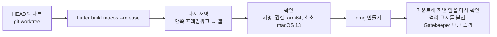

# 배포: dmg 만들기와 서명

`app/scripts/package_dmg.sh`가 릴리스 빌드부터 dmg 확인까지 한 번에 합니다. 결과는 `.cache/dist/Kari-<판>-beta-arm64.dmg`이고, 판은 `app/pubspec.yaml`의 `version`입니다.

```bash
app/scripts/package_dmg.sh                      # 지금 커밋(HEAD)의 사본에서 빌드부터
app/scripts/package_dmg.sh --src <폴더>          # 이미 있는 깨끗한 사본에서 빌드부터
app/scripts/package_dmg.sh --app <Kari.app>     # 이미 빌드한 앱으로(복사본에 서명한다)
app/scripts/package_dmg.sh --out <폴더>          # 결과를 둘 곳(기본 .cache/dist)
```

## 하는 일



| 단계 | 내용 |
|---|---|
| 빌드 | 커밋하지 않은 변경이 있는 사본에서는 멈춘다. 임시 작업 트리는 끝나면 지운다. 엔진은 `app/engine/rust-toolchain.toml`의 Rust 판으로 빌드된다 |
| 서명 | 프레임워크 안의 dylib → 각 프레임워크 → 앱 순서. 앱에는 `app/macos/Runner/Release.entitlements`의 권한만 준다(디버그용 `get-task-allow`는 빠진다) |
| 확인 | `codesign -v --deep --strict`, 권한이 `Release.entitlements`와 같은지, 모든 실행 파일이 arm64 전용인지, `LC_BUILD_VERSION`의 최소 macOS가 13.0 이하인지. 하나라도 어긋나면 멈춘다 |
| 고지 | `THIRD_PARTY_LICENSES.md`가 의존성과 맞는지(`app/scripts/third_party.py --check`). 맞지 않으면 멈춘다 |
| dmg | `Kari.app`, `Applications` 바로가기, `처음 여는 법.txt`(`Docs/guide/install.md`), `안내/`(`Docs/guide`의 쓰는 법, 면접, 개인정보), `라이선스/LICENSE.txt`, `라이선스/THIRD_PARTY_LICENSES.txt` |
| dmg 확인 | `hdiutil verify`, 내용물 확인, 꺼낸 앱의 서명 확인, `spctl -a -vv`, `syspolicy_check distribution` |

## 서명 신원

| 환경 변수 | 효과 |
|---|---|
| 없음 | 임시 서명(`-`). 받는 사람은 처음 한 번 열기를 허락한다([guide/install.md](../guide/install.md)) |
| `KARI_SIGN_IDENTITY` | 그 인증서(예: `Developer ID Application: 이름 (팀ID)`)로 서명한다. 강화된 런타임(`--options runtime`)과 시각 도장(`--timestamp`)을 붙이고 dmg에도 서명한다 |
| `KARI_NOTARY_PROFILE` | `KARI_SIGN_IDENTITY`와 함께 주면 dmg를 Apple 공증에 보내고(`xcrun notarytool submit --wait`) 결과를 dmg에 붙인다(`xcrun stapler staple`). 프로필은 `xcrun notarytool store-credentials <이름>`으로 만든다 |

## 릴리스

릴리스는 유지 관리자가 한다. 판 번호는 `0.MINOR.PATCH`이고(1.0.0은 유지 관리자가 정할 때까지 올리지 않는다) 태그는 `v<판>`이다. 큰 업데이트는 MINOR, 작은 이슈 수정은 PATCH를 올린다. 규칙은 [.github/CONTRIBUTING.md](../../.github/CONTRIBUTING.md)의 '판 번호'에 있다.

흐름은 릴리스 PR → `develop`에서 `main`으로 PR → 태그 → 초안 릴리스 → 게시이다.

1. 다음 판을 계산한다. 지난 `v*` 태그 이후 커밋 제목에 `feat`나 `!`가 있으면 MINOR, 아니면 PATCH를 올린 판이 나온다.
   ```bash
   git fetch origin --tags
   app/scripts/next_version.sh origin/develop        # 예: 0.2.0
   ```
2. `develop`에서 가지 `chore/release-<판>`을 따고 `app/pubspec.yaml`의 `version`을 그 판으로 바꾼다(빌드 번호 `+N`은 붙이지 않는다). 의존성이 바뀌었으면 `python3 app/scripts/third_party.py`로 고지를 다시 만든다.
3. 제목 `chore(release): <판>`으로 `develop`에 PR을 열어 스쿼시 병합한다. CI의 `version` 검사는 판 번호를 바꾸는 PR이 이 제목과 가지 이름이 아니면 거절한다.
4. `develop`에서 `main`으로 PR을 열어 **병합 커밋**으로 병합한다. `main`으로 가는 PR은 `develop`에서만 열 수 있고, CI의 `version` 검사가 `app/pubspec.yaml`의 판이 지난 태그보다 크고 규칙에 맞는지 본다.
5. `main`의 병합 커밋에 태그를 달아 민다.
   ```bash
   git fetch origin
   git tag v<판> origin/main
   git push origin v<판>
   ```
6. `.github/workflows/release.yml`이 먼저 태그를 검사한다(꼴 `v0.MINOR.PATCH` 또는 `v1.0.0`, 태그가 가리키는 커밋이 `origin/main`에 있는지, 태그의 판과 `app/pubspec.yaml`의 판이 같은지, 판이 지난 태그보다 크고 규칙과 맞는지). 하나라도 어긋나면 릴리스를 만들지 않고 실패한다. 통과하면 macOS 러너에서 `app/scripts/package_dmg.sh`로 dmg를 만들어 초안 릴리스에 `Kari-macos-arm64.dmg`와 `Kari-macos-arm64.dmg.sha256`을 올린다. 릴리스 글은 지난 `v*` 태그 이후 `main` 커밋 제목을 type으로 묶어(기능, 고침, 성능, 문서, 그 밖. `!`가 붙은 제목은 맨 위 '호환이 깨지는 변경'에도) `app/scripts/release_notes.sh`가 만든 목록에서 시작한다.
7. 맨 위에 이번 판의 요약과 처음 여는 법의 링크를 쓰고 게시한다. 바뀐 것의 기록은 릴리스 글이다.

태그를 밀기 전에 빌드와 dmg까지만 해 보려면 Actions의 `Release`를 손으로 돌린다(Run workflow). 릴리스는 만들지 않고 dmg와 sha256을 그 실행의 산출물로 남긴다.

README의 내려받기 링크 `releases/latest/download/Kari-macos-arm64.dmg`는 시험판(Pre-release)이 아닌 가장 최근 릴리스를 가리킨다.
