<h1 align="center">$\bf{\large{\color{#6580DD} Kari }}$</h1>

<p align="center">
  <a href="https://github.com/algocean1204/Kari-docs-helper-with-ai/releases/latest"></a>
  <a href="LICENSE"></a>
  
  <a href="https://github.com/algocean1204/Kari-docs-helper-with-ai/actions/workflows/ci.yml"></a>
</p>

<p align="center">
  <strong>이력서를 쓰고, 그 이력서와 채용공고로 기술 면접을 연습하는 맥 앱.</strong><br/>
  워드처럼 글이 흐르는 문서와 도형을 자유롭게 놓는 캔버스에 이력서를 쓰고, PDF와 Word로 내보냅니다.<br/>
  문서는 내 맥에만 있고, 면접 연습만 내가 고른 AI 제공사(Anthropic 또는 OpenAI)를 내 키로 부릅니다.
</p>

<h3 align="center"><a href="https://github.com/algocean1204/Kari-docs-helper-with-ai/releases/latest/download/Kari-macos-arm64.dmg"><ins>Kari 내려받기 (macOS, Apple Silicon)</ins></a></h3>
<p align="center"><a href="https://github.com/algocean1204/Kari-docs-helper-with-ai/releases/latest">가장 새 릴리스와 바뀐 점</a></p>

> **처음 열 때.** Kari는 Apple 공증을 받지 않은 오픈소스 앱이라, 처음 열면 macOS가 "'Kari.app'을(를) 열지 않음" 창을 띄웁니다.
> 1. 그 창에서 **완료**를 누릅니다(휴지통으로 옮기지 않습니다).
> 2. 시스템 설정 → **개인정보 보호 및 보안** → 아래 "보안"에서 Kari 옆의 **그래도 열기**를 누르고 맥 암호를 넣습니다.
> 3. 그 뒤로는 바로 열립니다. macOS 13·14와 자세한 방법은 [설치 안내](Docs/guide/install.md)에 있습니다. 소스와 빌드 방법은 모두 이 저장소에 있습니다.

<p align="center">
  
</p>

> **English summary.** Kari is a local-first macOS app for writing a résumé and practicing technical interviews based on it.
> Documents stay on your Mac; only the text interview calls the AI provider you choose (Anthropic or OpenAI) with your own key, after showing what will be sent.
> Flutter UI, Rust engine. The interface and documentation are in Korean. MIT licensed.

## 기능

아래 그림은 앱 화면의 시연입니다. 사람, 회사, 채용공고, 면접 질문과 리포트는 모두 견본 자료입니다.

<table>
<tr>
<td width="50%" valign="middle">

### 한글로 바로 쓰는 문서

워드처럼 글이 흐르고 쪽이 나뉘는 문서에 이력서를 씁니다. 한글 입력, 문단 스타일, 문단 맨 앞의 `- `, `1. `, `# `로 만드는 목록과 제목, 탭 정지, 링크, 글자 수와 낱말 수, 개요. 저장 단추 없이 고칠 때마다 저장됩니다. 글꼴은 앱에 든 Pretendard로 그려 어느 맥에서나 같은 자리에서 줄이 바뀝니다.

[쓰는 법 →](Docs/guide/writing.md)

</td>
<td width="50%">
  <a href="Docs/guide/writing.md"><picture><source srcset="Docs/assets/readme/features/writing.webp" type="image/webp">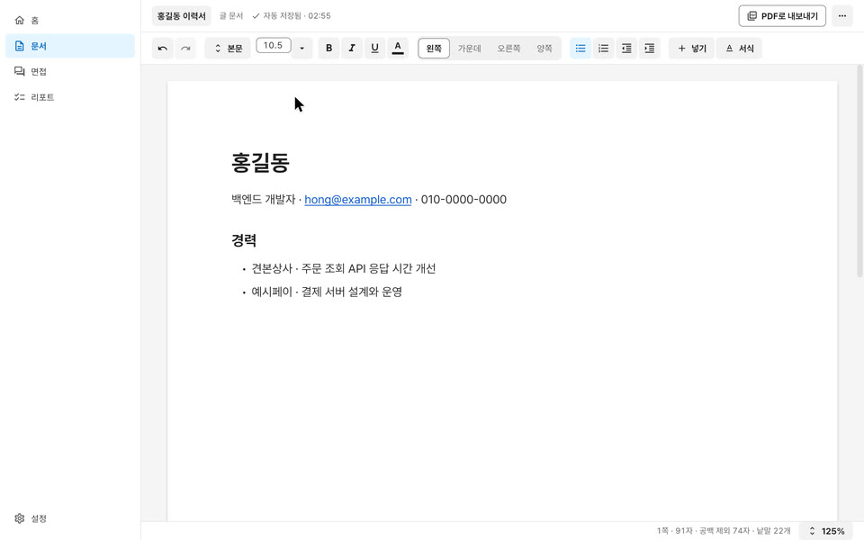</picture></a>
</td>
</tr>
<tr>
<td width="50%" valign="middle">

### 글자와 문단 모양

굵게, 기울임, 밑줄, 글자 크기, 글자색, 형광펜, 위·아래 첨자, 자간, 정렬, 들여쓰기, 줄 간격, 테두리와 바탕. 명령은 도구 줄, 단축키, macOS 메뉴 막대에 있습니다.

[글자 모양 →](Docs/guide/writing.md#글자-모양)

</td>
<td width="50%">
  <a href="Docs/guide/writing.md#글자-모양"><picture><source srcset="Docs/assets/readme/features/format.webp" type="image/webp">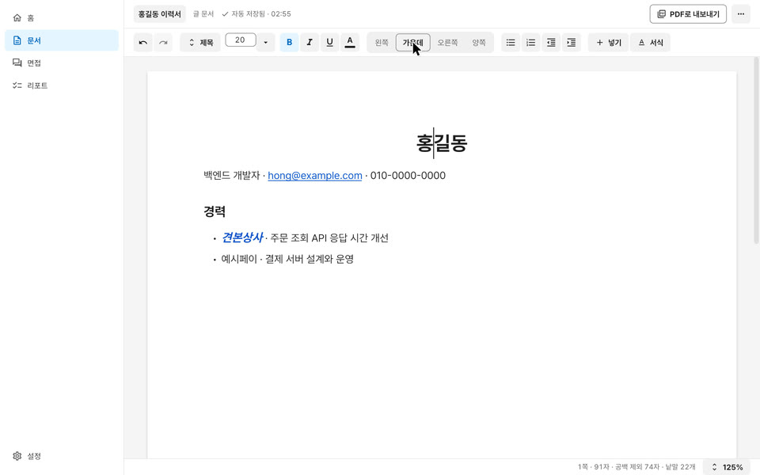</picture></a>
</td>
</tr>
<tr>
<td width="50%" valign="middle">

### 그림과 표

PNG와 JPEG 사진을 넣고, 손잡이를 끌어 크기를 바꾸거나 끌어서 다른 자리로 옮깁니다. 표를 넣어 칸을 옮겨 가며 씁니다. 칸마다 선과 바탕색, 셀 합치기, 경계를 끌어 열 폭과 행 높이 바꾸기, 쪽이 넘어가면 머리 행 반복.

[그림 →](Docs/guide/writing.md#그림) · [표 →](Docs/guide/writing.md#표)

</td>
<td width="50%">
  <a href="Docs/guide/writing.md#표"><picture><source srcset="Docs/assets/readme/features/tables.webp" type="image/webp">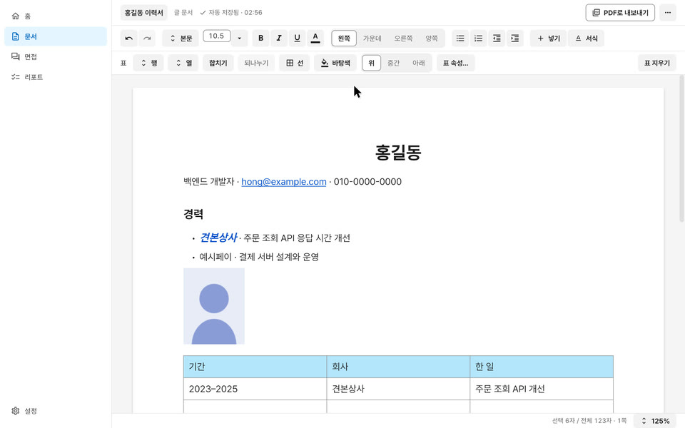</picture></a>
</td>
</tr>
<tr>
<td width="50%" valign="middle">

### 찾아 바꾸기

⌘F로 찾고 ⌥⌘F로 바꿉니다. 모든 일치가 종이 위에 표시되고, 대소문자 구분과 낱말 단위로 찾기를 고릅니다.

[찾기와 바꾸기 →](Docs/guide/writing.md#찾기와-바꾸기)

</td>
<td width="50%">
  <a href="Docs/guide/writing.md#찾기와-바꾸기"><picture><source srcset="Docs/assets/readme/features/find.webp" type="image/webp">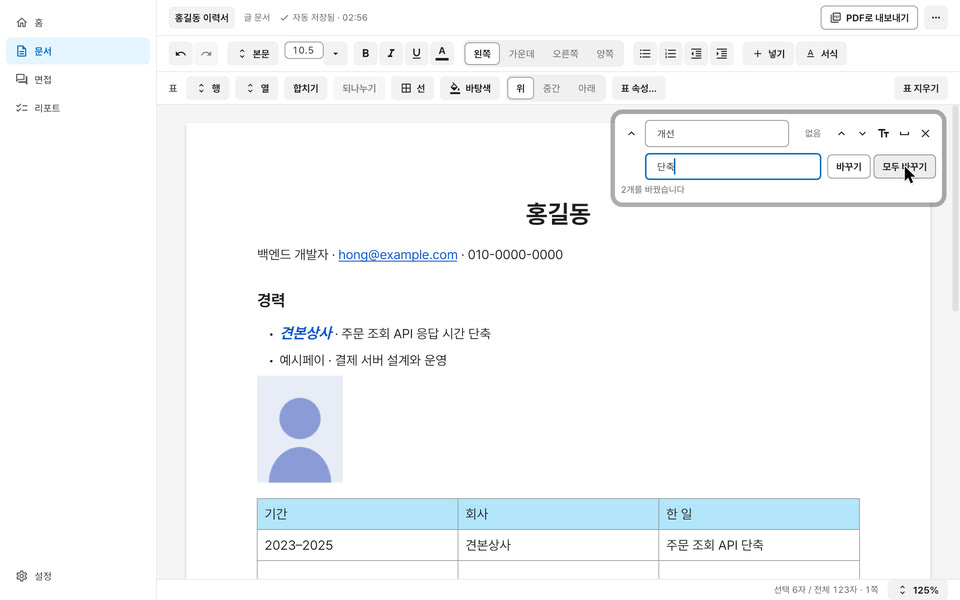</picture></a>
</td>
</tr>
<tr>
<td width="50%" valign="middle">

### 쪽 설정과 보기 배율

용지 크기와 방향, 여백, 머리글과 바닥글, 쪽 번호. 화면은 50~300%로 키우고 줄입니다.

[쪽 설정 →](Docs/guide/writing.md#쪽-설정)

</td>
<td width="50%">
  <a href="Docs/guide/writing.md#쪽-설정"><picture><source srcset="Docs/assets/readme/features/page.webp" type="image/webp">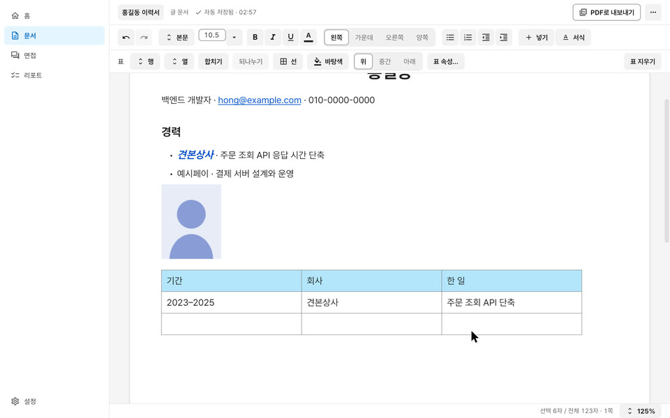</picture></a>
</td>
</tr>
<tr>
<td width="50%" valign="middle">

### 자동 저장과 버전

5분 동안 쉬거나 문서를 닫으면 버전을 남기고, 지금 상태에 이름을 붙여 둘 수도 있습니다. 어느 버전이든 미리 보고 그 버전으로 돌아갑니다.

[되돌리기와 버전 →](Docs/guide/writing.md#되돌리기와-버전)

</td>
<td width="50%">
  <a href="Docs/guide/writing.md#되돌리기와-버전"><picture><source srcset="Docs/assets/readme/features/versions.webp" type="image/webp">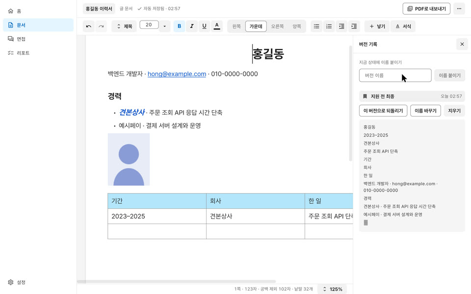</picture></a>
</td>
</tr>
<tr>
<td width="50%" valign="middle">

### PDF와 Word로 내보내기

화면과 같은 배치의 PDF를 만듭니다. 링크가 눌리고 글자를 고르고 찾을 수 있습니다. Word 문서(DOCX)와 텍스트로도 내보내고, 같은 배치로 인쇄하고 공유합니다.

[PDF로 내보내기 →](Docs/guide/writing.md#pdf로-내보내기)

</td>
<td width="50%">
  <a href="Docs/guide/writing.md#pdf로-내보내기"><picture><source srcset="Docs/assets/readme/features/export.webp" type="image/webp">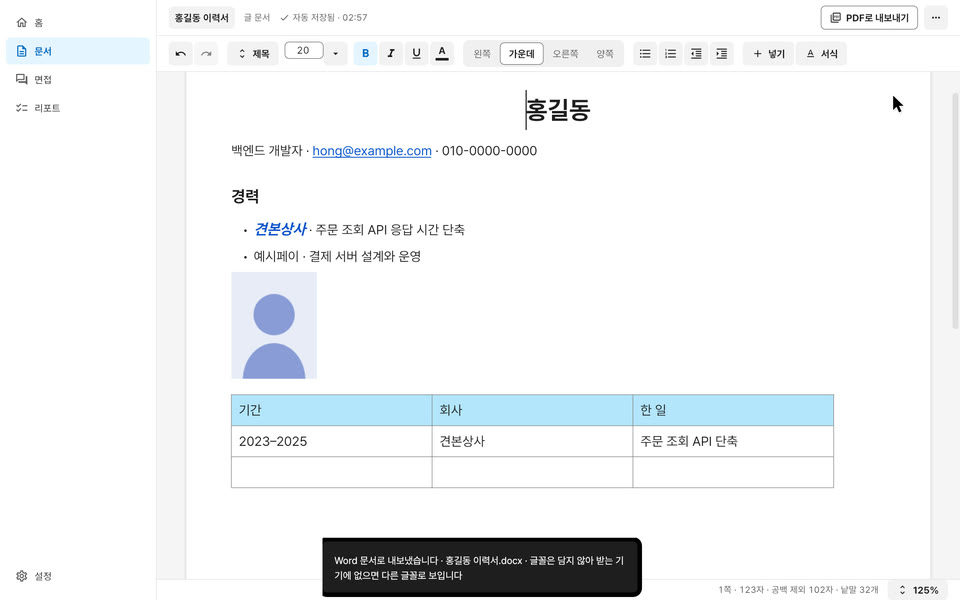</picture></a>
</td>
</tr>
<tr>
<td width="50%" valign="middle">

### 캔버스 문서

대지 위에 프레임, 사각형, 타원, 선, 글 상자, 그림을 자유롭게 놓습니다. 끌어서 옮기고 크기를 바꾸고 돌리며, 끄는 동안 다른 것의 변과 가운데, 같은 간격에 맞춰 붙고 안내선이 보입니다. 맞춤과 간격 고르게, 복사와 붙여넣기, 확대와 축소를 씁니다.

[캔버스 →](Docs/guide/canvas.md)

</td>
<td width="50%">
  <a href="Docs/guide/canvas.md"><picture><source srcset="Docs/assets/readme/features/canvas.webp" type="image/webp">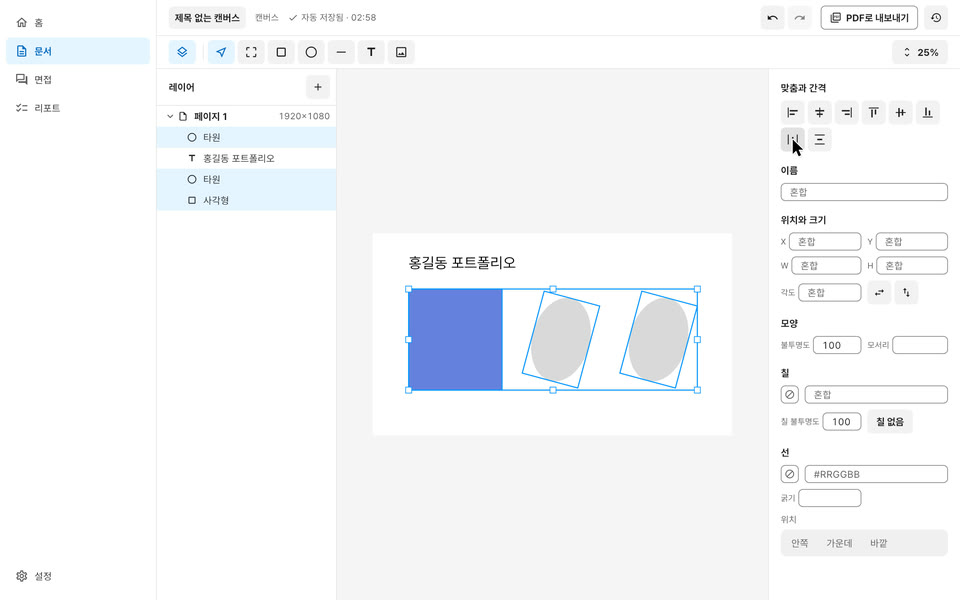</picture></a>
</td>
</tr>
<tr>
<td width="50%" valign="middle">

### 레이어와 대지

왼쪽 레이어 패널에 대지와 그 안의 것이 나무로 보입니다. 줄을 두 번 눌러 이름을 바꾸고, 숨기거나 잠그고, 끌어서 차례를 바꿉니다. ⌘G로 묶고, `+`로 A4, 1920×1080, iPhone 같은 크기의 대지를 더합니다.

[레이어와 대지 →](Docs/guide/canvas.md#레이어와-대지) · [맞춰 붙기 →](Docs/guide/canvas.md#맞춰-붙기와-거리-재기)

</td>
<td width="50%">
  <a href="Docs/guide/canvas.md#레이어와-대지"><picture><source srcset="Docs/assets/readme/features/layers.webp" type="image/webp">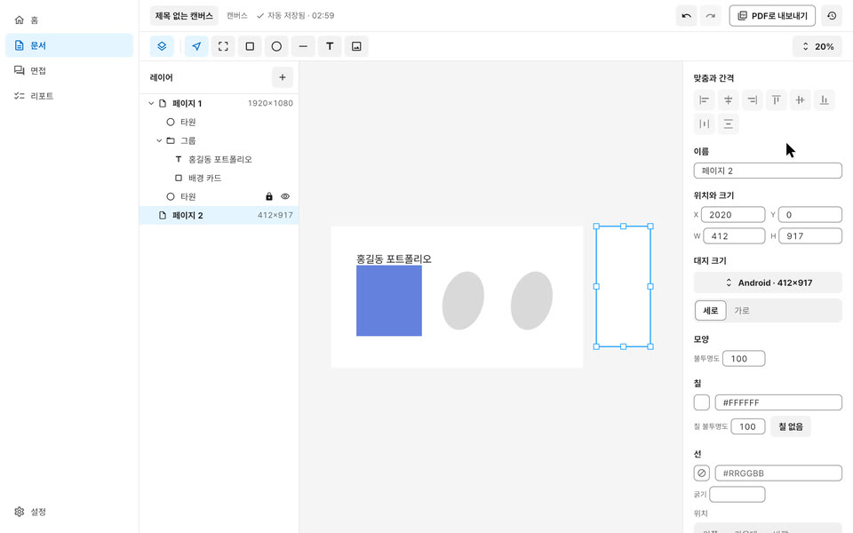</picture></a>
</td>
</tr>
<tr>
<td width="50%" valign="middle">

### 문서 목록과 휴지통

홈에서 문서를 만들고, 이름을 바꾸고, 복제합니다. 휴지통으로 옮긴 문서는 알림의 `되돌리기`나 휴지통에서 되살리고, 30일이 지나면 지워집니다.

[문서 목록 →](Docs/guide/writing.md#문서-목록-홈)

</td>
<td width="50%">
  <a href="Docs/guide/writing.md#문서-목록-홈"><picture><source srcset="Docs/assets/readme/features/home.webp" type="image/webp">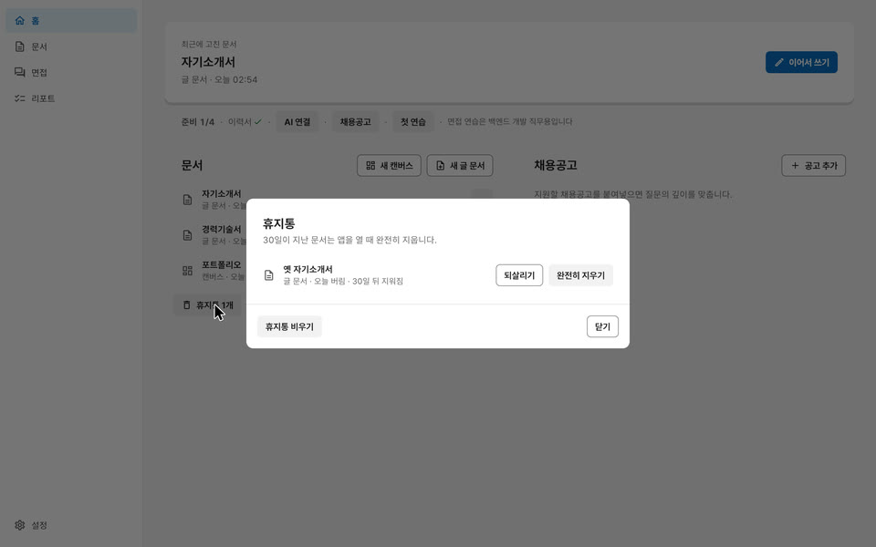</picture></a>
</td>
</tr>
<tr>
<td width="50%" valign="middle">

### AI 연결

면접 연습은 내 Anthropic(Claude) 또는 OpenAI API 키로 모델을 부릅니다. 키는 이 맥의 보안 저장소(키체인)에만 두고, 비용은 쓴 만큼 제공사가 청구합니다.

[AI 키 넣기와 비용 →](Docs/guide/install.md#5-ai-키-넣기와-비용-면접-연습에만-필요)

</td>
<td width="50%">
  <a href="Docs/guide/install.md#5-ai-키-넣기와-비용-면접-연습에만-필요"><picture><source srcset="Docs/assets/readme/features/ai.webp" type="image/webp">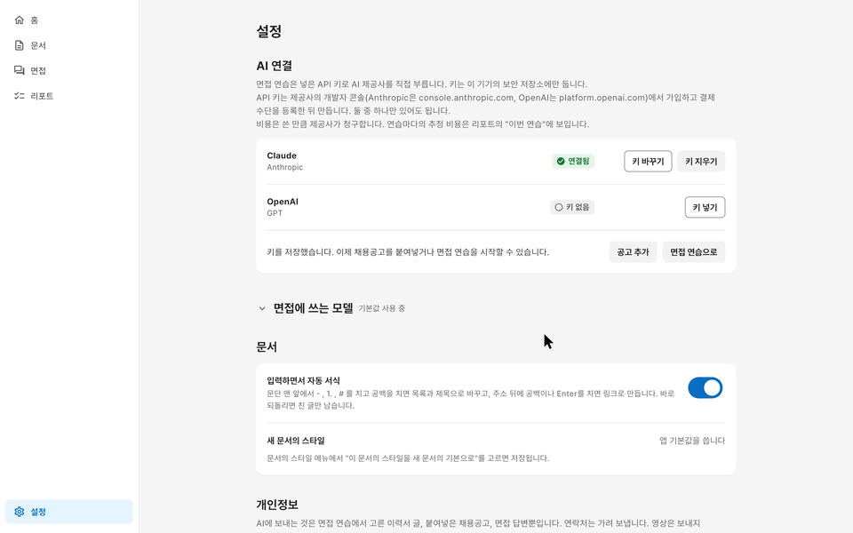</picture></a>
</td>
</tr>
<tr>
<td width="50%" valign="middle">

### 면접 연습

고른 이력서와 붙여넣은 채용공고로 백엔드 직무의 기술 면접을 글로 연습합니다. 연차, 시간, 압박 단계를 고르고, 질문은 한 번에 하나씩 답에 따라 더 깊게 묻습니다. 보내기 전에 무엇이 나가는지 보여 주고, 전자우편과 전화번호는 가려서 보냅니다. 주장 뽑기, 공고 나누기, 질문, 채점마다 제공사, 모델 계열, 추론 강도를 고릅니다. 시선 기록을 켜 두면 카메라로 화면을 보고 있는지만 보고 화면 밖을 본 구간을 남깁니다. 영상은 저장하지 않고 밖으로 보내지 않습니다.

[면접 연습 →](Docs/guide/interview.md)

</td>
<td width="50%">
  <a href="Docs/guide/interview.md"><picture><source srcset="Docs/assets/readme/features/interview.webp" type="image/webp">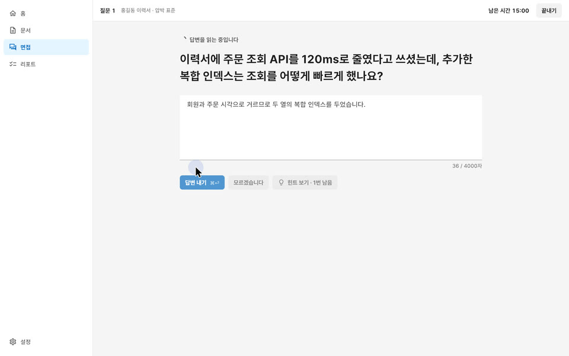</picture></a>
</td>
</tr>
<tr>
<td width="50%" valign="middle">

### 리포트

연습이 끝나면 먼저 고칠 것, 바로잡을 것, 주제별 깊이, 그 연습의 토큰 수와 추정 비용을 보여 줍니다. 빠진 내용마다 출처의 제목과 주소가 붙고, 같은 주제로 바로 다시 연습합니다. 홈에서는 이력서의 주장 가운데 면접에서 방어한 수와 먼저 준비할 주장을 봅니다.

[리포트 →](Docs/guide/interview.md#리포트)

</td>
<td width="50%">
  <a href="Docs/guide/interview.md#리포트"><picture><source srcset="Docs/assets/readme/features/report.webp" type="image/webp">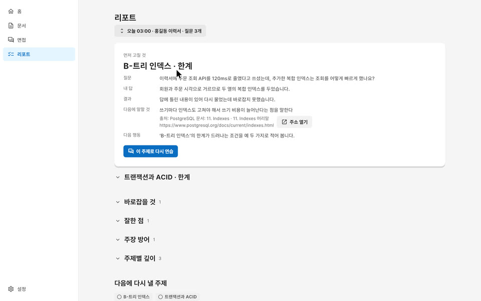</picture></a>
</td>
</tr>
</table>

## 설치

- 지원 기기: Apple Silicon 맥, macOS 13 이상
- [Kari 내려받기](https://github.com/algocean1204/Kari-docs-helper-with-ai/releases/latest/download/Kari-macos-arm64.dmg) → dmg를 열고 Kari를 응용 프로그램 폴더로 끌어 놓습니다. 이 링크는 늘 가장 새 릴리스의 dmg를 가리킵니다.
- 앱 안 업데이트: 새 판이 나오면 Kari가 "새 판이 있습니다" 창에 판과 바뀐 점을 보이고, `지금 업데이트`를 누르면 받아서 설치합니다. 누르지 않으면 받지 않습니다. 새 판 확인은 24시간에 한 번까지이고 설정에서 끌 수 있으며, 메뉴 막대의 `Kari` → `업데이트 확인…`으로 바로 확인할 수도 있습니다. 앱 안에서 업데이트할 수 없는 판이면 설정에 그렇게 적혀 있고, 그때는 위 링크로 새 dmg를 받습니다. [자세히](Docs/guide/install.md#업데이트)
- 지난 판과 바뀐 점: [가장 새 릴리스](https://github.com/algocean1204/Kari-docs-helper-with-ai/releases/latest), [모든 릴리스](https://github.com/algocean1204/Kari-docs-helper-with-ai/releases)
- 처음 여는 법, AI 키와 비용, 자료의 위치와 지우는 법: [Docs/guide/install.md](Docs/guide/install.md)
- 무엇이 기기 밖으로 나가는지: [Docs/guide/privacy.md](Docs/guide/privacy.md)
- 쓰는 법: [문서](Docs/guide/writing.md), [캔버스](Docs/guide/canvas.md), [면접 연습](Docs/guide/interview.md)

## 의견과 지원

- 버그와 기능 제안: [이슈](https://github.com/algocean1204/Kari-docs-helper-with-ai/issues/new/choose)
- 질문과 아이디어: [디스커션](https://github.com/algocean1204/Kari-docs-helper-with-ai/discussions)
- 보안 문제: [.github/SECURITY.md](.github/SECURITY.md)의 비공개 신고

## 개발

Flutter 3.38.2, Rust 1.97.1(`app/engine/rust-toolchain.toml`로 고정), Xcode 26 이상, CocoaPods, poppler, qpdf가 필요합니다.

```bash
brew install poppler qpdf cocoapods
cd app/engine && cargo test --workspace
cd .. && flutter pub get && flutter test && flutter run -d macos
```

- 빌드와 시험: [Docs/contributing/build-and-test.md](Docs/contributing/build-and-test.md)
- 구조: [Docs/architecture/](Docs/architecture/)
- 기여 안내: [.github/CONTRIBUTING.md](.github/CONTRIBUTING.md)
- 문서 전체: [Docs/README.md](Docs/README.md)

## 서명

배포하는 dmg는 임시 서명(ad-hoc)이며 Apple 공증을 거치지 않습니다. 처음 한 번 열기를 허락하는 법은 [Docs/guide/install.md](Docs/guide/install.md)에 있습니다. 릴리스마다 dmg의 SHA-256을 `.sha256` 파일로 함께 올립니다.

## 라이선스

[MIT](LICENSE). 앱에 함께 배포되는 제3자 코드와 글꼴의 고지는 [Docs/THIRD_PARTY_LICENSES.md](Docs/THIRD_PARTY_LICENSES.md)에 있습니다. 그 가운데 PDF 라이브러리 krilla의 일부 코드는 MPL-2.0이며, 소스를 받는 곳이 고지 파일에 있습니다.
