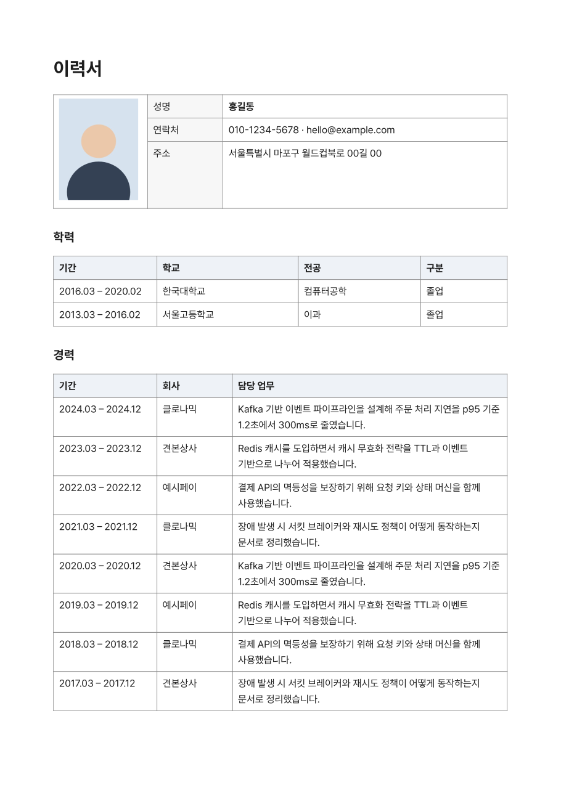
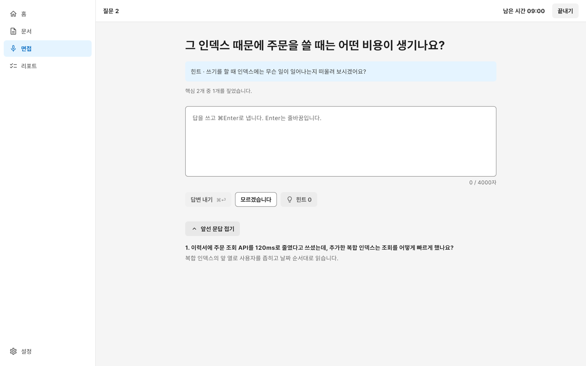
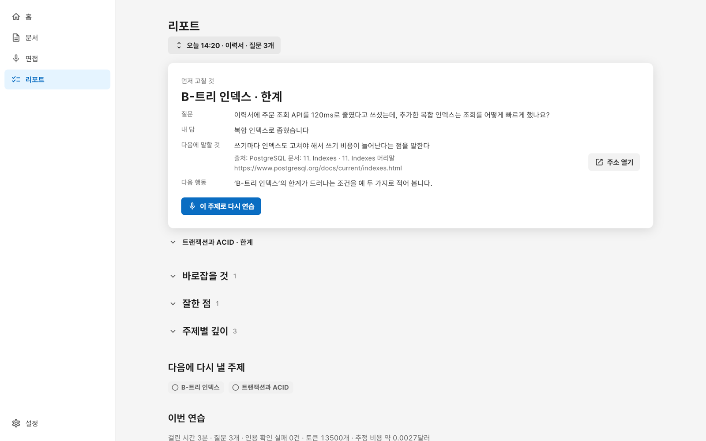

<div align="center">

# Kari (카리)

이력서를 쓰고, 그 이력서와 채용공고로 기술 면접을 연습하는 맥 앱

**[Kari 내려받기(macOS, Apple Silicon)](https://github.com/algocean1204/Kari-docs-helper-with-ai/releases/latest/download/Kari-macos-arm64.dmg)**

[](https://github.com/algocean1204/Kari-docs-helper-with-ai/actions/workflows/ci.yml)
[](LICENSE)


</div>

> **English summary.** Kari is a local-first macOS app for writing a résumé and practicing technical interviews based on it.
> Documents stay on your Mac; only the text interview calls the AI provider you choose (Anthropic or OpenAI) with your own key, after showing what will be sent.
> Flutter UI, Rust engine. The interface and documentation are in Korean. MIT licensed.

## 기능

### 문서 쓰기

워드처럼 글이 흐르고 쪽이 나뉘는 문서에 이력서를 씁니다. 한글 입력, 글자 모양(크기, 글자색, 형광펜, 위·아래 첨자, 자간), 문단 모양(스타일, 정렬, 들여쓰기, 간격, 줄 간격, 쪽 나누기), 목록, 탭 정지, 링크, 찾기·바꾸기, 글자 수, 쪽 설정, 머리글·바닥글, 쪽 번호를 씁니다. 화면은 50~300%로 키우고 줄입니다. 글꼴은 앱에 든 Pretendard로 그려 어느 맥에서나 같은 줄에서 줄이 바뀝니다.

### 표와 이미지, PDF 내보내기

표는 셀을 합치고, 쪽이 넘어가면 머리 행을 다시 그립니다. PNG와 JPEG 사진을 넣습니다. 화면과 같은 배치로 PDF를 만들어, 링크가 눌리고 글자를 고르고 찾을 수 있습니다. 같은 배치로 인쇄하고, PDF를 macOS 공유 메뉴로 보냅니다.



### 자동 저장과 버전

저장 단추가 없습니다. 고칠 때마다 저장하고, 5분 동안 쉬거나 문서를 닫으면 버전을 남깁니다. 이름을 붙인 버전을 남기고, 어느 버전으로든 돌아갈 수 있습니다. 되돌리기·다시 하기를 씁니다.

### 면접 연습

고른 이력서와 붙여넣은 채용공고로 백엔드 직무의 기술 면접을 글로 연습합니다. 질문은 한 번에 하나이고, 답에 따라 더 깊게 묻거나 기본으로 돌아갑니다. 모델은 사용자의 Anthropic(Claude) 또는 OpenAI API 키로 부르고, 보내기 전에 무엇이 나가는지 보여 주며, 전자우편과 전화번호는 가려서 보냅니다. 주장 뽑기, 공고 나누기, 질문, 채점마다 제공사, 모델 계열, 추론 강도를 고릅니다. 시선 기록을 켜 두면 카메라로 화면을 보고 있는지만 보고 화면 밖을 본 구간을 남깁니다. 영상은 저장하지 않고 밖으로 보내지 않습니다.



### 리포트

연습이 끝나면 먼저 고칠 것, 바로잡을 것, 주제별 깊이, 그 연습의 토큰 수와 추정 비용을 보여 줍니다. 빠진 내용마다 출처의 제목과 주소가 붙습니다. 홈에서는 이력서의 주장 가운데 면접에서 방어한 수와 먼저 준비할 주장을 봅니다.



## 설치

- 지원 기기: Apple Silicon 맥, macOS 13 이상
- [Kari 내려받기](https://github.com/algocean1204/Kari-docs-helper-with-ai/releases/latest/download/Kari-macos-arm64.dmg) → dmg를 열고 Kari를 응용 프로그램 폴더로 끌어 놓습니다.
- 처음 여는 법, AI 키와 비용, 자료의 위치와 지우는 법: [Docs/guide/install.md](Docs/guide/install.md)
- 무엇이 기기 밖으로 나가는지: [Docs/guide/privacy.md](Docs/guide/privacy.md)

## 의견과 지원

- 버그와 기능 제안: [이슈](https://github.com/algocean1204/Kari-docs-helper-with-ai/issues/new/choose)
- 질문과 아이디어: [디스커션](https://github.com/algocean1204/Kari-docs-helper-with-ai/discussions)
- 보안 문제: [.github/SECURITY.md](.github/SECURITY.md)의 비공개 신고

## 개발

Flutter 3.38.2, Rust 1.97.1(`app/engine/rust-toolchain.toml`로 고정), Xcode 26 이상, CocoaPods, poppler, qpdf가 필요합니다.

```bash
brew install poppler qpdf cocoapods
cd app/engine && cargo test --workspace
cd .. && flutter pub get && flutter test && flutter run -d macos
```

- 빌드와 시험: [Docs/contributing/build-and-test.md](Docs/contributing/build-and-test.md)
- 구조: [Docs/architecture/](Docs/architecture/)
- 기여 안내: [.github/CONTRIBUTING.md](.github/CONTRIBUTING.md)
- 문서 전체: [Docs/README.md](Docs/README.md)

## 서명

배포하는 dmg는 임시 서명(ad-hoc)이며 Apple 공증을 거치지 않습니다. 처음 한 번 열기를 허락하는 법은 [Docs/guide/install.md](Docs/guide/install.md)에 있습니다. 릴리스마다 dmg의 SHA-256을 `.sha256` 파일로 함께 올립니다.

## 라이선스

[MIT](LICENSE). 앱에 함께 배포되는 제3자 코드와 글꼴의 고지는 [Docs/THIRD_PARTY_LICENSES.md](Docs/THIRD_PARTY_LICENSES.md)에 있습니다. 그 가운데 PDF 라이브러리 krilla의 일부 코드는 MPL-2.0이며, 소스를 받는 곳이 고지 파일에 있습니다.
