<p align="center">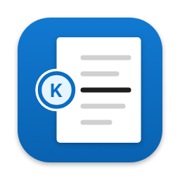</p>

<div align="center">

$\bf{\large{\color{#6580DD} Kari }}$
===

카리

</div>

<p align="center"><b>이력서를 쓰고, 같은 앱에서 그 이력서로 기술 면접을 연습해 다시 고치는 맥 앱.</b> 워드처럼 글이 흐르는 문서(이력서)와 대지 위에 자유롭게 놓는 캔버스(포트폴리오)에서 작업해 PDF와 Word로 내보낸다. 내 이력서에서 뽑은 주장(쓴 기술, 겪은 문제, 낸 결과)과 채용공고로 면접을 연습하고, 리포트와 홈에서 방어한 주장과 먼저 준비할 주장을 확인한다. 서버 없이 문서는 내 맥에만 있다. 면접 연습을 할 때만 내가 고른 AI 제공사(Anthropic 또는 OpenAI)를 내 키로 부르고, 보내기 전에 무엇이 나가는지 보여 주며 연락처는 가려 보낸다.</p>

<p align="center">
  <a href="https://github.com/algocean1204/Kari-docs-helper-with-ai/actions/workflows/ci.yml"></a>
  <a href="LICENSE"></a>
</p>

<p align="center"><a href="https://github.com/algocean1204/Kari-docs-helper-with-ai/releases/latest"></a></p>

<p align="center"><a href="https://github.com/algocean1204/Kari-docs-helper-with-ai/releases/latest/download/Kari-macos-arm64.dmg"><b>macOS(Apple Silicon)용 내려받기</b></a> · <a href="#소스로-실행하기">소스로 실행하기</a></p>

<p align="center">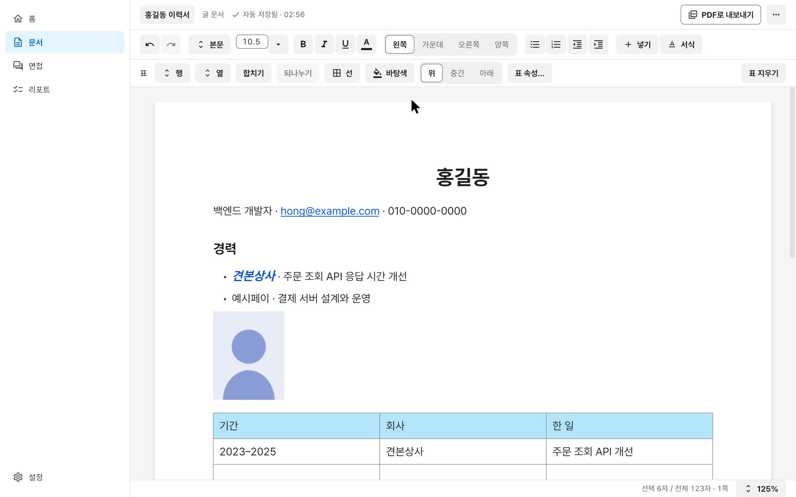</p>

증명사진과 경력 표가 든 이력서를 쓰는 문서 화면이다. 왼쪽 막대에서 홈, 문서, 면접, 리포트, 설정으로 이동한다.

## Kari는 이렇게 쓴다

1. 쓰기: 워드처럼 글이 흐르는 문서에 이력서를 쓰고, 대지 위에 자유롭게 놓는 캔버스에 포트폴리오를 만든다. [한글로 바로 쓰는 문서](#한글로-바로-쓰는-문서) · [캔버스 문서](#캔버스-문서)
2. 면접 연습: 내 API 키로 AI 제공사를 연결하고, 이력서에서 뽑은 주장(쓴 기술, 겪은 문제, 낸 결과)과 채용공고로 백엔드 기술 면접을 글로 연습한다. [AI 연결](#ai-연결) · [면접 연습](#면접-연습)
3. 리포트: 면접이 끝나면 방어한 주장과 먼저 준비할 주장, 빠진 내용과 주제별 깊이를 확인한다. [리포트](#리포트)
4. 다시 고치기: 홈과 리포트에서 먼저 준비할 주장을 확인하고, `이력서에서 보기`로 문서의 그 문장으로 가서 고친 뒤 버전을 남기거나 PDF와 Word로 내보낸다. [자동 저장과 버전](#자동-저장과-버전) · [PDF와 Word로 내보내기](#pdf와-word로-내보내기)

## 기능

아래 그림은 앱 화면 시연이다. 사람, 회사, 채용공고, 면접 질문과 리포트는 모두 견본 자료다.

### 쓰기

#### 한글로 바로 쓰는 문서

워드처럼 글이 흐르고 쪽이 나뉘는 문서에 이력서를 쓴다. 한글 입력과 문단 스타일을 쓰고, 문단 맨 앞에 `- `, `1. `, `# `를 붙이면 목록과 제목이 된다. 탭 정지와 링크도 쓰고, 글자 수와 낱말 수, 개요도 볼 수 있다. 저장 버튼 없이 고칠 때마다 바로 저장되며, 앱에 포함된 Pretendard 글꼴로 그려 어느 맥에서나 같은 자리에서 줄이 바뀐다. [쓰는 법](Docs/guide/writing.md)

<p align="center"><a href="Docs/guide/writing.md"><picture><source srcset="Docs/assets/readme/features/writing.webp" type="image/webp">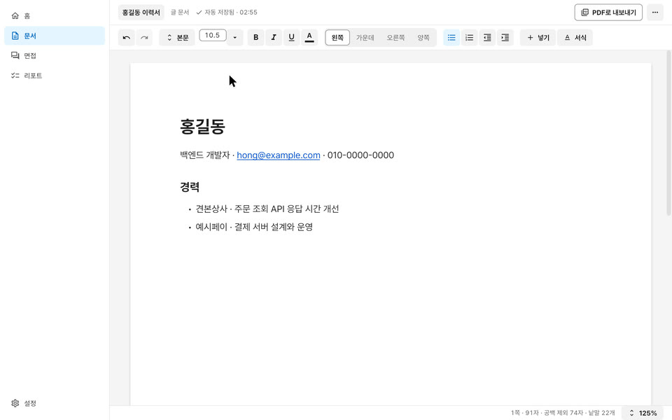</picture></a></p>

새 문서에 이름을 붙이고 한글로 내용을 입력하는 장면이다. 문단 맨 앞의 `# `와 `- `가 제목과 목록이 된다.

#### 글자와 문단 모양

굵게, 기울임, 밑줄은 물론 글자 크기와 글자색, 형광펜, 위·아래 첨자, 자간까지 고른다. 정렬, 들여쓰기, 줄 간격으로 문단 모양을 잡고, 테두리와 바탕도 입힌다. 도구 줄과 단축키, macOS 메뉴 막대 어느 쪽에서나 바로 쓴다. [글자 모양](Docs/guide/writing.md#글자-모양)

<p align="center"><a href="Docs/guide/writing.md#글자-모양"><picture><source srcset="Docs/assets/readme/features/format.webp" type="image/webp">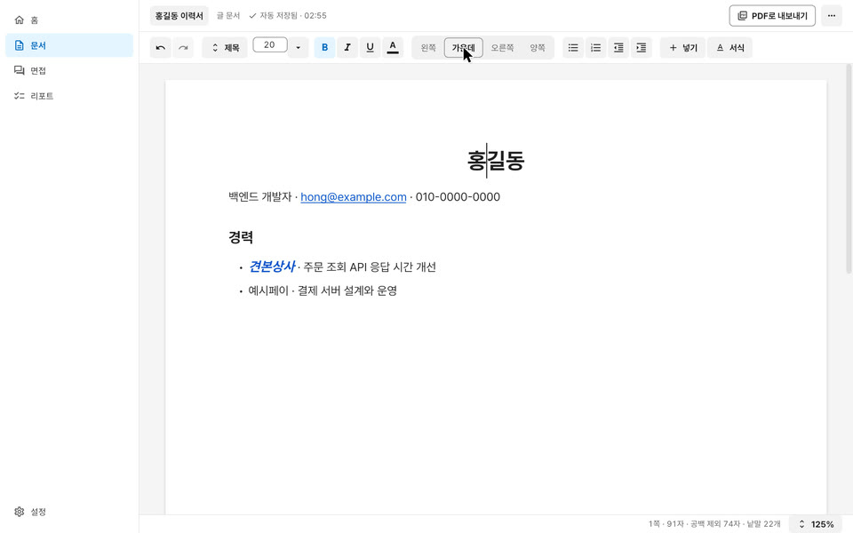</picture></a></p>

낱말을 끌어 골라 굵게, 파란 글자색, 큰 글자로 바꾼다. 제목은 가운데로 맞춘다.

#### 그림과 표

PNG와 JPEG 사진을 넣고, 손잡이를 끌어 크기를 바꾸거나 사진을 끌어 다른 자리로 옮긴다. 표를 넣어 칸을 옮겨 가며 내용을 쓰고, 칸마다 선과 바탕색을 정하거나 셀을 합친다. 경계를 끌어 열 폭과 행 높이를 바꾸고, 쪽이 넘어가면 머리 행이 반복된다. [그림](Docs/guide/writing.md#그림) · [표](Docs/guide/writing.md#표)

<p align="center"><a href="Docs/guide/writing.md#표"><picture><source srcset="Docs/assets/readme/features/tables.webp" type="image/webp"></picture></a></p>

손잡이로 증명사진을 줄이고 표의 칸을 채운 뒤, 머리 행에 바탕색을 칠하는 모습이다.

#### 찾아 바꾸기

⌘F로 찾고 ⌥⌘F로 바꾼다. 일치하는 부분이 모두 종이 위에 표시되며, 대소문자 구분과 낱말 단위 찾기도 된다. [찾기와 바꾸기](Docs/guide/writing.md#찾기와-바꾸기)

<p align="center"><a href="Docs/guide/writing.md#찾기와-바꾸기"><picture><source srcset="Docs/assets/readme/features/find.webp" type="image/webp">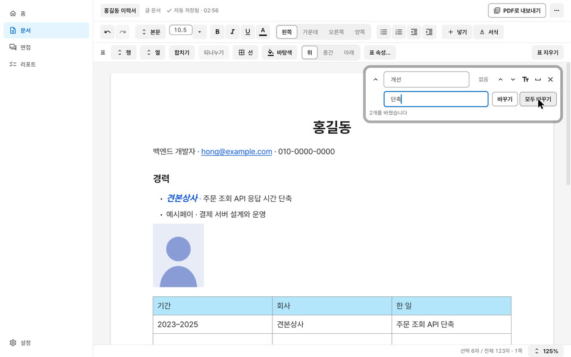</picture></a></p>

찾기 막대에 낱말을 치고 바꿀 글을 넣어 모두 바꾸는 장면이다.

#### 쪽 설정과 보기 배율

용지 크기와 방향, 여백을 고르고 머리글과 바닥글, 쪽 번호를 넣는다. 화면은 50~300% 사이에서 키우거나 줄인다. [쪽 설정](Docs/guide/writing.md#쪽-설정)

<p align="center"><a href="Docs/guide/writing.md#쪽-설정"><picture><source srcset="Docs/assets/readme/features/page.webp" type="image/webp">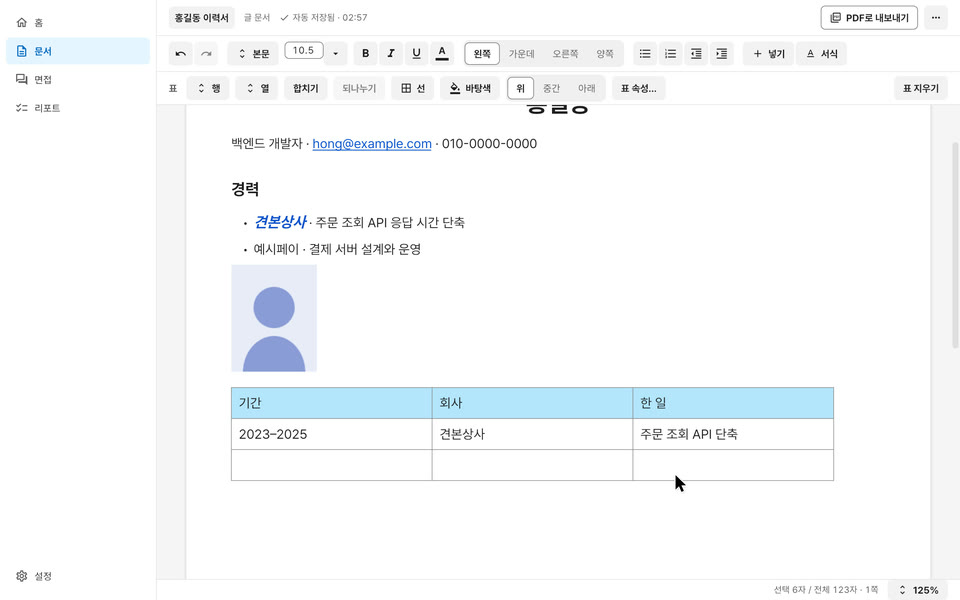</picture></a></p>

쪽 설정 창에서 여백을 좁히고 쪽 번호를 넣은 뒤 보기 배율까지 바꾼다.

#### PDF와 Word로 내보내기

화면과 같은 배치의 PDF를 만든다. PDF 안의 링크가 그대로 동작하고, 글자를 고르거나 찾을 수 있다. Word 문서(DOCX)와 텍스트로도 내보내며, 같은 배치로 인쇄하고 공유한다. [PDF로 내보내기](Docs/guide/writing.md#pdf로-내보내기)

<p align="center"><a href="Docs/guide/writing.md#pdf로-내보내기"><picture><source srcset="Docs/assets/readme/features/export.webp" type="image/webp">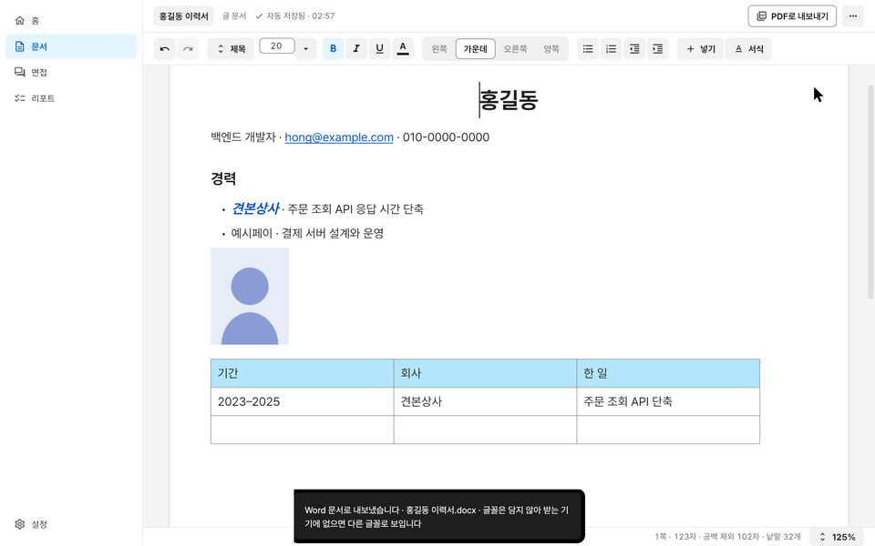</picture></a></p>

PDF에 이어 Word 문서까지 차례로 내보내는 과정이다.

#### 캔버스 문서

대지 위에 프레임과 사각형·타원·선, 그리고 글 상자와 그림을 자유롭게 놓는다. 끌어서 옮기고 크기를 바꾸거나 돌린다. 요소를 끄는 동안에는 다른 요소의 변과 가운데, 같은 간격에 맞춰 붙으며 안내선이 나타난다. 맞춤과 간격 고르게, 복사와 붙여넣기, 확대와 축소도 된다. [캔버스](Docs/guide/canvas.md)

<p align="center"><a href="Docs/guide/canvas.md"><picture><source srcset="Docs/assets/readme/features/canvas.webp" type="image/webp">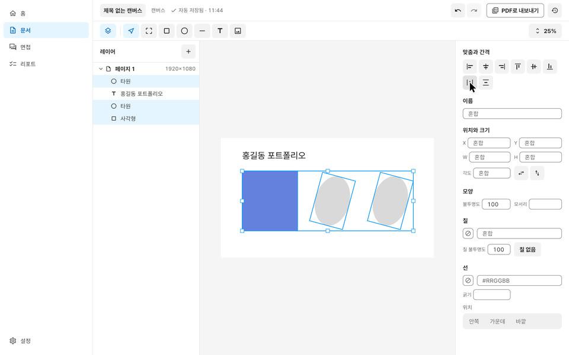</picture></a></p>

도형과 글 상자를 만들어 색을 칠하고 돌린 뒤, 셋을 함께 골라 가운데 맞춤과 간격 고르게를 실행한다.

#### 레이어와 대지

왼쪽 레이어 패널에는 대지와 그 안의 요소가 트리 구조로 표시된다. 항목을 두 번 눌러 이름을 고치고, 숨기거나 잠그며, 끌어서 순서를 바꾼다. ⌘G로 묶고, `+`로 A4, 1920×1080, iPhone 같은 크기의 대지를 더한다. [레이어와 대지](Docs/guide/canvas.md#레이어와-대지) · [맞춰 붙기](Docs/guide/canvas.md#맞춰-붙기와-거리-재기)

<p align="center"><a href="Docs/guide/canvas.md#레이어와-대지"><picture><source srcset="Docs/assets/readme/features/layers.webp" type="image/webp">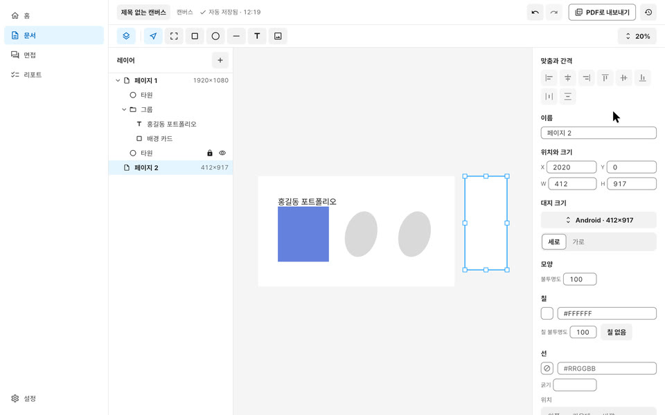</picture></a></p>

안내선에 맞춰 붙이고 이름을 고친 뒤, 숨기고 잠갔다가 묶고 새 대지를 더해 크기를 조절하는 모습이다.

### 연습

#### AI 연결

면접 연습은 내 Anthropic(Claude) 또는 OpenAI API 키로 모델을 호출한다. 키는 이 맥의 보안 저장소(키체인)에만 저장되며, 비용은 쓴 만큼 제공사가 청구한다. 문서 작성은 키 없이도 된다. [AI 키 넣기와 비용](Docs/guide/install.md#5-ai-키-넣기와-비용-면접-연습에만-필요)

<p align="center"><a href="Docs/guide/install.md#5-ai-키-넣기와-비용-면접-연습에만-필요"><picture><source srcset="Docs/assets/readme/features/ai.webp" type="image/webp">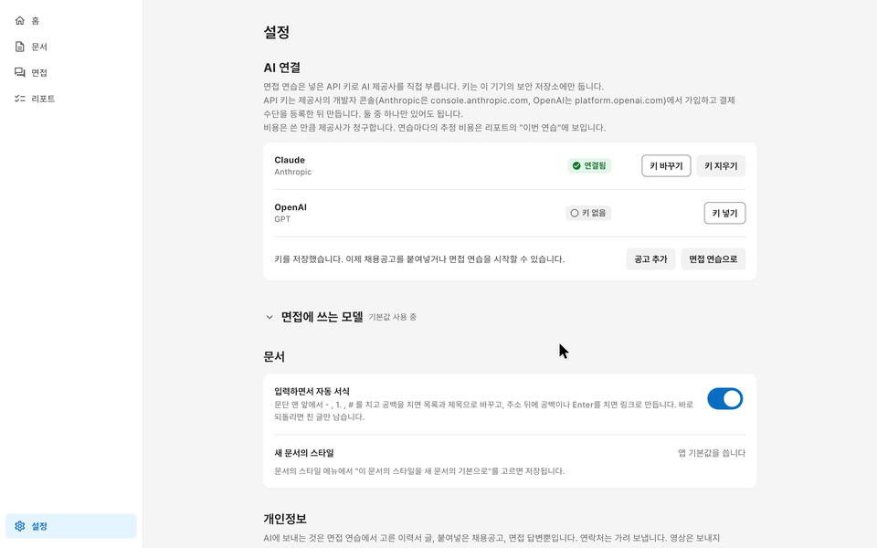</picture></a></p>

설정에서 키를 가린 채 입력하고 확인하면 연결됨 상태가 된다.

#### 면접 연습

선택한 이력서와 붙여넣은 채용공고로 백엔드 직무의 기술 면접을 글로 연습한다. 연차와 시간, 압박 단계를 정하며, 질문은 한 번에 하나씩 나오고 답에 따라 더 깊게 묻는다. 외부로 보내기 전에 어떤 내용이 전송되는지 미리 보여 주고, 이메일과 전화번호는 가려서 보낸다. 주장 뽑기, 공고 나누기, 질문, 채점 단계마다 제공사, 모델 계열, 추론 강도도 따로 고를 수 있다. 시선 기록을 켜 두면 카메라로 화면을 바라보는지만 확인해 화면 밖을 본 구간을 남기며, 영상은 저장하거나 밖으로 보내지 않는다. [면접 연습](Docs/guide/interview.md)

<p align="center"><a href="Docs/guide/interview.md"><picture><source srcset="Docs/assets/readme/features/interview.webp" type="image/webp">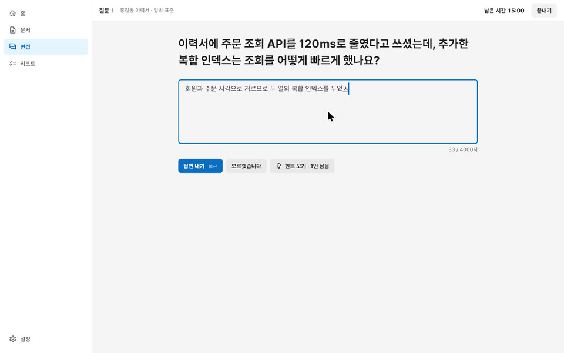</picture></a></p>

채용공고를 붙여넣고 준비한 뒤, 첫 질문에 답하면 그 답을 파고드는 꼬리질문이 이어진다.

#### 리포트

연습이 끝나면 먼저 고칠 점과 바로잡을 내용, 주제별 깊이는 물론 그 연습에 든 토큰 수와 예상 비용까지 보여 준다. 빠진 내용마다 출처 제목과 주소가 붙고, 같은 주제로 바로 다시 연습할 수 있다. 홈에서는 이력서의 주장 가운데 면접에서 방어한 주장 수와 먼저 준비할 주장을 확인한다. [리포트](Docs/guide/interview.md#리포트)

<p align="center"><a href="Docs/guide/interview.md#리포트"><picture><source srcset="Docs/assets/readme/features/report.webp" type="image/webp">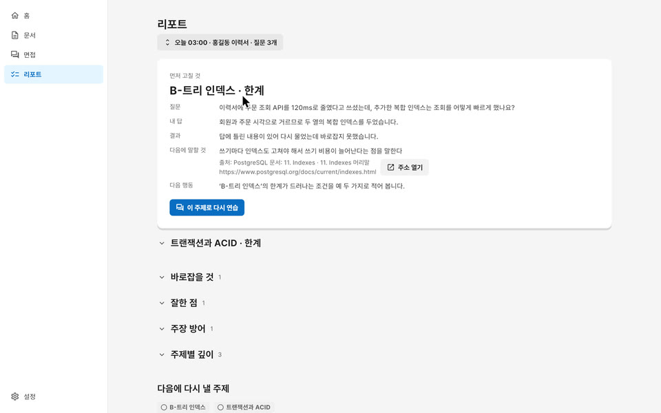</picture></a></p>

리포트 카드를 훑어보고 `이 주제로 다시 연습`을 누르는 장면이다.

### 내 맥 안에서

#### 자동 저장과 버전

5분 동안 쉬거나 문서를 닫으면 버전을 남기고, 지금 상태에 이름을 붙여 둘 수도 있다. 어느 버전이든 미리 보고 그 버전으로 돌아간다. [되돌리기와 버전](Docs/guide/writing.md#되돌리기와-버전)

<p align="center"><a href="Docs/guide/writing.md#되돌리기와-버전"><picture><source srcset="Docs/assets/readme/features/versions.webp" type="image/webp">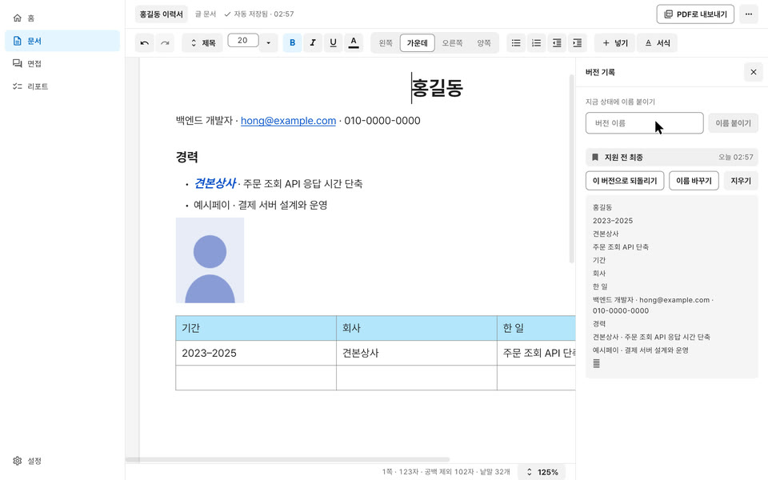</picture></a></p>

지금 상태에 이름을 붙여 남겼다가 글을 지운 뒤 그 버전으로 되돌아간다.

#### 문서 목록과 휴지통

홈에서 문서를 만들고 이름을 바꾸거나 복제한다. 휴지통으로 옮긴 문서는 알림의 `되돌리기`를 누르거나 휴지통에 들어가 되살린다. 30일이 지나면 삭제된다. [문서 목록](Docs/guide/writing.md#문서-목록-홈)

<p align="center"><a href="Docs/guide/writing.md#문서-목록-홈"><picture><source srcset="Docs/assets/readme/features/home.webp" type="image/webp">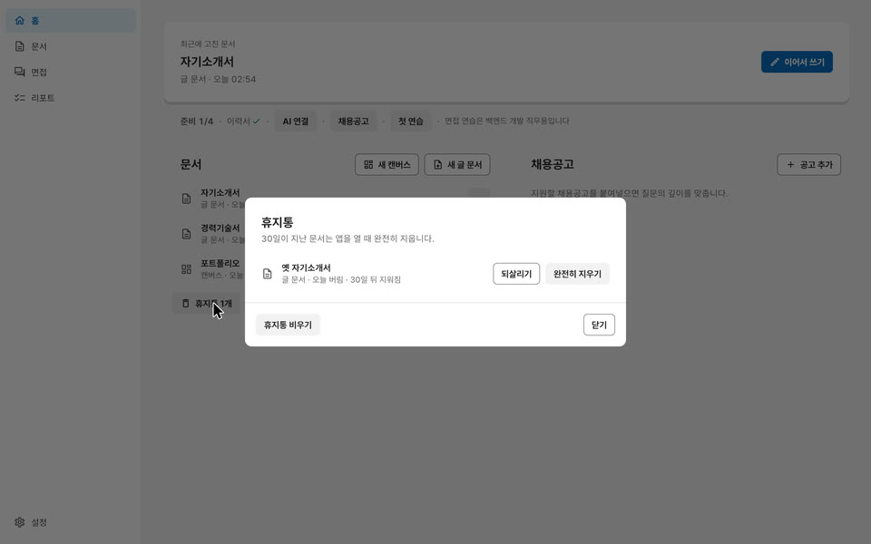</picture></a></p>

휴지통의 문서를 되살리고, 문서를 휴지통으로 옮겼다가 알림에서 되돌린다.

## 지원하는 기기와 AI

| | |
| --- | --- |
| 기기 | Apple Silicon 맥(M1 이후), macOS 13(Ventura) 이상 |
| 내보내기 | PDF, Word 문서(DOCX), 텍스트. 인쇄와 macOS 공유 메뉴 |
| 가져오기 | Word 문서(DOCX), 한글 문서(HWPX), HTML, Google Docs의 웹 페이지 꾸러미(zip), PDF를 새 글 문서로. [가져오기](Docs/guide/writing.md#가져오기) |
| AI 연결 | Anthropic(Claude) API 키나 OpenAI API 키(선택). 면접 연습에만 쓴다 |
| 모델 | 주장 뽑기, 공고 나누기, 질문, 채점마다 제공사, 모델 계열, 추론 강도를 고른다 |

자세한 내용은 [AI 키 넣기와 비용](Docs/guide/install.md#5-ai-키-넣기와-비용-면접-연습에만-필요)과 [무엇이 기기 밖으로 나가는가](Docs/guide/privacy.md)에 나와 있다.

## 설치

### 내려받기

아래 링크를 누르면 늘 [마지막 릴리스](https://github.com/algocean1204/Kari-docs-helper-with-ai/releases/latest)의 파일을 내려받는다. 버전마다 바뀐 내용은 [릴리스 목록](https://github.com/algocean1204/Kari-docs-helper-with-ai/releases)에 있다. 버전은 `0.x.y` 형식이며, 큰 업데이트에는 둘째 숫자가, 작은 수정에는 셋째 숫자가 오른다.

| 운영체제 | 파일 |
| --- | --- |
| macOS 13 이상 (Apple Silicon) | [Kari-macos-arm64.dmg](https://github.com/algocean1204/Kari-docs-helper-with-ai/releases/latest/download/Kari-macos-arm64.dmg) |

`.dmg`를 열어 Kari를 `Applications`로 옮긴다. 릴리스마다 dmg의 SHA-256을 `.sha256` 파일로 함께 올린다. 자세한 내용은 [설치](Docs/guide/install.md)에 있다.

#### macOS에서 처음 열 때

설치 파일이 임시 서명만 되어 있고 Apple 공증을 받지 않아, 처음 열면 "'Kari.app'을(를) 열지 않음" 창이 뜬다. 앱이 망가졌다는 뜻이 아니다. macOS 15(Sequoia) 이상에서는 아래처럼 한 번만 허용한다.

1. 경고 창에서 **'완료'**를 누른다. '휴지통으로 이동'은 누르지 않는다.
2. 시스템 설정 → **개인정보 보호 및 보안**을 열어 아래로 내린 뒤, "보안"에서 Kari 옆의 **'그래도 열기'**를 누른다. 이 버튼은 실행이 막힌 뒤 한 시간쯤만 보이며, 보이지 않으면 앱을 한 번 더 열어 막힌 뒤 다시 확인한다.
3. 맥의 암호(또는 Touch ID)를 넣고, 다시 뜨는 창에서 **'그래도 열기'**를 누른다. 한 번 열면 다음부터는 그냥 열린다.

macOS 13·14에서는 Control 키를 누른 채 앱을 눌러 '열기'를 골라도 열린다. [macOS 판마다의 방법](Docs/guide/install.md#3-처음-여는-법)

터미널을 쓸 수 있으면 앱을 `Applications`로 옮긴 뒤 아래 명령 한 줄로도 해결된다. 내려받은 파일에 붙는 격리 표시를 지우는 명령이므로, 이 저장소의 릴리스에서 받은 파일에만 사용한다. [처음 여는 법](Docs/guide/install.md#3-처음-여는-법)

```bash
xattr -dr com.apple.quarantine /Applications/Kari.app
```

#### 업데이트

새 버전이 나오면 Kari가 "새 판이 있습니다" 창에 버전과 바뀐 점을 보여 주고, `지금 업데이트`를 누르면 내려받아 설치한다. 누르지 않으면 받지 않는다. 받은 새 버전은 Kari의 릴리스 서명이 맞을 때만 설치한다. 새 버전 확인은 24시간에 한 번까지 실행되며 설정에서 끌 수 있고, 메뉴 막대의 `Kari` → `업데이트 확인…`으로 바로 확인해도 된다. 앱 안에서 업데이트할 수 없는 버전이면 설정에 안내가 적혀 있으며, 그때는 위 링크에서 새 dmg를 내려받는다. [업데이트](Docs/guide/install.md#업데이트)

### 소스로 실행하기

Flutter 3.50.1, Rust 1.97.1(`app/engine/rust-toolchain.toml`로 고정), Xcode 26 이상, CocoaPods, poppler, qpdf가 필요하다.

```bash
brew install poppler qpdf cocoapods
git clone -b main https://github.com/algocean1204/Kari-docs-helper-with-ai.git
cd Kari-docs-helper-with-ai/app/engine && cargo test --workspace
cd .. && flutter pub get && flutter test && flutter run -d macos
```

빌드와 테스트 방법은 [빌드와 시험](Docs/contributing/build-and-test.md)에 있다. 면접 연습에 쓰는 키는 앱 설정에서 입력한다.

## 문서

- 쓰는 사람: [설치](Docs/guide/install.md) · [문서 쓰기](Docs/guide/writing.md) · [캔버스](Docs/guide/canvas.md) · [면접 연습](Docs/guide/interview.md) · [개인정보](Docs/guide/privacy.md)
- 고치는 사람: [문서 지도](Docs/README.md) · [구조](Docs/architecture/) · [빌드와 시험](Docs/contributing/build-and-test.md) · [기여 안내](.github/CONTRIBUTING.md)
- 보안 문제 알리기: [SECURITY.md](.github/SECURITY.md)
- 질문과 아이디어는 [Discussions](https://github.com/algocean1204/Kari-docs-helper-with-ai/discussions), 버그와 제안은 [이슈 양식](https://github.com/algocean1204/Kari-docs-helper-with-ai/issues/new/choose)으로 올린다.

## 알려진 한계

- 설치 파일은 임시 서명으로 Apple 공증을 거치지 않아 처음 한 번 열기를 허용해야 한다.
- Apple Silicon 맥과 macOS 13 이상에서만 돌아간다.
- 화면과 문서는 한국어다.
- 면접 연습은 백엔드 개발 직무를 다루며 글로 진행한다.
- 다른 앱의 파일은 Word 문서(DOCX), 한글 문서(HWPX), HTML, Google Docs의 웹 페이지 꾸러미(zip), PDF만 가져온다. 옛 한글 파일(HWP)은 HWPX나 PDF로 저장해야 한다. 그 밖의 형식은 아직 가져오지 않는다. 글 문서로 가져오면 PDF의 그림과 스캔 쪽은 옮기지 않는다(캔버스로 가져오면 쪽 그림을 바탕에 두고 스캔 쪽은 이 맥 안에서 글자를 읽는다).
- 글꼴은 앱에 포함된 Pretendard로 쓰고 그린다. 이 글꼴에 없는 글자(한자, 이모지 등)는 빈 네모로 보이며, 문서 화면에 그 글자 수를 알린다.
- Word 문서로 내보낼 때 글꼴은 포함하지 않는다.

## 라이선스

[MIT](LICENSE). 앱에 함께 배포되는 제3자 코드와 글꼴의 고지는 [Docs/THIRD_PARTY_LICENSES.md](Docs/THIRD_PARTY_LICENSES.md)에 있다. 그중 PDF 라이브러리 krilla의 일부 코드는 MPL-2.0이며, 소스를 받는 곳도 고지 파일에 적혀 있다.
